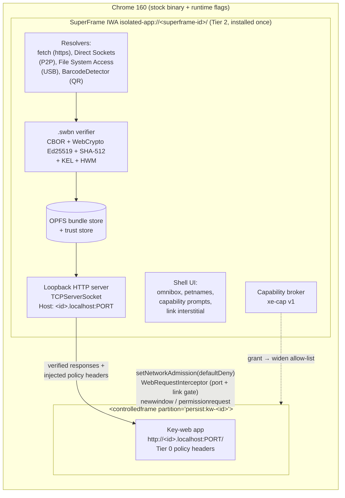

<!-- SPDX-License-Identifier: BSD-3-Clause -->
<!-- Copyright (c) 2026 The Key-Origin Web Authors. See LICENSE in this directory. -->

# Key-Origin Web: Chromium `160.0.8176.0` Engineering Blueprint

| | |
|---|---|
| **Status** | Engineering blueprint, v0.2 (November 2026). v0.2 adds human-readable rail names: Layer A §3.7 and patch **KW6**. |
| **Target** | Chromium `160.0.8176.0` (`chrome/VERSION`: MAJOR=160, MINOR=0, BUILD=8176, PATCH=0) |
| **Normative spec** | [ARCHITECTURE-SPEC.md](ARCHITECTURE-SPEC.md). Section references like "Spec §2.4" point there. |
| **Threats and tests** | [THREAT-MODEL.md](THREAT-MODEL.md). Invariants `INV-*` are defined there. |

---

## 0. How this blueprint was verified

- Every `path:line` below was read in a Chromium `160.0.8176.0` source checkout. Paths are relative to `src/`, and line numbers are exact *at that revision*. They will drift, so treat them as anchors.
- **Directories absent from the reference checkout:** `url/` and `net/` were not present in the tree used for verification. Symbols from them (`url::Origin`, `net::IsLocalhost`, host-resolver behaviour for `*.localhost`) are cited **by name only**, and their behaviour is flagged *verify on target build*.
- **Flag-gated features.** Some Controlled Frame "agent features" used by Layer A exist in this checkout behind `base::Feature`s that are **disabled by default**. Before claiming they work on a given Chrome channel, confirm that they are present there. Each one has a fallback listed.
- **Corrections to the design discussion** that came out of reading the code:
  1. **CSP `navigate-to` does not exist in Chromium.** It is absent from `network::mojom::CSPDirectiveName` (`services/network/public/mojom/content_security_policy.mojom:95-127`). Outbound navigation must be policed by a navigation throttle (KW4).
  2. **`<link rel=preconnect>` bypasses both CSP and `X-DNS-Prefetch-Control`.**
     - Blink's preconnect path only checks `ProtocolIsInHttpFamily()` (`third_party/blink/renderer/core/loader/preload_helper.cc:357-358`). Compare DNS prefetch, which checks `GetDNSPrefetchingEnabled()` at `:330`.
     - The browser then hands preconnects straight to the `PreconnectManager` (`chrome/browser/predictors/network_hints_handler_impl.cc:117-144`).
     - They never touch the WebRequest proxy, so **Controlled Frame network admission does not see them**.
     - **`Connection-Allowlist` does**, and it is the load-bearing control (Spec §2.4).
  3. **Stock IWAs are not exfiltration-proof.** Their enforced CSP allows `connect-src 'self' https: wss: blob: data:` and `img-src 'self' https: blob: data:` (`components/webapps/isolated_web_apps/url_loading/header_utils.cc:22-36`).
  4. **Controlled Frame network admission matches hosts, not ports** (`extensions/browser/guest_view/web_view/controlled_frame_network_admission.cc:56-74, 97-116`). Layer A must add a port check (§3.6).
  5. **Controlled Frame removes `loadDataWithBaseUrl`** (`chrome/renderer/resources/controlled_frame/controlled_frame_api_methods.js:104-110`). Layer A can't inject bundle content that way; it uses a loopback origin instead (§3.4).
  6. **The stock signature verifier would reject log-rooted (K-SAID) IDs.** `SignedWebBundleSignatureVerifier` calls `IdentityValidator::ValidateWebBundleIdentity(id, public_keys)` (`components/web_package/signed_web_bundles/signed_web_bundle_signature_verifier.cc:46-54`). The base implementation requires the ID to *be* one of the keys (`identity_validator.cc:57-75`). KW2 changes this.

---

## 1. What Chromium 160 already gives us

### 1.1 Signed Web Bundle primitives (`components/web_package/signed_web_bundles/`)

| Primitive | Location | Reuse |
|---|---|---|
| Integrity Block v2 magic `🖋📦` | `constants.h:21-23` | As-is |
| Version `2b\0\0` (v1 rejected) | `constants.h:26-31` | As-is |
| `webBundleId` attribute name | `constants.h:34` | As-is |
| `ed25519PublicKey` / `ecdsaP256SHA256PublicKey` | `constants.h:37-42` | As-is |
| 1 MiB integrity block cap | `constants.h:45` (`kMaxIntegrityBlockSize`) | Bounds the embedded KEL (Spec §1.5) |
| `SignedWebBundleId` (base32, 3-byte type suffix) | `signed_web_bundle_id.h:30` (class), `:62-64` (suffixes), `:67-74` (`Type`), `:79` (`Create`), `:82-86` (`CreateForPublicKey`), `:102` (`id()`) | **K-ED and K-P256 reuse it verbatim. KW1 adds K-SAID.** |
| `Ed25519PublicKey` (32 bytes) | `ed25519_public_key.h:28-38` | As-is |
| Integrity block parse (memory-safe Rust) | `rust/integrity_block.rs:118` (`parse_integrity_block`). Only `webBundleId` is looked up (`:149-155`). The whole attributes map is retained (`:175`). | **The extra `keyWeb` attribute is tolerated and preserved** |
| Signature payload construction | `rust/signature_verifier.rs:17-31` (`create_empty_integrity_block_cbor(attributes_cbor)`), `:41-56` (`create_signature_payload`: `len‖hash ‖ len‖IB-cbor ‖ len‖sig-attrs`) | **`keyWeb` is signed.** The attributes sit inside the IB-CBOR item. |
| `SignedWebBundleIntegrityBlock` | `signed_web_bundle_integrity_block.h:29` (class), `:47` (`size_in_bytes`), `:49` (`signature_stack`), `:54` (`web_bundle_id`), `:56-58` (`attributes_cbor()`) | KW2 reads `keyWeb` through `attributes_cbor()` |
| `SignedWebBundleSignatureVerifier` | `signed_web_bundle_signature_verifier.h:25` (class), `:61-63` (`VerifySignatures`), `:74-77` (`CalculateHashOfUnsignedWebBundle`, SHA-512) | As-is. The SHA-512 is Spec's `bundleHash`. |
| `IdentityValidator` (singleton) | `identity_validator.h:25` (class), `:30` (`GetInstance`), `:35-37` (virtual, id + keys), `:40-41` (integrity-block overload) | **KW2 extends it** |
| `WebBundleParser` | `components/web_package/web_bundle_parser.h:21`, `:48` (`ParseIntegrityBlock`), `:49-50` (`ParseMetadata`) | As-is |

### 1.2 IWA platform (`components/webapps/isolated_web_apps/`)

| Primitive | Location | Reuse |
|---|---|---|
| `kIsolatedAppScheme = "isolated-app"` | `scheme.h:14` | Template for `kKeyWebScheme` |
| `IwaOrigin` | `types/iwa_origin.h:28` (`Create`), `:32` (`GetPartitionDomain`). `types/iwa_origin.cc:21-28` (triple-hashed partition domain, prefix `"i"`), `:44-46` (scheme check) | Template for `KeyWebOrigin` (prefix `"k"`) |
| `IwaVersion` (≤ 4 numeric components) | `types/iwa_version.h:21`, `:34`, `:36-40` | Not reused. Key-web uses integer `seq` (Spec §1.6). |
| `SignedWebBundleReader` | `reading/signed_web_bundle_reader.h:54` (class), `:64-67` (`Create(path, base_url, verify_signatures, cb)`), `:95` (`GetIntegrityBlock`), `:103` (`GetEntries`), `:132` (`ReadResponse`), `:137` (`ReadResponseBody`) | **Reused directly by KW2** |
| `IsolatedWebAppReaderRegistry` (reader cache) | `reading/response_reader_registry.h:39`, `:86` (`ReadResponse`). Identity re-validated at `response_reader_registry.cc:330, 407`. | Template for `KeyWebReaderRegistry` |
| `IsolatedWebAppValidator` | `reading/validator.h:29`, `:44` (`ValidateIntegrityBlock`). Calls `IwaIdentityValidator` at `reading/validator.cc:46`. | **Not reused.** It encodes IWA trust (allowlists, dev mode). |
| `IwaIdentityValidator` (vendor key rotation) | `identity/iwa_identity_validator.h:14`, `:19` (`CreateSingleton`), `:30-33` (soft rotation). `iwa_identity_validator.cc:101-132`. | KW2 adds a K-SAID branch |
| `IsolatedWebAppURLLoaderFactory` | `url_loading/url_loader_factory.h:25`, `:45` (`CreateForFrame`), `:53` (`Create`) | Template for `KeyWebURLLoaderFactory` |
| Default IWA CSP and COOP/COEP/CORP injection | `url_loading/header_utils.cc:22-36` (`kIsolatedAppCspTemplate`), `:76-91` (`SetRequiredHeadersForIsolatedApp`), `:93-122` (`SetRequiredParsedHeadersForIsolatedApp`, parsed with `ContentSecurityPolicySource::kHTTP` so `frame-ancestors` applies) | **Template for KW3**, with a much stricter policy |
| Centralized key distribution | `key_distribution/iwa_key_distribution_info_provider.h`. `chrome/browser/web_applications/isolated_web_apps/key_rotation_util.h:32` (`GetKeyRotationData`), `:42` (`IsInstallationSigningKeyRevoked`) | **Replaced** by a self-certifying KEL (Spec §4) |

### 1.3 Embedder hooks (`chrome/` and `content/`)

| Hook | Location | KW use |
|---|---|---|
| Standard-scheme list | `chrome/common/chrome_content_client.cc:189-202` (`kChromeStandardURLSchemes`, IWA at `:195`) | KW1 |
| `AddAdditionalSchemes` | `chrome_content_client.cc:205`. IWA: `isolated_app_schemes` at `:221`; secure, CORS, SW, and web-storage at `:270-273`. | KW1 (everything **except** `isolated_app_schemes`) |
| `Schemes` struct | `content/public/common/content_client.h:120` (standard), `:137` (`csp_bypassing_schemes`), `:139` (secure), `:151` (`isolated_app_schemes`) | KW1 |
| Isolated-app registration into Blink | `content/common/url_schemes.cc:85-87` (`RegisterURLSchemeAsIsolatedApp`) | **Must not** run for `key-web` |
| Isolation levels | `content/public/browser/web_exposed_isolation_level.h:49-64` (`kNotIsolated` / `kIsolated` / `kIsolatedApplication`) | Key-web reaches `kIsolated` at most |
| Isolated-context checks | `content/public/browser/isolated_context_util.h:30` (`HasIsolatedContextCapability`), `:40` (`IsIsolatedContext`). Blink: `third_party/blink/public/web/blink.h:146-147`, `execution_context.h:427`. | KW3 asserts `false` |
| `ShouldUrlUseApplicationIsolationLevel` | `content_browser_client.h:858`. Chrome impl: `chrome_content_browser_client.cc:2813`. Content: `site_isolation_policy.cc:440`. | KW3 asserts `false` for `key-web` |
| `GetStoragePartitionConfigForSite` | `content_browser_client.h:1213`. Chrome impl: `chrome_content_browser_client.cc:1818`, IWA branch at `:1845-1856`. | KW4 adds a key-web branch |
| `IsolatedWebAppUrlInfo::storage_partition_config` | `chrome/browser/web_applications/isolated_web_apps/isolated_web_app_url_info.h:72`, `.cc:114-120` | Template |
| Navigation loader factory | `content_browser_client.h:1873`. Chrome impl: `chrome_content_browser_client.cc:6415`, IWA branch at `:6456-6461`. | KW2 |
| Worker / SW-update / subresource factories | `chrome_content_browser_client.cc:6516`, `:6565`, `:6817` (IWA branch at `:6846-6859`). Header: `content_browser_client.h:1886`, `:1909`. | KW2 |
| Navigation throttles | `content_browser_client.h:1640`. Chrome: `chrome_content_browser_client.cc:5786`. Registry: `chrome_content_browser_client_navigation_throttles.cc:632` (IWA throttle). `isolated_web_app_throttle.h:23-32`, `.cc:80-87`. | KW4 |
| `CanCreateWindow` / `HandleExternalProtocol` | `content_browser_client.h:1317`, `:2505`. Chrome: `chrome_content_browser_client.cc:4487`, `:7574`. | KW4 |
| `OverrideWebPreferences` | `chrome_content_browser_client.cc:4712`. `dns_prefetching_enabled` at `third_party/blink/public/common/web_preferences/web_preferences.h:78-81`. | KW3 (belt and braces) |
| Display-only URL | `content/public/browser/navigation_entry.h:99-100` (`SetVirtualURL` / `GetVirtualURL`) | KW6: show `cool-site.lukeinth.at` while the committed URL stays `<kw-id>.key` |
| URL rewrite pairs (forward + reverse) | `content/public/browser/browser_url_handler.h:25` (class), `:60` (`AddHandlerPair`). Registered via `content_browser_client.h:1411` (`BrowserURLHandlerCreated`). Chrome: `chrome_content_browser_client.cc:5247`. | KW6 (reverse: key URL → name, for history and reload) |
| Loader-level redirect | `services/network/public/mojom/url_loader.mojom:80` (`URLLoaderClient::OnReceiveRedirect`) | KW6: name URL → key URL internal redirect |
| Omnibox formatting | `components/omnibox/browser/location_bar_model_impl.cc:60` (`GetFormattedFullURL`), `:67` (`GetURLForDisplay`), `:105` (`GetFormattedURL`) | KW6: `cool-site · lukeinth.at` |
| Custom error page | `chrome_content_browser_client.cc:9053-9057` (`MaybeGetIsolatedWebAppErrorPageInfo`) | KW6: mismatch interstitial |
| Host-resolver TXT queries | `services/network/public/mojom/host_resolver.mojom:185` (`TXT`) | KW6 `at` rail (`_atproto.<handle>`) |
| IWA permissions-policy baseline | `chrome_content_browser_client_isolated_web_apps_part.h:40-41` (`GetBaselinePermissionsPolicyForIsolatedWebApp`). Chrome: `chrome_content_browser_client.cc:2541`. | Template for KW3 |
| `kIsolatedWebApps` feature | `content/public/common/content_features.cc:668-673` (enabled on ChromeOS only) | Layer A needs it on desktop |
| `kIsolatedWebAppDevMode` | `chrome/common/chrome_features.cc:1378` (disabled by default) | Layer A self-install |

### 1.4 The anti-exfiltration engine already in M160: `Connection-Allowlist`

This is the most important discovery for this design. M160 contains a network-service-enforced **Connection-Allowlist** implementation. It derives from the anti-exfiltration proposal and is described as "a flag-guarded prototype" in its mojom.

| Piece | Location |
|---|---|
| Feature (`kConnectionAllowlists`, **ENABLED_BY_DEFAULT** here) | `services/network/public/cpp/features.h:135`, `features.cc:314` |
| Mojom (`allowlist`, `redirect_behavior`, `webrtc_behavior`, `match_response_origin`) | `services/network/public/mojom/connection_allowlist.mojom` |
| C++ struct, defaults `redirects=block`, `webrtc=block` | `services/network/public/cpp/connection_allowlist.h:25-58`. `ConnectionAllowlistMatchesUrl` at `:72`, `ConnectionAllowlistSubsumes` at `:88`. |
| Header parser: `response-origin`, `report-to`, `redirects`, `webrtc`. A second list triggers `kMoreThanOneList`. | `services/network/public/cpp/connection_allowlist_parser.cc:28-33`, `:59`, `:100-160` |
| Parsed into `ParsedHeaders` | `services/network/public/cpp/parsed_headers.cc:61-65` |
| Per-document network restrictions ID | `content/public/browser/render_frame_host.h:600-604` (`GetNetworkRestrictionsID`) |
| **Host resolution** blocked per restrictions ID | `services/network/network_context.cc:2769` (`ResolveHost`), check at `:2784-2790` |
| **Socket preconnect** blocked | `network_context.cc:3097` (`PreconnectSockets`), check at `:3128` |
| **WebTransport** blocked | `network_context.cc:2715` (`CreateWebTransport`), check at `:2734` |
| **Prefetch** blocked | `network_context.cc:4506` (`Prefetch`), check at `:4524` |
| Core check | `network_context.cc:4670` (`IsNetworkForNetworkRestrictionsIdAndUrlAllowed`), decl at `network_context.h:867-875` |
| **WebRTC** binders refused | `content/browser/connection_allowlist_utils.h:73` (`IsWebRTCAllowedByConnectionAllowlist`). Enforced at `content/browser/browser_interface_binders.cc:901` and `content/browser/renderer_host/render_frame_host_impl.cc:20535`. |
| Workers inherit from responses (non-local schemes) | `content/browser/connection_allowlist_utils.h:63` (`GetConnectionAllowlistsForWorker`), `.cc:175-196` |
| Embedded enforcement (iframe attribute, origin trial) | `third_party/blink/renderer/platform/runtime_enabled_features.json5:1550-1551` |

### 1.5 Controlled Frame (Layer A substrate)

| Piece | Location | Default |
|---|---|---|
| `setNetworkAdmission({defaultDeny, allow, block, secureOnly})` | `chrome/renderer/resources/controlled_frame/html_controlled_frame_element.js:710-721`. Schema: `extensions/common/api/web_view_internal.json` (`setNetworkAdmission`, `:997`). | Behind `extensions_features::kControlledFrameNetworkAdmission` (`extensions/common/extension_features.cc:307-308`, **disabled**) |
| Policy struct and matcher | `extensions/browser/guest_view/web_view/controlled_frame_network_admission.h:33-48`, `.cc:97-116` (`Admits`). Host canonicalization at `.cc:23-54`, host match at `.cc:56-74`. `data:`, `blob:`, `about:`, and `filesystem:` are always admitted. | n/a |
| Fail-closed parameter `require_policy` | `controlled_frame_network_admission.h:50-52`, `.cc:86-88` | `false` |
| Enforcement point (before any webRequest listener; covers HTTP, WS, and WebTransport handshakes) | `extensions/browser/api/web_request/extension_web_request_event_router.cc:974-987` | n/a |
| Automatic WebRTC lockdown when a policy is set (`kDisableNonProxiedUdp`) | `extensions/browser/api/guest_view/web_view/web_view_internal_api.cc:558-561`. `extensions/browser/guest_view/web_view/web_view_guest.cc:605-623`. Enum: `third_party/blink/public/mojom/peerconnection/webrtc_ip_handling_policy.mojom:14`. | n/a |
| Policy inherited by guest-opened windows | `web_view_guest.cc:1127-1132`, `:2940-2941` | n/a |
| Capability gate | `extensions/browser/guest_view/web_view/controlled_frame_agent_gate.h` (`AgentCapability::kNetworkAdmission`). `.cc:15-84`. | n/a |
| WebRequest interceptor (blocking `beforerequest`; `preventDefault()` cancels) | `chrome/renderer/resources/controlled_frame/controlled_frame_web_request.js:170-186` (`createWebRequestInterceptor`), `:200`, `:231-232` (`blocking`), `:447-470` (`BeforeRequestEvent.preventDefault` / `redirect`). Details: `e.request.{url,method,type}` (`:91-160`). | Stock Controlled Frame |
| Per-app guest partitions | `chrome/browser/web_applications/isolated_web_apps/controlled_frame_partitions_manager.h:39`. `isolated_web_app_url_info.h:77-80` (`GetStoragePartitionConfigForControlledFrame`). | Stock |
| `loadDataWithBaseUrl` **deleted** for Controlled Frame | `chrome/renderer/resources/controlled_frame/controlled_frame_api_methods.js:104-110` | n/a |

> **Gate quirk worth reporting upstream.** `controlled_frame_agent_gate.cc:74-84` first checks the `controlled-frame` permissions policy. For "agent" capabilities it then checks **`kControlledFrame` a second time** while emitting the error string "needs the controlled-frame-agent policy". In this checkout there is no distinct `controlled-frame-agent` feature. Declaring `controlled-frame` is therefore sufficient, and the "agent policy" provides no extra separation.

### 1.6 Direct Sockets (Layer A loopback server)

`third_party/blink/renderer/modules/direct_sockets/tcp_server_socket.idl`: `TCPServerSocket(localAddress, options)`, exposed with the `DirectSockets` context feature in `SecureContext`. That means it is available to the SuperFrame IWA and to **no** key-web document.

The same directory has `udp_socket.idl:16` (`UDPSocket`) and `multicast_controller.idl:25-27` (`MulticastController.joinGroup`). These let the SuperFrame speak Mainline DHT (the PKARR `dht` rail) and mDNS (the `local` rail) without patches (§3.7).

### 1.7 Network hints (why Layer B needs Connection-Allowlist)

| Path | Location | Gated by |
|---|---|---|
| `<link rel=dns-prefetch>` | `third_party/blink/renderer/core/loader/preload_helper.cc:314-345` | `Settings::GetDNSPrefetchingEnabled()` (`:330`) **and** the document's DNS-prefetch control (`third_party/blink/renderer/core/dom/document.cc:8690-8700`. Once `off`, it can't be turned back `on`.) |
| `<link rel=preconnect>` | `preload_helper.cc:357-392` | **Only** `ProtocolIsInHttpFamily()` |
| Browser handler | `chrome/browser/predictors/network_hints_handler_impl.cc:93-115` (`PrefetchDNS`), `:117-144` (`Preconnect`). Both pass `GetNetworkRestrictionsID()` (`:107`, `:135`). | Network context restrictions (§1.4) |
| Subresource Web Bundles (for the comparison) | `third_party/blink/renderer/core/script/script_loader.cc:490` (`kWebBundle` script type) | n/a |

---

## 2. Gap analysis

| Requirement (Spec) | M160 status | Closed by |
|---|---|---|
| `key-web` standard, secure, SW, CORS, storage scheme, **not** isolated-app (§1.1) | Missing | KW1 |
| K-SAID identifier type (§1.2) | Missing. The verifier would reject it (§0, item 6). | KW1 + KW2 |
| `keyWeb` attribute parse, KEL validation, HWM ordering (§1.5–1.6, §4) | Missing. Attribute already tolerated and signed. | KW2 |
| Non-isolated, bundle-backed loader (§1.5) | IWA loader exists but is IWA-trust-coupled | KW2 |
| Exfil-proof CSP (§2.3) | Template exists (IWA, permissive) | KW3 |
| Network-level egress block (§2.4) | **Exists** (Connection-Allowlist) | KW3 (inject) |
| Outbound Navigation Gate (§2.5) | Missing (`navigate-to` absent) | KW4 |
| Header sanitizer (§2.6) | Missing | KW2 |
| Key-scoped partition + quotas (§2.9) | IWA template exists | KW4 |
| Capabilities, petnames, identity UI, resolvers (§2.12, §3, §4.8) | Missing | KW5 |
| Human-readable rail names, key-anchored redirect, fail-closed bindings, pins, name display (§1.7) | Missing. The display (`SetVirtualURL`), redirect, and TXT-lookup hooks exist. | KW6 |

---

## 3. Layer A: zero Chromium patches, today, inside a SuperFrame IWA

### 3.1 Architecture



There is one installed privileged app: the **SuperFrame**, which acts as the Super User Agent. Every key-web app runs inside it, unprivileged, with **no per-app install**.

### 3.2 Runtime prerequisites

| Requirement | How | Source |
|---|---|---|
| IWAs on desktop | `--enable-features=IsolatedWebApps` | `content_features.cc:668-673` |
| Install the SuperFrame without enterprise policy | `--enable-features=IsolatedWebAppDevMode`, or enterprise force-install policy | `chrome_features.cc:1378` |
| Network admission (defense in depth) | `--enable-features=ControlledFrameNetworkAdmission` (optional parameter `require_policy/true` to fail closed) | `extension_features.cc:307-308`, `controlled_frame_network_admission.cc:86-88` |
| Connection-Allowlist (load-bearing) | Default-enabled in this checkout | `features.cc:314` |

> If a target build lacks `ControlledFrameNetworkAdmission`, Layer A still holds through Connection-Allowlist + CSP + the WebRequest interceptor (§3.6). The one exception is the **WebRTC IP-handling lockdown**, which then rests on Connection-Allowlist's `webrtc=block` alone.

### 3.3 SuperFrame manifest (`/.well-known/manifest.webmanifest` inside the SuperFrame bundle)

```json
{
  "name": "SuperFrame",
  "short_name": "SuperFrame",
  "version": "0.1.0",
  "start_url": "/",
  "display": "standalone",
  "permissions_policy": {
    "controlled-frame": ["self"],
    "direct-sockets": ["self"],
    "cross-origin-isolated": ["self"]
  },
  "protocol_handlers": [
    { "protocol": "web+kw", "url": "/open?u=%s" }
  ]
}
```

- **Click-to-open.** `key-web:` isn't a registrable scheme for web apps, so Layer A links use `web+kw://<id>/<path>`. IWA manifests can declare `protocol_handlers`; this is exercised in `chrome/browser/web_applications/isolated_web_apps/browser_navigator_iwa_browsertest.cc:87`, with per-app user approval at `:253`. The first use shows Chrome's one-time handler approval. After that, every key-web link opens in the SuperFrame with no further prompts.
- A plain-`https://` landing page can also offer a "Open in SuperFrame" button that links to `web+kw://…`.

### 3.4 Content delivery: the loopback origin

Controlled Frame can't take bundle bytes directly (`loadDataWithBaseUrl` is deleted), and the SuperFrame can't synthesize responses through webRequest. So the SuperFrame **serves verified responses over loopback**, and each app gets a stable per-key origin:

```
http://<56-char-id>.localhost:<PORT>/
```

- A 56-character ID fits a DNS label (≤ 63 characters).
- `*.localhost` names resolve to loopback inside Chrome, and loopback is a potentially trustworthy (secure) context. Both properties live in `net/`, which isn't in the reference checkout, so **verify on the target build** with `isSecureContext === true` in the guest.
- **`PORT` is chosen once per SuperFrame install and persisted.** Storage inside the guest partition is keyed by origin, *including* the port. If the port is taken at startup, the SuperFrame **MUST NOT** silently pick another one, because doing so would orphan app data. It shows an error and retries (limitation **LA-1**).

```js
// SuperFrame: loopback server (sketch). LOOPBACK is the loopback interface literal.
const server = new TCPServerSocket(LOOPBACK, { localPort: state.port });
const { readable } = await server.opened;
for await (const conn of readable) serve(conn).catch(() => conn.close());

async function serve(conn) {
  const req = await readHttpRequest(conn);                       // minimal HTTP/1.1 parser
  const m = /^([a-z2-7]{56,58})\.localhost:(\d+)$/.exec(req.headers.host ?? '');
  if (!m || Number(m[2]) !== state.port) return reply(conn, 421); // misdirected
  if (!['GET', 'HEAD'].includes(req.method)) return reply(conn, 405);
  const site = req.headers['sec-fetch-site'];
  if (site && site !== 'same-origin' && site !== 'none') return reply(conn, 403); // block cross-site probes
  const release = await store.currentRelease(m[1]);               // verified, HWM-checked
  if (!release) return reply(conn, 404);
  const res = await release.response(req.path);                   // from the parsed Web Bundle
  if (!res) return reply(conn, 404);
  const headers = sanitize(res.headers);                          // Spec §2.6
  Object.assign(headers, tier0Headers(m[1], state.port, grants.for(m[1])));
  return reply(conn, res.status, headers, req.method === 'HEAD' ? null : res.body);
}
```

```js
// Spec §2.3/§2.4/§2.8 adapted to the loopback origin. 'self' == http://<id>.localhost:PORT
function tier0Headers(id, port, grants) {
  const extra = grants.connectTargets();                          // [] in Tier 0
  return {
    'Content-Security-Policy': [
      "default-src 'self'", "script-src 'self' 'wasm-unsafe-eval'",
      "style-src 'self' 'unsafe-inline'", "img-src 'self' data: blob:",
      "media-src 'self' data: blob:", "font-src 'self' data: blob:",
      `connect-src 'self' data: blob:${extra.map(o => ' ' + o.origin).join('')}`,
      "worker-src 'self' blob:", "frame-src 'self' blob:", "fenced-frame-src 'none'",
      "manifest-src 'self'", "object-src 'none'", "base-uri 'none'",
      "form-action 'none'", "frame-ancestors 'self'",
      "require-trusted-types-for 'script'",
    ].join('; '),
    'Connection-Allowlist':
      `(response-origin${extra.map(t => ` "${t.pattern}"`).join('')});redirects=block;webrtc=block`,
    'Cross-Origin-Opener-Policy': 'same-origin',
    'Cross-Origin-Embedder-Policy': 'require-corp',
    'Cross-Origin-Resource-Policy': 'same-origin',
    'Origin-Agent-Cluster': '?1',
    'Referrer-Policy': 'no-referrer',
    'X-DNS-Prefetch-Control': 'off',
    'X-Content-Type-Options': 'nosniff',
    'Permissions-Policy': TIER0_PERMISSIONS_POLICY,              // Spec §2.7
    'Cache-Control': 'no-store',
  };
}
```

`Connection-Allowlist: (response-origin)` resolves to `http://<id>.localhost:PORT`. Unlike network admission, it is **port-exact**, so it also closes the port-blindness gap (§3.6) at the network-service layer.

### 3.5 Verifier (inside the SuperFrame)

| Step (Spec §1.5) | Layer A implementation |
|---|---|
| Parse the Integrity Block v2 | CBOR decoder in WASM (memory-safe Rust compiled to WASM, or a vetted JS CBOR library) |
| SHA-512 of the unsigned bundle | `crypto.subtle.digest('SHA-512', …)`, streaming over 10 MB chunks, the same chunking as M160 (`signed_web_bundle_signature_verifier.h:90`) |
| Ed25519 verification | `crypto.subtle.verify({ name: 'Ed25519' }, key, sig, payload)` with the M160 payload layout (`rust/signature_verifier.rs:41-56`) |
| ECDSA P-256 | `crypto.subtle.verify({ name: 'ECDSA', hash: 'SHA-256' }, …)` |
| KEL + HWM | JS module plus the trust store in OPFS/IndexedDB in the **SuperFrame's** partition, which the guests cannot reach |
| Release Manifest + chunk Merkle | Spec §3.5–3.6 |

### 3.6 Guest lockdown stack

```js
// SuperFrame: open a key-web app (sketch)
async function openApp(id, path = '/') {
  const host = `${id}.localhost`, port = state.port;
  const frame = document.createElement('controlledframe');
  frame.setAttribute('partition', `persist:kw-${id}`);           // key-scoped storage (Spec §2.9)
  frame.src = `http://${host}:${port}${path}`;                   // set before attach; the frame stays blank until the policy is set (below)
  mount(frame);

  // (1) Browser-enforced host admission + automatic WebRTC lockdown (flag-gated).
  await frame.setNetworkAdmission?.({ defaultDeny: true, allow: [host], secureOnly: false });

  // (2) Port-exact admission + Navigation Gate (Spec §2.5). Admission is host-only.
  const icpt = frame.request.createWebRequestInterceptor({ urlPatterns: ['<all_urls>'], blocking: true });
  icpt.addEventListener('beforerequest', (e) => {
    const u = new URL(e.request.url);
    if (u.protocol === 'data:' || u.protocol === 'blob:') return;
    const self = u.hostname === host && u.port === String(port) && u.protocol === 'http:';
    if (self) return;
    if (grants.for(id).admits(u)) return;                         // Tier 1b connect grants
    e.preventDefault();                                           // cancel
    if (e.request.type === 'main-frame') linkGate.consider(id, e.request.url); // static/dynamic link rule
  });

  // (3) Popups: never let the guest create windows directly.
  frame.addEventListener('newwindow', (e) => { e.preventDefault(); linkGate.consider(id, e.targetUrl); });

  // (4) Permissions: deny unless an xe-cap grant exists (Spec §2.11).
  frame.addEventListener('permissionrequest', (e) =>
      grants.for(id).has(e.permission) ? e.request.allow() : e.request.deny());

  // (5) Fail closed: if (1) is unavailable, require the flag-independent layers.
  if (!frame.setNetworkAdmission) console.warn('LA-2: relying on CSP + Connection-Allowlist + interceptor');
}
```

`linkGate.consider()` implements the Static Link Rule (NG3) against the bundle's `external_links`. Static links open with `window.open(url, '_blank', 'noopener,noreferrer')` *from the SuperFrame*. Anything else shows the SuperFrame's full-URL interstitial (NG4).

**What each layer covers in Layer A:**

| Channel (Spec §2.10) | CSP | Connection-Allowlist | Network admission | Interceptor | Link gate / newwindow |
|---|---|---|---|---|---|
| fetch / beacon / WS / WebTransport | ✅ | ✅ | ✅ (host) | ✅ (host+port) | n/a |
| Subresource URLs (img, CSS, fonts) | ✅ | ✅ | ✅ | ✅ | n/a |
| DNS prefetch | n/a (`X-DNS-Prefetch-Control: off`) | ✅ | ❌ (not proxied) | ❌ | n/a |
| **Preconnect** | ❌ | ✅ | ❌ | ❌ | n/a |
| WebRTC | n/a | ✅ `webrtc=block` | ✅ IP-handling lockdown | n/a | n/a |
| Top-level navigation / `window.open` | n/a | n/a | ✅ (host) | ✅ | ✅ |
| Other loopback ports | ✅ (`'self'` includes the port) | ✅ (port-exact) | ❌ **host-only** | ✅ | n/a |

### 3.7 Human-readable names in the SuperFrame (Spec §1.7)

Shared links look like `web+kw://cool-site.lukeinth.at/#:~:pin=e4g5saaasdl6ahelvnt4`. The SuperFrame resolves the name itself. **Only the resolved K_app ever reaches the guest:**

| Guest property | Derived from | Never from |
|---|---|---|
| Guest origin `http://<kw-id>.localhost:PORT` | K_app | the handle |
| Partition `persist:kw-<kw-id>` | K_app | the handle |
| CSP / Connection-Allowlist `response-origin` | K_app | the handle |
| `xe-cap` grants, egress ledger | K_app | the handle |

So `cool-site.lukeinth.at` and `cool-site.lukeinth.dht` open the **same** guest partition.

| Rail | SuperFrame implementation (no Chromium patch) |
|---|---|
| `at` | `fetch()` over HTTPS. The SuperFrame's IWA CSP allows `connect-src https:` (`header_utils.cc:27`). It resolves `https://<handle>/.well-known/atproto-did` (an IWA has no raw DNS-TXT API, so the `_atproto` TXT path needs a DNS-over-HTTPS resolver), then the DID document (PLC directory or did:web), then the PDS `com.atproto.repo.getRecord` for `<nsid>.publisher/self` and `<nsid>.app/<slug>`. |
| `dht` | PKARR relays over `fetch()` (HTTPS), **or** native Mainline DHT (BEP 44 `get`) over `UDPSocket` (`udp_socket.idl:16`). Verify the PKARR signature, then the inner K_pub signature. |
| `nostr` | `new WebSocket('wss://<relay>')` (IWA CSP allows `wss:`). REQ for the addressable event (`d` = slug), filtered by the `npub` from the label or the publisher book. NIP-05 labels use an HTTPS `/.well-known/nostr.json` lookup. |
| `local` | Publisher book in the SuperFrame's IndexedDB (never a guest partition), plus mDNS over `UDPSocket` + `MulticastController.joinGroup` (`multicast_controller.idl:25-27`) for `_key-web._tcp.local`. Verify multicast availability on the target OS and build. |
| `key` | No lookup |

```js
// SuperFrame: open a name URL (sketch). Spec §1.7.5 is normative.
async function openName(rawUrl) {
  const u = new URL(rawUrl.replace(/^web\+kw:/, 'key-web:'));
  const pin = takeDirective(u, 'pin');                         // strip #:~:pin=
  const { slug, publisher, rail } = parseNameHost(u.hostname);  // Spec §1.7.2
  const { pdoc, rec } = await rails[rail].resolve(publisher, slug, book);
  await verifyPublisherDoc(pdoc); await verifyAppRecord(rec, pdoc); // K_pub sigs + KEL
  const kApp = rec.app;
  if (pin && pinOf(kApp).slice(0, pin.length) !== pin)
    return mismatch({ reason: 'pin', offered: kApp });
  const known = book.binding(rec.pub, slug);
  if (known && known.app !== kApp && !(await successionProven(known.app, kApp)))
    return mismatch({ reason: 'key', known: known.app, offered: kApp, rail });   // FAIL CLOSED
  book.bind({ name: u.hostname, pub: rec.pub, slug, app: kApp, rail, pinned: !!pin });
  book.learnRails(pdoc);                         // enables .dht/.nostr failover later
  crossCheckOtherRails(pdoc, slug, kApp);        // background → "2 rails agree" badge
  shell.setTitle({ app: slug, publisher: displayPublisher(rail, publisher), badges: badgesFor(kApp) });
  return openApp(kApp, u.pathname + u.search);   // §3.6: guest keyed by kApp only
}
```

`mismatch()` renders the shell's browser-owned **cryptographic mismatch** page (Spec §1.7.5). Its default action is `openApp(known.app)` from the cached release. It **never** calls `openApp(offered)` without a deliberate second confirmation, and even then the offered key gets a fresh, empty partition.

### 3.8 Layer A limitations

| ID | Limitation | Mitigation |
|---|---|---|
| **LA-1** | The origin includes the loopback port. Changing the port orphans guest storage. | Persist the port. Refuse to start rather than re-port. Offer a UA-mediated export and import if migration is ever needed. |
| **LA-2** | Network admission is flag-gated and host-only (any port on `<id>.localhost` is admitted) | Connection-Allowlist (port-exact) + interceptor port check + CSP |
| **LA-3** | Preconnect and DNS prefetch bypass webRequest | Connection-Allowlist only. KW tests (§5) must confirm it on the target build. |
| **LA-4** | Origins are `http://…localhost`, not `key-web://` | Cosmetic in the SuperFrame UI. Identity is shown by the shell, not the URL. |
| **LA-5** | Other local processes can reach the loopback server | It serves only **public, signed, immutable** bundle bytes. It checks `Host` and `Sec-Fetch-Site`. User data lives in guest partitions, never on the server. |
| **LA-6** | Web pages could probe `*.localhost` to fingerprint installed apps | `Sec-Fetch-Site` check (403 on cross-site), plus Chrome's local-network-access restrictions on public→loopback requests (verify on target build) |
| **LA-7** | The SuperFrame is a single Tier 2 TCB | Keep it minimal and audited. Grants and trust state live only in its partition. Guests never get the `controlled-frame` or `direct-sockets` policies. |
| **LA-8** | `web+kw://` instead of `key-web://` | Layer B fixes this |
| **LA-9** | Rail lookups from the SuperFrame reveal "someone here resolves `lukeinth.at`" to PDS hosts, relays, and DHT nodes | Cache bindings; jitter background cross-checks; prefer the publisher book and pins; optional relay or anonymity routing (Spec §3.9) |
| **LA-10** | No raw DNS-TXT API in an IWA | Use the `/.well-known/atproto-did` path or DNS-over-HTTPS. Layer B uses the host resolver's TXT queries. |

---

## 4. Layer B: native Chromium 160 patch series KW1–KW6

### Global shape

```
components/webapps/key_web/              (new, sibling of isolated_web_apps/)
  scheme.h                               kKeyWebScheme = "key-web"
  key_web_origin.{h,cc}                  KeyWebOrigin (mirrors IwaOrigin)
  key_event_log.{h,cc}                   C++ façade over Rust KEL parser
  identity.{h,cc}                        K-ED / K-P256 / K-SAID identity check
  release_store.{h,cc}                   HWM + releases + trust state (profile-keyed)
  reader_registry.{h,cc}                 KeyWebReaderRegistry (reuses SignedWebBundleReader)
  url_loader_factory.{h,cc}              KeyWebURLLoaderFactory
  header_policy.{h,cc}                   sanitizer + Tier-0 CSP/C-A/COOP/COEP/PP injection
components/web_package/signed_web_bundles/rust/
  key_event_log.rs                       #![forbid(unsafe_code)] KEL + keyWeb attr parser
chrome/browser/key_web/                  (new)
  key_web_navigation_throttle.{h,cc}     Navigation Gate (Spec §2.5)
  key_web_storage.{h,cc}                 partition config + quota policy
  key_web_capability_broker.{h,cc}       xe-cap v1 mint/store/revoke + materialization
  key_web_resolver_service.{h,cc}        HTTPS mirror resolver + chunk verifier
  ui/                                    identity chip, petnames, prompts, link interstitial
  naming/                                KW6: name-host parser, KeyWebNameResolver, rails
    at_rail / dht_rail / nostr_rail / local_rail
    key_web_tab_helper.{h,cc}            SetVirtualURL for verified bindings only
components/webapps/key_web/naming/
  publisher_book.{h,cc}                  aliases, (K_pub, slug) → K_app bindings, evidence
components/web_package/signed_web_bundles/rust/
  name_records.rs                        #![forbid(unsafe_code)] publisher-doc / app-record
chrome/common/chrome_features.{h,cc}     BASE_FEATURE(kKeyOriginWeb, DISABLED_BY_DEFAULT)
```

All behaviour is gated on `features::kKeyOriginWeb`. Scheme registration runs before the feature list exists, so KW1 registers the scheme unconditionally. **The loader factory is the gate:** with the feature off, no factory is registered and `key-web://` navigations fail safely.

---

### KW1: `key-web` scheme, identity types, feature flag

**Goal:** `key-web://<id>.key/` parses to a tuple origin. It is a secure, non-isolated-app scheme. The K-SAID ID type exists.

**Changes.**

1. `components/webapps/key_web/scheme.h` (new):
   ```cpp
   namespace key_web {
   inline constexpr char kKeyWebScheme[] = "key-web";
   }
   ```
2. `chrome/common/chrome_content_client.cc`:
   ```cpp
   // :189-202 kChromeStandardURLSchemes
       webapps::kIsolatedAppScheme,
   +   key_web::kKeyWebScheme,
   ...
   // after :270-273 (IWA registrations)
   +  schemes->secure_schemes.push_back(key_web::kKeyWebScheme);
   +  schemes->cors_enabled_schemes.push_back(key_web::kKeyWebScheme);
   +  schemes->service_worker_schemes.push_back(key_web::kKeyWebScheme);
   +  url::AddWebStorageScheme(key_web::kKeyWebScheme);
   +  // DELIBERATELY NOT: isolated_app_schemes (:221), csp_bypassing_schemes.
   +  // key-web documents must never be isolated contexts (Spec §1.1).
   ```
3. `components/web_package/signed_web_bundles/signed_web_bundle_id.h`:
   ```cpp
   // :62-64
     static constexpr TypeSuffix kTypeEcdsaP256PublicKey = {0x00, 0x02, 0x02};
   + // Provisional (Spec §1.2): H256 of a Key Event Log inception event.
   + static constexpr TypeSuffix kTypeKeyEventLogDigest = {0x00, 0x03, 0x02};
   // :67-74
     enum class Type { kProxyMode, kEd25519PublicKey, kEcdsaP256PublicKey,
   +                   kKeyEventLogDigest };
   ```
   `Create()` (`:79`) accepts the new suffix only when `kKeyOriginWeb` is enabled. Every exhaustive `switch` over `Type` then fails to compile until it is handled, which is intentional.
4. `components/webapps/isolated_web_apps/types/iwa_origin.cc:44-46`: **reject** `kKeyEventLogDigest` in `IwaOrigin::Create`. `isolated-app://` must never accept log-rooted IDs.
5. `components/webapps/key_web/key_web_origin.{h,cc}`: mirrors `IwaOrigin` (`types/iwa_origin.h:28-32`). It accepts **only** `<kw-id>.key` hosts (Spec §1.3), so a name host can never become an origin. It rejects proxy-mode IDs, ports, and userinfo. `GetPartitionDomain()` returns `"k" + Base64(SHA256("key-web-partition/v1" + origin.Serialize()))`.
6. `chrome/common/chrome_features.cc`: `BASE_FEATURE(kKeyOriginWeb, base::FEATURE_DISABLED_BY_DEFAULT);`, next to `:1378`.

**Tests.**

- `KeyWebOriginTest.{ParsesKEd,ParsesKSaid,RejectsProxyMode,RejectsPort,RejectsUserinfo,LowercasesHost,RejectsNameHost,RequiresDotKeySuffix}`
- `SignedWebBundleIdTest.KeyEventLogDigestGatedByFeature`
- `IwaOriginTest.RejectsKeyEventLogDigest`
- WPT-style: `new URL('key-web://<id>.key/a').origin === 'key-web://<id>.key'`, and `isSecureContext === true`.

---

### KW2: bundle loading, identity, rollback store, header sanitizer

**Goal:** serve `key-web://` resources from verified releases with no network access. Validate K-ED, K-P256, and K-SAID identities. Enforce HWM ordering. Strip dangerous headers.

**Changes.**

1. **Rust KEL parser** (`components/web_package/signed_web_bundles/rust/key_event_log.rs`, `#![forbid(unsafe_code)]`). It parses `keyWeb` from `attributes_cbor` and validates the KEL (Spec §4.5). Untrusted CBOR is parsed in the browser process, so it **must** be memory-safe Rust to satisfy the Rule of 2, the same reasoning `signed_web_bundles/README.md` uses for the integrity-block parser.
2. **Identity routing** (`signed_web_bundle_signature_verifier.cc:46-54`). Change `ValidateWebBundleId(id, signatures)` so it calls the **integrity-block** overload, `IdentityValidator::ValidateWebBundleIdentity(const SignedWebBundleIntegrityBlock&)` (`identity_validator.h:40-41`), and make that overload virtual. In the base implementation (`identity_validator.cc:77-82`):
   ```cpp
   if (integrity_block.web_bundle_id().type() ==
       SignedWebBundleId::Type::kKeyEventLogDigest) {
     return ValidateKeyEventLogIdentity(integrity_block, base::Time::Now());  // Rust-backed
   }
   return ValidateWebBundleIdentity(id, public_keys);  // unchanged K-ED/K-P256 path
   ```
   `IwaIdentityValidator` (`iwa_identity_validator.cc:101-132`) keeps its vendor-rotation logic for key types. K-SAID validation is a pure function of the bundle and the time, so sharing it is safe. IWA *origins* already refuse K-SAID (KW1, item 4).
3. **`KeyWebReaderRegistry`** (modeled on `response_reader_registry.h:39`). It creates readers with:
   ```cpp
   SignedWebBundleReader::Create(release_path, GURL("key-web://" + id + ".key/"),
                                 /*verify_signatures=*/true, std::move(cb));   // reader.h:64-67
   ```
   After the reader is created, it checks `GetIntegrityBlock()` (`reader.h:95`):
   - `webBundleId == origin id`,
   - `keyWeb` is present (author intent, Spec §1.5),
   - the `ReleaseStore` acceptance rules (Spec §1.6) pass.
   It does **not** use `IsolatedWebAppValidator` (`reading/validator.h:29`) or any IWA trust checker.
4. **`ReleaseStore`** (profile-keyed, persisted). It holds `{HWM, kel, current bundleHash, kept, petname, grants}` per ID. It **survives "clear site data"** and is cleared by "forget app" or by clearing *all* history (Spec §1.6.3).
5. **`KeyWebURLLoaderFactory`** (modeled on `url_loader_factory.h:25-58`). It is non-network: every response comes from the reader. For each response it:
   - runs the **sanitizer** (Spec §2.6),
   - then runs KW3's header injection, filling both `net::HttpResponseHeaders` and `network::mojom::ParsedHeaders`, the same split the IWA factory uses at `header_utils.cc:76-122`.
6. **Registration** in `ChromeContentBrowserClient`, beside each IWA branch:

   | Hook | Line | IWA branch to mirror |
   |---|---|---|
   | `CreateNonNetworkNavigationURLLoaderFactory` | `:6415` | `:6456-6461` |
   | `RegisterNonNetworkWorkerMainResourceURLLoaderFactories` | `:6516` | (IWA block inside) |
   | `RegisterNonNetworkServiceWorkerUpdateURLLoaderFactories` | `:6565` | `:6573-6576` |
   | `RegisterNonNetworkSubresourceURLLoaderFactories` | `:6817` | `:6846-6859` |

   Subresource factories are registered only when `request_initiator_origin` is the **same** key-web origin. That is `enforce_same_origin` semantics, as in the IWA call at `:6459-6461`.

**Tests.**

- `KeyWebIdentityTest.{KEdMatchesKey,KSaidInceptionDigest,KSaidRotation,KSaidPendingRecovery,KSaidVetoContested,DuplicityFreezes}`
- `ReleaseStoreTest.{AcceptsHigher,RejectsRollback,EquivocationFreezes,KelSnDominatesSeq,SurvivesClearSiteData,ForgetClearsAll}`
- `KeyWebHeaderSanitizerTest.*`
- Browser test `KeyWebLoaderBrowserTest.{LoadsFromBundle,NoNetworkFallback,RejectsBundleWithoutKeyWebAttr,RejectsCrossOriginEntries}`
- Fuzzer `key_event_log_fuzzer`

---

### KW3: the exfiltration-proof default policy

**Goal:** inject Spec §2.3, §2.4, §2.7, and §2.8 into every key-web response, and prove that `IsIsolatedContext == false`.

**Changes.**

1. **`components/webapps/key_web/header_policy.cc`**, modeled on `header_utils.cc:22-122`:
   ```cpp
   inline constexpr char kKeyWebCsp[] =
       "default-src 'self';"
       "script-src 'self' 'wasm-unsafe-eval';"
       "style-src 'self' 'unsafe-inline';"
       "img-src 'self' data: blob:;"
       "media-src 'self' data: blob:;"
       "font-src 'self' data: blob:;"
       "connect-src 'self' data: blob:;"
       "worker-src 'self' blob:;"
       "frame-src 'self' blob:;"
       "fenced-frame-src 'none';"
       "manifest-src 'self';"
       "object-src 'none';"
       "base-uri 'none';"
       "form-action 'none';"
       "frame-ancestors 'self';"
       "require-trusted-types-for 'script';";

   void SetRequiredParsedHeadersForKeyWeb(network::mojom::ParsedHeaders& parsed,
                                          const GURL& url,
                                          const GrantSet& grants) {
     const url::Origin origin = url::Origin::Create(url);
     parsed.cross_origin_opener_policy.value =
         network::mojom::CrossOriginOpenerPolicyValue::kSameOrigin;
     parsed.cross_origin_embedder_policy.value =
         network::mojom::CrossOriginEmbedderPolicyValue::kRequireCorp;

     // kHTTP so frame-ancestors is honoured (cf. header_utils.cc:113-115).
     auto csp = network::ParseContentSecurityPolicies(
         WithGrantedConnectSources(kKeyWebCsp, grants),
         network::mojom::ContentSecurityPolicyType::kEnforce,
         network::mojom::ContentSecurityPolicySource::kHTTP, origin.GetURL());
     CHECK_EQ(csp.size(), 1u);
     parsed.content_security_policy.push_back(std::move(csp[0]));

     // Spec §2.4: network-service-enforced; covers ResolveHost/PreconnectSockets/
     // Prefetch/WebTransport (network_context.cc:2784,3128,4524,2734) and WebRTC.
     network::ConnectionAllowlist allow;
     allow.allowlist.push_back(origin.Serialize());          // == (response-origin)
     for (const auto& p : grants.ConnectPatterns()) allow.allowlist.push_back(p);
     allow.redirect_behavior = network::ConnectionAllowlist::RedirectBehavior::kBlock;
     allow.webrtc_behavior = grants.AllowsWebRtc()
         ? network::ConnectionAllowlist::WebRtcBehavior::kAllow
         : network::ConnectionAllowlist::WebRtcBehavior::kBlock;
     parsed.connection_allowlists.response_url = url;
     parsed.connection_allowlists.enforced = std::move(allow);
     parsed.connection_allowlists.report_only.reset();       // reporting == egress
   }
   ```
   The textual twin, `SetRequiredHeadersForKeyWeb(net::HttpResponseHeaders&)`, sets the same values plus `Referrer-Policy`, `X-DNS-Prefetch-Control: off`, `X-Content-Type-Options`, `Origin-Agent-Cluster`, `CORP`, and `Permissions-Policy`.
2. **Permissions-policy baseline.** A `GetBaselinePermissionsPolicyForKeyWeb()` analogous to `chrome_content_browser_client_isolated_web_apps_part.h:40-41`, wired where Chrome selects the IWA baseline (`chrome_content_browser_client.cc:2541`). Denied features follow Spec §2.7.
3. **Isolation level.** No change to `ShouldUrlUseApplicationIsolationLevel` (`chrome_content_browser_client.cc:2813`), which already returns `false` for non-IWA URLs. KW3 adds a **CHECK-style test** so a later refactor can't flip it.
4. **`OverrideWebPreferences`** (`:4712`). Set `dns_prefetching_enabled = false` for key-web frames as belt and braces (`web_preferences.h:78-81`). The header already disables the Blink path, and Connection-Allowlist covers the rest.
5. **UA-internal egress.** Deny Push, Background Sync, and Periodic Sync permission contexts for `key-web` origins. Restrict `speechSynthesis` to local voices for key-web frames.

**Tests** (each maps to a THREAT-MODEL invariant).

| Test | Asserts | INV |
|---|---|---|
| `KeyWebPolicyBrowserTest.NotIsolatedContext` | `content::HasIsolatedContextCapability(rfh) == false`; JS `typeof TCPSocket === 'undefined'`; `crossOriginIsolated === true` | INV-1 |
| `…FetchToHttpsBlocked` | `fetch('https://a.test/')` rejects; the server sees zero requests | INV-2 |
| `…PreconnectBlockedAtNetworkService` | `<link rel=preconnect href=https://a.test>`: test server sees **no TCP accept**, DNS stub sees no query | INV-2 |
| `…DnsPrefetchBlocked` | `<link rel=dns-prefetch href=//x.a.test>`: no resolver query | INV-2 |
| `…WebRtcBinderRefused` | `new RTCPeerConnection({iceServers:[{urls:'stun:a.test'}]})` gathers **no** srflx candidates; P2P binder refused (`browser_interface_binders.cc:901`) | INV-2 |
| `…WebTransportBlocked`, `…SendBeaconBlocked`, `…PingBlocked` | No egress | INV-2 |
| `…ServiceWorkerInheritsAllowlist` | SW `fetch('https://a.test')` blocked | INV-2 |
| `…AppHeadersCannotLoosen` | A bundle that sets `Connection-Allowlist: (*)`, `Reporting-Endpoints`, or `Link: preconnect` has no effect | INV-3 |
| `…CspReportUriStripped` | A violation produces zero network reports | INV-3 |

---

### KW4: Navigation Gate, popups, external protocols, storage partitions

**Goal:** implement Spec §2.5 (NG1–NG9) and §2.9.

**Changes.**

1. **`KeyWebNavigationThrottle`**, registered beside `IsolatedWebAppThrottle::MaybeCreateAndAdd` (`chrome_content_browser_client_navigation_throttles.cc:632`). Pattern: `isolated_web_app_throttle.h:23-32`.
   ```cpp
   ThrottleCheckResult KeyWebNavigationThrottle::WillStartRequest() {
     auto& h = navigation_handle();
     const auto& initiator = h.GetInitiatorOrigin();
     if (!initiator || initiator->scheme() != key_web::kKeyWebScheme) return PROCEED;
     if (url::Origin::Create(h.GetURL()).IsSameOriginWith(*initiator)) return PROCEED;  // NG1
     if (h.IsPrerenderedPageActivation() || IsSpeculative(h)) return CANCEL;           // NG7
     const ReleaseView release = store_->Current(*initiator);
     if (h.HasUserGesture() && IsAnchorInitiated(h) &&
         release.external_links().contains(Canonicalize(h.GetURL()))) {                // NG3
       return OpenInNewTopLevelNoOpenerNoReferrer(h);                                    // NG5
     }
     if (!h.HasUserGesture()) return BLOCK_REQUEST;                                       // NG4
     ShowFullUrlInterstitial(h, base::BindOnce(&KeyWebNavigationThrottle::OnDecision,
                                               weak_factory_.GetWeakPtr()));
     return DEFER;                                                                        // NG4
   }
   ```
   The throttle also runs on `WillRedirectRequest`. Redirects can't occur on the non-network factory, but the check is defensive.
2. **`CanCreateWindow`** (`chrome_content_browser_client.cc:4487`). For key-web openers, force `noopener` and route through the throttle. Deny popups that have no user activation.
3. **`HandleExternalProtocol`** (`:7574`). External schemes from key-web initiators always take the dynamic-link interstitial (NG4/C16).
4. **Storage partition.** In `GetStoragePartitionConfigForSite` (`:1818`), add a branch mirroring the IWA one (`:1845-1856`):
   ```cpp
   if (site.SchemeIs(key_web::kKeyWebScheme) &&
       base::FeatureList::IsEnabled(features::kKeyOriginWeb)) {
     ASSIGN_OR_RETURN(auto origin, key_web::KeyWebOrigin::Create(site),
                      [&](auto) { return default_storage_partition_config; });
     return content::StoragePartitionConfig::Create(
         browser_context, origin.GetPartitionDomain(), /*partition_name=*/"",
         /*in_memory=*/false);
   }
   ```
5. **Quotas** (Spec §2.9). A `KeyWebStoragePolicy` provides:
   - the default bucket cap of 64 MiB for apps that aren't kept,
   - the key-web pool cap,
   - LRU eviction after 30 idle days,
   - `persist()` only for kept apps.
   It hooks into the quota manager's per-origin policy. The exact hook is to be chosen during implementation, with `SpecialStoragePolicy` as the starting point.
6. **Process model.** `key-web` is a standard scheme with a host, so every ID is its own site and is process-locked under site-per-process. Add a test asserting distinct processes for two IDs.

**Tests.**

- `KeyWebNavigationBrowserTest.{SameOriginFree,StaticLinkNoPrompt,DynamicLinkInterstitialShowsFullUrl,NoGestureBlocked,WindowOpenForcedNoopener,MailtoInterstitial,MetaRefreshGated,FormActionBlocked,SpeculationRulesIgnored,OpenerSeveredByCoop}`
- `KeyWebStorageBrowserTest.{PartitionPerKey,SurvivesUpdate,SurvivesKSaidRotation,QuotaCap,EvictionSkipsKept,ForgetDeletesEverything}`
- `KeyWebProcessBrowserTest.DistinctProcessPerKey`

---

### KW5: capabilities, identity UI, resolvers

**Goal:** Tier 1 (Spec §2.11–2.12), naming (Spec §4.8), and distribution (Spec §3).

**Changes.**

1. **`KeyWebCapabilityBroker`** (profile-keyed service).
   - **Mints** `xe-cap v1` tokens with a per-profile Ed25519 grant key held in the OS keystore.
   - **Stores** grants in `ReleaseStore`.
   - **Exposes** `navigator.keyWeb.requestCapability(name)`, a new Blink interface that is `[SecureContext]` and restricted to `key-web` origins. It returns an opaque handle and never the token.
   - **Materializes** grants: the next document load adds patterns to the Connection-Allowlist and CSP in `SetRequiredParsedHeadersForKeyWeb`.
   - **Revokes** grants: kill the renderer for the origin, then drop the grant.
   - **Live widening** without a reload would need a network-context API to update a document's restrictions. The `RestrictNetworkForIds` family (`services/network/public/mojom/network_context.mojom`, see comments at `:1066-1072`, `:1783-1785`) is the candidate, and its semantics must be confirmed (Spec Appendix B, item 3).
2. **Prompts.** Browser-owned bubbles anchored to the identity chip. They show the petname or ID fingerprint, the destination host, the declaration's `why` text marked *self-claimed*, and the budget.
3. **Identity chip and page info.** Omnibox shows: identicon of the full ID, then petname, or self-claimed name plus "(unverified)", then `first8…last4`. Page info adds the KEL profile (`keys-first` / `guardians-final`), first-seen date, the grant ledger, and Keep / Forget.
4. **`KeyWebResolverService`**. In tree: the HTTPS-mirror resolver, chunk Merkle verification (Spec §3.6), background head polling (Spec §3.7), and `.swbn` + `.kwrm` import and export. P2P resolvers (Iroh, libp2p, BitTorrent v2, Hypercore, Peergos) attach through a resolver extension point. Until they are in tree, the Layer A SuperFrame can act as a resolver provider over a `MessagePort`.
5. **Fragment directive** `#:~:kw=` parsing and stripping, by extending the text-fragment directive stripping.

**Tests.**

- `KeyWebCapabilityBrowserTest.{UndeclaredRequestRejected,GrantWidensOnlyTarget,AttenuationSubset,RevokeKillsConnections,UpdateDoesNotAutoGrant,TokenNeverInRenderer}`
- `KeyWebResolverTest.{BadChunkBansSource,HeadSignatureRequired,SizeLimit,FreezeIndicator}`
- `KeyWebIdentityUiTest.{SelfClaimedMarked,PetnameWins,DnsHintRequiresBidirectional,ConfusablePetnameWarns}`

---

### KW6: human-readable rail names (resolve by rail, anchor to the key)

**Goal:** implement Spec §1.7. `key-web://cool-site.lukeinth.at/` navigates to `key-web://<K_app>.key/`. Origin, partition, CSP, and grants stay keyed to K_app. The omnibox shows `cool-site · lukeinth.at` with badges. Hijacks fail closed.

**Design choice: redirect, don't re-key.** Chromium computes `url::Origin` from the committed URL throughout the stack: process locks, storage keys, CSP `'self'`, Connection-Allowlist `response-origin`. Teaching it that "this name's origin is really that key" would mean auditing every one of those call sites. Instead:

- The name URL is **never committed**. It is resolved inside the `key-web` navigation loader and answered with an **internal redirect** to the key URL.
- The name exists only in the **display layer**.

The invariant is therefore *structural*. Under KW1, a name host can't even be parsed into a `KeyWebOrigin`.

```
 omnibox input / link click            KeyWebURLLoaderFactory (navigation)
 key-web://cool-site.lukeinth.at/ ──▶  host is name-host?
                                          ├─ not main-frame navigation ──▶ ERR_INVALID_URL
                                          └─ KeyWebNameResolver::Resolve() (async, UA-initiated)
                                               ├─ ok ──▶ client->OnReceiveRedirect(307 →
                                               │          key-web://<K_app>.key/<path>)
                                               └─ mismatch ──▶ error page (mismatch interstitial)
 commit: key-web://<K_app>.key/…  ──▶  KeyWebTabHelper: entry->SetVirtualURL(name URL)
                                       omnibox: "cool-site · lukeinth.at" + badges
```

**Changes.**

1. **Name-host parsing** (`chrome/browser/key_web/naming/name_host.{h,cc}`). Spec §1.7.2 rules: reserved rails `dht`, `nostr`, `local`, and `key`, with `at` as the default; ASCII-only labels; `xn--` kept as punycode. KW1's `KeyWebOrigin::Create` rejects every name host.
2. **Record parsing in Rust** (`components/web_package/signed_web_bundles/rust/name_records.rs`, `#![forbid(unsafe_code)]`). `publisher-doc` and `app-record` CBOR, verified under the K_pub KEL with the KW2 machinery. Untrusted rail bytes are parsed in the browser process, so this preserves the Rule of 2.
3. **`KeyWebNameResolver`** (profile-keyed). It runs the Spec §1.7.5 algorithm. Rail plug-ins:

   | Rail | Implementation |
   |---|---|
   | `at` | Host-resolver `TXT` for `_atproto.<handle>` (`host_resolver.mojom:185`), or HTTPS `/.well-known/atproto-did`, then the DID document, then the PDS `getRecord` via `network::SimpleURLLoader` |
   | `dht` | PKARR relays over HTTPS in tree. Native Mainline DHT is a follow-up, or can be delegated to the Layer A SuperFrame through the resolver extension point (KW5, item 4). |
   | `nostr` | Browser-side WebSocket (`network::mojom::WebSocket`) to the configured relays |
   | `local` | Publisher book, plus LAN mDNS through the browser's existing mDNS facilities (verify availability per platform; otherwise defer to Layer A) |

   Rail traffic is **UA-initiated**. It runs in a dedicated, cookie-less network context or isolation key, and is **never** attributed to, or observable by, the document. NG10 means Tier 0 documents can't trigger silent lookups.
4. **Navigation path** (`KeyWebURLLoaderFactory`, KW2):
   - A name host on a main-frame navigation → resolve → `URLLoaderClient::OnReceiveRedirect` (`url_loader.mojom:80`) to the key URL, with directives stripped.
   - A name host on any other request type → `net::ERR_INVALID_URL`.
   - Mismatch, pin failure, or rail disagreement → a custom error page, modeled on `MaybeGetIsolatedWebAppErrorPageInfo` (`chrome_content_browser_client.cc:9053-9057`). It shows the known key, the offered key, and the rails, with **Open the app I know** as the default action.
5. **Publisher book and bindings** (`components/webapps/key_web/naming/publisher_book.{h,cc}`). Stored in the KW2 `ReleaseStore` database, it keeps aliases, `(K_pub, slug) → K_app` bindings, evidence (rails, pin, first-seen), and the learned rail maps. It survives "clear site data", like the HWM. "Forget app" removes the app's bindings, and clearing *all* history removes everything.
6. **Display** (`chrome/browser/key_web/naming/key_web_tab_helper.{h,cc}`):
   - On `DidFinishNavigation` for a key URL that arrived via a name redirect, call `NavigationEntry::SetVirtualURL(name URL)` (`navigation_entry.h:99`). Do this **only if** the publisher book holds a verified binding *from that name to the committed K_app*.
   - Register a reverse handler with `BrowserURLHandler::AddHandlerPair` (`browser_url_handler.h:60`, in `BrowserURLHandlerCreated` at `chrome_content_browser_client.cc:5247`). It maps key URLs back to their bound name, so reload, history, and session restore show the name.
   - In the omnibox model (`location_bar_model_impl.cc:60, 67, 105`), format `<slug> · <publisher>` and attach the KW5 identity chip with rail, pin, agreement, vouch, and warning badges.
   - **Copy, share, and edit** in the omnibox produce the *shareable* form `key-web://cool-site.lukeinth.at/#:~:pin=<20>`. A `.local` name is converted to a portable rail name or a pinned `.key` link.
7. **Pins.** Extend KW5's fragment-directive stripping to `:~:pin=`. Accept a whole-fragment `#pin=<v>` on name URLs only. Require at least 16 characters.
8. **Succession.** Before a binding moves to K_app′, check for a `tomb` with `successor` in K_app's KEL (KW2 `KeyEventLog`). Then offer the KW4 data-migration flow. A binding never moves silently.
9. **Cross-rail checks.** After a successful resolution, query the other rails in the verified rail map in the background. Agreement adds the "N rails agree" badge. Disagreement marks the binding **contested**, which blocks Tier 1 grants until the user reviews it.

**Tests.**

- `KeyWebNameBrowserTest.{AtRailRedirectsToKeyOrigin,LocationOriginIsKeyNeverName,CrossRailSameOriginSameStorage,AtRailDownDhtStillOpens,HandleReassignedToEvilKeyFailsClosed,EvilKeyNeverGetsKnownPartition,ValidSuccessionOffersMigration,PinMismatchFailsClosed,ShortPinRejected,RailsDisagreeRefusesToBind,NameHostRejectedForSubresources,VirtualUrlOnlyForVerifiedBinding,LocalNameNotShareable,PublisherKeyChangeSuspendsAttribution,TierZeroCannotTriggerSilentResolution}`
- `NameHostParserTest.{DefaultRailIsAt,ReservedRails,NpubLabelFits,PkarrLabelFits,Nip05MultiLabel,PunycodeKept}`
- `name_records_fuzzer`

---

## 5. Conformance and test matrix

| Invariant (THREAT-MODEL §5) | Layer A test | Layer B test |
|---|---|---|
| INV-1 Not an isolated context | `TCPSocket`/`controlled-frame` absent in the guest | `KeyWebPolicyBrowserTest.NotIsolatedContext` |
| INV-2 Zero network egress in Tier 0 | Harness with a counting HTTP/DNS/STUN sink; run every channel C1–C20 | KW3 tests |
| INV-3 App can't loosen policy | Malicious-header bundle corpus | `AppHeadersCannotLoosen`, `CspReportUriStripped` |
| INV-4 Outbound navigation gated | Link-gate unit tests | KW4 navigation tests |
| INV-5 Monotonic releases | Shared `ReleaseStore` test vectors | KW2 `ReleaseStoreTest` |
| INV-6 Identity survives rotation | KEL vectors | KW2/KW4 rotation tests |
| INV-7 Grants never exceed declarations | Broker unit tests | KW5 capability tests |
| INV-8 Data never deleted by update or tombstone | Partition persistence | `SurvivesUpdate`, tombstone tests |
| INV-10 Origin, partition, CSP, and grants derive from K_app, never from a name | Guest origin and partition built from `kApp` only | `LocationOriginIsKeyNeverName`, `RejectsNameHost` |
| INV-11 Name→key mismatch without a succession proof fails closed | `openName` mismatch tests | `HandleReassignedToEvilKeyFailsClosed`, `PinMismatchFailsClosed` |
| INV-12 Every rail for the same K_app shares one origin and one data store | `.at` / `.dht` open the same partition | `CrossRailSameOriginSameStorage`, `AtRailDownDhtStillOpens` |

**Shared test vectors** live in a language-neutral corpus (`.swbn`, `.kwrm`, KEL CBOR, and expected verdicts). The Layer A JS verifier and the Layer B C++/Rust verifier must agree **byte for byte**.

---

## 6. Rollout and upstreaming

1. **Layer A first.** Ship the SuperFrame to prove the UX and the policy stack. Collect egress-harness results on each Chrome channel.
2. **Upstream discussions, in parallel:**
   - **K-SAID suffix** (`00 03 02`) in the WICG Isolated Web Apps scheme explainer.
   - **Connection-Allowlist:** key-web is a strong use case for a *UA-imposed* allowlist on non-network schemes. Track the design while it is in flux.
   - **Controlled Frame:** port-aware admission (LA-2), and the agent-gate quirk (§1.5).
3. **Layer B behind `kKeyOriginWeb`** in a fork. KW1 → KW6 land in order, and each patch is independently testable.
4. **Risks.**

   | Risk | Impact | Response |
   |---|---|---|
   | Connection-Allowlist semantics change | KW3 is load-bearing | Pin with tests; keep CSP as an independent second wall |
   | Upstream reuses suffix `00 03 02` | ID collision | Coordinate before any stable release; keep the feature-gated parse |
   | Virtual-URL display is a spoofing surface | A name shown for the wrong key | Set only by `KeyWebTabHelper`, only for verified bindings; always paired with the identity chip; `INV-10/11` tests |
   | Rail dependencies (DNS/PLC for `at`, relays for `nostr`) | Names stop resolving | Cross-rail failover via learned rail maps; the `.key` fallback always works |
   | Navigation-gate UX friction | Developers rely on dynamic links | Generous `external_links`; one-click interstitial; `navigator.keyWeb.openExternal(url)` sugar that always shows the URL |
   | Quota and eviction surprises | Data loss perception | Prominent **Keep**; never evict kept apps; export everywhere |

---

## Appendix: citation index

| Area | Citations |
|---|---|
| Signed bundles | `components/web_package/signed_web_bundles/{constants.h:21-45, signed_web_bundle_id.h:30-102, ed25519_public_key.h:28-38, signed_web_bundle_integrity_block.h:29-71, signed_web_bundle_signature_verifier.h:25-90, signed_web_bundle_signature_verifier.cc:37-54, identity_validator.h:25-41, identity_validator.cc:57-82, rust/integrity_block.rs:118-182, rust/signature_verifier.rs:17-56, README.md}`, `components/web_package/web_bundle_parser.h:21-50` |
| IWA component | `components/webapps/isolated_web_apps/{scheme.h:14, types/iwa_origin.h:28-32, types/iwa_origin.cc:21-46, types/iwa_version.h:21-40, reading/signed_web_bundle_reader.h:54-137, reading/response_reader_registry.h:39-86, reading/response_reader_registry.cc:330,407, reading/validator.h:29-59, reading/validator.cc:46, identity/iwa_identity_validator.h:14-33, identity/iwa_identity_validator.cc:101-132, url_loading/url_loader_factory.h:25-58, url_loading/header_utils.h:24-40, url_loading/header_utils.cc:22-122}` |
| Chrome IWA | `chrome/browser/web_applications/isolated_web_apps/{isolated_web_app_url_info.h:29-80, isolated_web_app_url_info.cc:114-130, isolated_web_app_throttle.h:23-32, isolated_web_app_throttle.cc:80-100, key_rotation_util.h:17-44, controlled_frame_partitions_manager.h:39, chrome_content_browser_client_isolated_web_apps_part.h:25-51, browser_navigator_iwa_browsertest.cc:87,253}` |
| Embedder | `chrome/common/chrome_content_client.cc:189-273`, `chrome/browser/chrome_content_browser_client.cc:1818-1860, 2541, 2813, 4487, 4712, 5786, 6415-6461, 6516, 6565-6576, 6817-6859, 7574`, `chrome/browser/chrome_content_browser_client_navigation_throttles.cc:632`, `chrome/common/chrome_features.cc:1378` |
| Content | `content/public/common/content_client.h:120-155`, `content/common/url_schemes.cc:85-87`, `content/public/browser/{content_browser_client.h:858,1213,1317,1640,1873,1886,1909,2053,2505,3050, isolated_context_util.h:30-40, web_exposed_isolation_level.h:49-64, site_isolation_policy.cc:440, render_frame_host.h:600-604}`, `content/public/common/content_features.cc:668-673`, `content/browser/{connection_allowlist_utils.h:29-73, connection_allowlist_utils.cc:175-196, browser_interface_binders.cc:901, renderer_host/render_frame_host_impl.cc:20535}` |
| Network | `services/network/public/mojom/{content_security_policy.mojom:95-127, connection_allowlist.mojom, network_context.mojom:1060-1072}`, `services/network/public/cpp/{content_security_policy/content_security_policy.h:58-174, connection_allowlist.h:25-93, connection_allowlist_parser.cc:28-160, parsed_headers.cc:61-65, features.h:135, features.cc:314}`, `services/network/{network_context.h:867-875, network_context.cc:2715-2734, 2769-2790, 3097-3128, 4506-4534, 4670}` |
| Blink | `third_party/blink/public/web/blink.h:146-147`, `third_party/blink/renderer/core/execution_context/execution_context.h:427`, `third_party/blink/renderer/core/loader/preload_helper.cc:314-392`, `third_party/blink/renderer/core/dom/document.cc:8677-8700`, `third_party/blink/public/common/web_preferences/web_preferences.h:78-81`, `third_party/blink/public/mojom/peerconnection/webrtc_ip_handling_policy.mojom:10-14`, `third_party/blink/renderer/modules/direct_sockets/tcp_server_socket.idl`, `third_party/blink/renderer/core/script/script_loader.cc:490`, `third_party/blink/renderer/platform/runtime_enabled_features.json5:1550-1551` |
| Controlled Frame | `extensions/browser/guest_view/web_view/{controlled_frame_network_admission.h:33-92, controlled_frame_network_admission.cc:23-191, controlled_frame_agent_gate.h, controlled_frame_agent_gate.cc:15-84, web_view_guest.cc:597,605-623,1127-1132,1914,2940-2941}`, `extensions/browser/api/guest_view/web_view/web_view_internal_api.cc:525-564`, `extensions/browser/api/web_request/extension_web_request_event_router.cc:974-987`, `extensions/common/{extension_features.cc:305-315, extension_features.h:462, api/web_view_internal.json:997-1030}`, `chrome/renderer/resources/controlled_frame/{html_controlled_frame_element.js:710-721, controlled_frame_api_methods.js:104-110, controlled_frame_web_request.js:91-160,170-232,447-470}`, `chrome/browser/predictors/network_hints_handler_impl.cc:93-144` |
| Naming (KW6) | `content/public/browser/{navigation_entry.h:99-100, browser_url_handler.h:25,60, content_browser_client.h:1411}`, `chrome/browser/chrome_content_browser_client.cc:5247, 9053-9057`, `services/network/public/mojom/{url_loader.mojom:80, host_resolver.mojom:185}`, `components/omnibox/browser/location_bar_model_impl.cc:60,67,105`, `third_party/blink/renderer/modules/direct_sockets/{udp_socket.idl:16, multicast_controller.idl:25-27}` |
| Not in reference checkout | `url/origin.h` (`url::Origin`), `net/` (`*.localhost` resolution and trustworthiness): cited by name, verify on target build |
