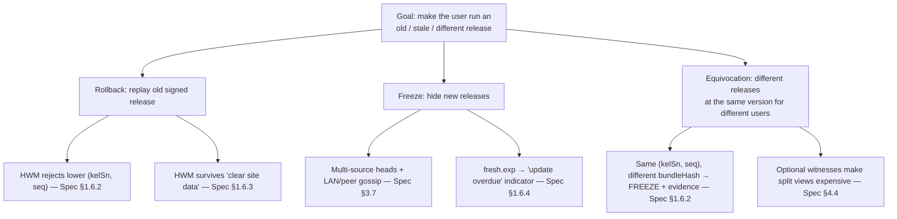
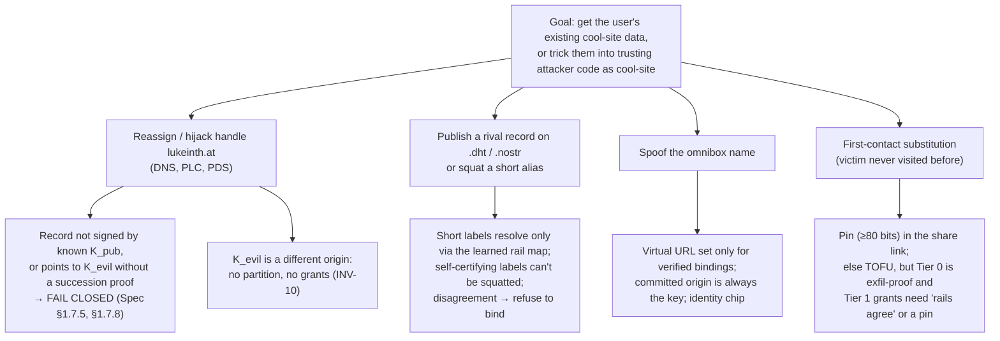

<!-- SPDX-License-Identifier: BSD-3-Clause -->
<!-- Copyright (c) 2026 The Key-Origin Web Authors. See LICENSE in this directory. -->

# Key-Origin Web: Threat Model

| | |
|---|---|
| **Status** | Draft, v0.2 (November 2026). v0.2 adds T12 (name-rail attacks) and INV-10…12. |
| **Covers** | [ARCHITECTURE-SPEC.md](ARCHITECTURE-SPEC.md) (normative behaviour) and both implementation layers in [CHROMIUM-160-BLUEPRINT.md](CHROMIUM-160-BLUEPRINT.md) |
| **Method** | Assets → adversaries → attack trees per threat class → mitigations → residual risk → testable invariants |

---

## 1. Scope and assumptions

### 1.1 Assets

| ID | Asset | Why it matters |
|---|---|---|
| A1 | **User data entered into or stored by an app** (notes, credentials typed into fake forms, files opened) | Primary target of exfiltration |
| A2 | **App integrity**: the code that actually runs under `key-web://<id>.key` | Malicious code, rollback, or targeted code |
| A3 | **Identity continuity**: the binding of an ID to its legitimate key holders | Key theft, rotation hijack, orphaning |
| A4 | **Availability**: the ability to obtain and run an app | Kill switches, freezes, eclipse |
| A5 | **The user's device resources**: disk, CPU, battery | Storage exhaustion, abuse |
| A6 | **User privacy**: which apps a user runs, and their fingerprint | Resolution metadata, tracking |
| A7 | **Capability grants** | Abuse, laundering, confused deputies |
| A8 | **Name bindings**: which K_app a human name such as `cool-site · lukeinth.at` leads to, and the display that tells the user so | Hijacked handles, rail compromise, display spoofing |

### 1.2 Adversaries

| ID | Adversary | Capabilities |
|---|---|---|
| ADV-1 | **Malicious app author** | Publishes arbitrary signed bundles under keys they control. Can make users click links. |
| ADV-2 | **Network attacker** | Observes and modifies traffic on any transport. |
| ADV-3 | **Malicious mirror or peer** | Serves arbitrary bytes, withholds data, lies about heads. |
| ADV-4 | **Phisher** | Creates look-alike apps, names, and IDs, and grinds vanity keys. |
| ADV-5 | **Key thief** | Holds a stolen current signing key, or more rarely next keys or a guardian subset. |
| ADV-6 | **Colluding co-resident party** | Another tab, app, or process on the same device that *does* have network access. |
| ADV-7 | **Malicious capability target** | Operator of a relay the user approved. |
| ADV-8 | **Powerful central party** | Registrar, CA, hosting provider, or UA vendor under coercion. |
| ADV-9 | **Rail attacker** | Controls or compromises one naming rail: an ATProto handle's DNS, the PLC directory, or a PDS; a set of Nostr relays; DHT nodes or PKARR relays; the user's LAN. Can serve, withhold, or replay rail records. |

### 1.3 Trusted computing base

- The UA binary, its sandbox, and site isolation.
- Cryptographic primitives (Ed25519, ECDSA P-256, SHA-256, SHA-512).
- In Layer A, also the **SuperFrame IWA**.
- The OS keystore holding the UA's grant-signing key.

**Out of scope:**

- Memory-safety exploits of the UA. The existing sandbox handles them; key-web adds no new privileged surface beyond the parsers, which are Rust (Blueprint KW2).
- Malicious browser extensions the user installed.
- Physical side channels (C24).

---

## 2. Threat summary

| ID | Threat class | Primary adversaries | Pre-mitigation severity | Residual |
|---|---|---|---|---|
| T1 | Drive-by attacks via click-to-open | ADV-1 | High | **Low** |
| T2 | Bundle rollback, freeze, and equivocation | ADV-2/3/5 | High | **Low** |
| T3 | Phishing and petname confusion | ADV-4 | High | **Medium** |
| T4 | Key theft and rotation hijacking | ADV-5 | Critical | **Low** (K-SAID) / **High** (K-ED) |
| T5 | Storage and resource exhaustion | ADV-1 | Medium | **Low** |
| T6 | Covert exfiltration channels | ADV-1, ADV-6 | Critical | **Low** (network) / **Medium** (local collusion) |
| T7 | Capability abuse and laundering | ADV-1, ADV-7 | High | **Medium** |
| T8 | Resolver and transport attacks | ADV-2/3 | Medium | **Low** |
| T9 | Layer A–specific weaknesses | ADV-1, ADV-6 | Medium | **Low–Medium** |
| T10 | Cross-tier confusion (key-web ↔ IWA) | ADV-1 | Medium | **Low** |
| T11 | Browser-level and vendor kill switches | ADV-8 | Medium | **Medium** (accepted) |
| T12 | Name-rail hijack, rail disagreement, and name-display spoofing | ADV-4, ADV-8, ADV-9 | Critical (on today's web, a name hijack = origin + data takeover) | **Low** for known bindings / **Medium** for unpinned first contact |

---

## 3. Threats in detail

### T1. Drive-by attacks

**Scenario.** The user clicks an attacker's `key-web://` link, or a `web+kw://` link in Layer A. No prompt appears, by design.

| Attack | Mitigation | Residual |
|---|---|---|
| T1.1 Exfiltrate anything typed or computed | Tier 0 sandbox (Spec §2.2–2.10): CSP + Connection-Allowlist + Navigation Gate + header sanitizer | See T6 |
| T1.2 Credential phishing form | No egress; `form-action 'none'`; the identity chip shows "unverified" and the ID fingerprint (T3) | Users may *re-type* the credential elsewhere after being told to. This is social engineering, not technical exfiltration. |
| T1.3 Exploit a renderer bug | Same renderer sandbox as `https://`; per-key process lock; parsers in memory-safe Rust | Same as the web today |
| T1.4 Use privileged APIs | `IsIsolatedContext() == false`; Tier 2 APIs denied (INV-1) | None |
| T1.5 Fingerprint the device | It can compute a fingerprint but can't transmit it | Becomes relevant only if the user later grants egress (T7) |
| T1.6 Cryptomining, CPU burn | No way to deliver results (no egress); normal background-tab throttling | Battery and CPU while the tab is open |
| T1.7 Popup or notification spam | Popups need activation and go through the Navigation Gate; notifications denied | None |
| T1.8 Clickjacking via framing | `frame-ancestors 'self'` | None |
| T1.9 Open-redirect laundering (an `https://` page bounces the user to a malicious key-web app that pretends to be a trusted brand) | Identity chip is mandatory; petnames; "first seen" date | See T3 |

### T2. Rollback, freeze, and equivocation



| Attack | Mitigation | Residual |
|---|---|---|
| T2.1 Replay of a vulnerable older release | Monotonic `(kelSn, seq)` HWM | A *first-contact* user can be served an old release, since there is no prior HWM. Mitigations: `minSeq` in locators, and freshness. |
| T2.2 Reset the HWM via "clear site data" | HWM is kept in a separate trust store | Clearing *all* history resets it (privacy trade-off, documented) |
| T2.3 Freeze, by withholding updates from one user | Many independent sources; gossip; `fresh.exp` indicator | A full eclipse (every source attacker-controlled) can freeze until `exp`. The app keeps running and the user is warned. |
| T2.4 Targeted equivocation, a special build for one victim | Needs the signing key (T4). Detected when two releases meet at one UA or peer. Witnesses (if declared) receipt only one per `sn`. | Undetected if the victim never meets the other branch and no witnesses are declared |
| T2.5 Seq exhaustion (`seq = 2⁶⁴−1`) by a thief | `kelSn` dominates `seq`; rotation resets the space | K-ED identities can't recover (T4) |
| T2.6 Downgrade via user-initiated rollback UI | Explicit warning; HWM is never lowered | User choice |

### T3. Phishing and petname confusion

Zooko's triangle means the real name (the key) isn't memorable. Attackers exploit the gap.

| Attack | Mitigation | Residual |
|---|---|---|
| T3.1 **Vanity-key prefix or suffix grinding** to match `mix2p32o…aaic` | UI shows an identicon of the **full** ID plus first-8/last-4. Matching 8 base32 characters costs about 2⁴⁰ Ed25519 keygens, which is feasible for a determined attacker. Matching first-8 **and** last-4 **and** the identicon is far harder. | Users who only glance at a prefix. **Petnames are the real defence.** |
| T3.2 **Self-claimed name spoofing** ("PayPal Notes") | Self-claimed names are always labelled *unverified* and never shown alone without the fingerprint | Inattentive users (as on today's web) |
| T3.3 **Petname collision or confusable** ("My Bank" vs "My Bаnk" with a Cyrillic а) | UTS #39 skeleton comparison; warning on collision; petnames are user-local and can't be set by apps | Low |
| T3.4 **DNS-hint hijack**: the attacker obtains a lapsed domain | Hints need a **bidirectional** claim. The attacker can only make *their own* app show "claimed by example.org". They can't capture the legitimate app's origin, data, or grants (unlike DNS today). | The attacker's app gains a borrowed reputation, the same as domain hijacking today |
| T3.5 **ENS-hint hijack** | As for T3.4 | As for T3.4 |
| T3.5b **Rail-name look-alikes** (`cool-site.lukeinth.at` vs `cool-site.luke1nth.at`) | Rail-name display includes the rail badge and verification state. Bindings and petnames are compared under UTS #39 skeletons. See **T12** for the full rail-name analysis. | Medium for first contact without a pin |
| T3.6 **Edge-name poisoning**: a compromised contact suggests a bad petname | Suggestions are attributed ("Bob calls this …"), never auto-applied | Trust in the contact |
| T3.7 **Grant-prompt phishing**: "Allow sync to `relay.example-notes.org`" from a fake app | Prompt shows the destination host, the app's identicon and petname, and the `why` text marked self-claimed | Users approving prompts without reading |
| T3.8 Link-interstitial fatigue (NG4) | Static links need no prompt; the interstitial shows the full URL with the query highlighted | Habituation |

### T4. Key theft and rotation hijacking

| Attack | K-ED / K-P256 (simple) | K-SAID (`keys-first`) | K-SAID (`guardians-final`) |
|---|---|---|---|
| T4.1 Thief has the **current** signing key | ❌ Thief can publish updates and tombstone indefinitely | ✅ Thief signs until the owner rotates with the cold next keys; thief releases then lose on `kelSn` | ✅ Same |
| T4.2 Thief has the **next** keys | n/a | ❌ Thief can rotate and capture the identity | ✅ Guardians **veto** within `rotDelay` → contested → guardian recovery |
| T4.3 Owner **loses all keys** | ❌ Identity orphaned; data stays local, migration is manual | ✅ Guardian `rec` after `delay` | ✅ Same |
| T4.4 **Malicious guardian threshold** | n/a | ✅ Owner cancels `rec` by rotating within `delay` | ❌ Guardians are final by design (choose them carefully) |
| T4.5 Thief tombstones to kill the app | ❌ Possible (self-signed tomb) | ✅ Tomb needs next keys or guardians | ✅ Same |
| T4.6 Thief shows a forked KEL to some users (split view) | n/a | ⚠️ Detected at merge (duplicity → freeze). Witnesses prevent it if declared. | ⚠️ Same |

**Recommendations.**

- K-SAID with `keys-first` for solo developers: next keys in offline storage, 3-of-5 guardians, `g.delay` ≥ 7 days.
- `guardians-final` with `rotDelay` ≥ 48 h for organisations.
- Declare witnesses for widely used apps.

### T5. Storage and resource exhaustion

| Attack | Mitigation | Residual |
|---|---|---|
| T5.1 One drive-by app fills the disk | 64 MiB best-effort cap per origin in Tier 0 (Spec §2.9) | None |
| T5.2 Many drive-by apps (link spam with many keys) each take their cap | Global key-web pool cap (`min(2 GiB, 5% free)`); LRU eviction of apps that aren't kept | Eviction of the user's own unkept apps under attack. Mitigated by **Keep** and an eviction notice. |
| T5.3 Giant bundles exhaust download or cache | `size` ≤ 512 MiB; the UA never downloads more than the head's `size`; bundle cache LRU; dedup by `bundleHash` | Bandwidth on metered links: the UA asks before fetching more than a threshold on metered networks |
| T5.4 KEL bloat | Integrity block ≤ 1 MiB (`kMaxIntegrityBlockSize`) | None |
| T5.5 Parser DoS (deep CBOR, huge maps) | Rust parsers with depth and size limits; fuzzers (Blueprint KW2) | None known |
| T5.6 Trust-store growth (one HWM per ID ever seen) | HWM records are tiny; auto-prune entries for evicted, never-kept apps after 1 year (they become first-contact again, see T2.1) | Low |

### T6. Covert exfiltration channels

The full channel table is Spec §2.10 (C1–C26). This section groups the channels by residual risk and records **why** each one is closed.

**Closed at the network service (the strongest guarantee).**

- Host resolution, socket preconnect, prefetch, and WebTransport are all checked against the document's network-restrictions ID, which is derived from the injected `Connection-Allowlist`. Blueprint §1.4 cites the four check sites in `network_context.cc`.
- WebRTC P2P and mDNS binders are refused.

This layer is **independent of the renderer**: even a compromised renderer that ignores CSP is still subject to it. That property matters for C5 and C6, because **CSP does not cover preconnect and Blink does not apply DNS-prefetch control to preconnect** (Blueprint §0).

**Closed in the renderer, backed by the network service.** C1–C4, C10, and C12: CSP plus Connection-Allowlist.

**Closed in the browser.** C8, C11, C15, and C16 (Navigation Gate). C14 (header sanitizer). C13, C17, and C18 (permissions).

**Residual: user-mediated.**

| Channel | Residual |
|---|---|
| C8/C16 dynamic links | The user sees the full URL before anything is sent. Long base64 blobs in a query are visible. The UA **SHOULD** flag high-entropy queries with a "this link contains encoded data" hint. |
| C9 static-link choice | ≤ log₂64 = 6 bits per deliberate click. Not practical for bulk data. |
| C26 copy, paste, download, print | User action |

**Residual: local collusion (ADV-6).**

| Channel | Bandwidth | Notes |
|---|---|---|
| C22 CPU, memory, cache contention | Bits to hundreds of bits per second under lab conditions | Needs a co-resident **receiver that has egress**. Process isolation per key limits shared-memory gadgets. `crossOriginIsolated` in Tier 0 gives high-resolution timers to the *sender*. That is a conscious trade-off for WASM threads (Spec §2.8). A UA **MAY** offer a "hardened timers" mode that drops COEP for Tier 0. |
| C23 storage-pressure signalling | Very low | Per-origin cap; pool accounting is coarse |
| C24 physical (audio, screen, LEDs) | Varies | Out of scope; needs a nearby receiver |

**The honest claim.** In Tier 0, a key-web app **cannot by itself cause a network transmission** to a destination or with content it chooses. The remaining channels need a user action the user can see, or a separate colluding party on the same device that already has network access. In that second case the colluder is the real exfiltration vector.

### T7. Capability abuse

| Attack | Mitigation | Residual |
|---|---|---|
| T7.1 App with a relay grant sends *everything* to the relay | Inherent in granting egress. Grants are **destination-scoped**; the prompt states the destination; the egress ledger and budget meter are visible; revocation is instant. | **Medium.** Users must trust the destination. End-to-end encrypted relays reduce harm only if the relay is honest about its role. |
| T7.2 App requests capabilities it never declared | Rejected (Spec §2.11.1, INV-7) | None |
| T7.3 Update silently widens targets | Updates never auto-grant; changed targets suspend the grant (Spec §2.11.2) | None |
| T7.4 Token theft or replay by the app | Token never enters the renderer; opaque handle; bound to `sub` | None |
| T7.5 **Laundering**: app A passes data to app B, which holds a grant | No implicit inter-origin channel in Tier 0 (COOP, frame-ancestors, origin-scoped storage and BroadcastChannel). Tier 1d channels name both ends, and the prompt shows B's grants. Dynamic links from A to B go through NG4. | Low: a user can approve a channel without understanding B's grants |
| T7.6 Confused deputy: the relay (ADV-7) sends commands back | Ingress is the app's concern; it can't escalate privileges (still Tier 1, same grants) | App-level |
| T7.7 Attenuated delegation widens the grant | Subset check on `targets`, `exp`, and budget (Spec §2.12) | None |

### T8. Resolver and transport attacks

| Attack | Mitigation | Residual |
|---|---|---|
| T8.1 Tampered bytes | Full Integrity Block v2 verification (Spec §1.5) | None |
| T8.2 Poisoned chunks waste bandwidth | Per-chunk Merkle verification against the signed head; 3-strike ban (Spec §3.6) | Bounded waste |
| T8.3 Fake heads | Heads are signed by current keys and checked against the KEL | None |
| T8.4 Eclipse (every source is the attacker) | Multiple transport types; LAN and peer gossip; freshness indicator | See T2.3 |
| T8.5 Metadata surveillance ("who fetches ID X") | Batching, jitter, relays or anonymity networks as a setting; no resolution triggered by Tier 0 apps (Spec §3.9) | **Medium** on public P2P networks (DHT and swarm visibility) |
| T8.6 Malicious locator in a QR code | A locator is only a hint; the origin comes from the ID; the bundle is verified | The locator chooses *which* ID you open, which is T3 |

### T9. Layer A–specific

| Attack | Mitigation | Residual |
|---|---|---|
| T9.1 **Port-blind admission**: the guest reaches other loopback services at `<id>.localhost:<other-port>` (Blueprint LA-2) | Connection-Allowlist is port-exact; CSP `'self'` includes the port; the interceptor checks the port | None, if Connection-Allowlist is enforced on the target build (test it) |
| T9.2 Preconnect and DNS prefetch bypass webRequest (LA-3) | Connection-Allowlist | Depends on the target build. **Test this before relying on Layer A.** |
| T9.3 Network admission unavailable (flag missing) | CSP, Connection-Allowlist, interceptor, and link gate still apply | WebRTC lockdown rests on `webrtc=block` alone |
| T9.4 Local processes or web pages read bundles from the loopback server | Public signed content only; `Host` and `Sec-Fetch-Site` checks; no user data on the server | Installed-app enumeration by local malware (which already has more power) |
| T9.5 SuperFrame compromise | It is the Tier 2 TCB: keep it minimal and audited, with grants and trust store in its own partition | Single point of failure for all hosted apps. Layer B removes it. |
| T9.6 Port change orphans data (LA-1) | Persisted port; fail rather than re-port | Availability (not confidentiality) |

### T10. Cross-tier confusion

| Attack | Mitigation | Residual |
|---|---|---|
| T10.1 An IWA bundle (expects Tier 2) is opened as key-web | `keyWeb` attribute required (author intent, Spec §1.5). Even if present, Tier 0 policy applies. | None (fails closed) |
| T10.2 A key-web K-ED bundle is installed as an IWA by social engineering | Different origin (`isolated-app://`); full IWA install ceremony; no data shared | Same risk as any IWA install |
| T10.3 K-SAID ID used as `isolated-app://` | `IwaOrigin::Create` rejects it (Blueprint KW1) | None |
| T10.4 Data bridge between the key-web and IWA origins of the same key | Only through a UA-mediated, user-confirmed export and import | None |

### T11. Browser-level and vendor kill switches

The UA remains a chokepoint, and an honest design says so.

| Vector | Position |
|---|---|
| Safe-Browsing-style malware blocklists by key | Allowed for genuine malware. A block **MUST** be shown with its reason and **MUST** be overridable by the user. Data is **never** deleted. The blocklist **SHOULD** be published as a transparency log. |
| Vendor disabling the `key-web` feature | Layer A shows that the model works on stock primitives. Exported `.swbn` files keep working in any conforming UA. |
| Coerced revocation of a *key* | There is no central revocation authority: rotation and tombstoning are self-certifying (Spec §4). A vendor blocklist is the only lever, and it is visible. |

### T12. Name-rail hijack, rail disagreement, and name-display spoofing

Human names (Spec §1.7) bring back the rails the design otherwise avoids: DNS, the PLC directory, PDS hosts, relays, DHTs, and LANs. **The security argument rests on one invariant: a name is a lookup, never an identity.** Origin, storage, CSP, and grants are derived from K_app alone (INV-10). The worst a rail can do is therefore *fail to answer* or *answer with a different key*, and a different key gets a different, empty origin.



| Attack | Mitigation | Residual |
|---|---|---|
| T12.1 **Handle reassignment or DNS hijack** of `lukeinth.at`, now pointing to a DID controlled by K_evil | App and publisher records must verify under the **known** K_pub KEL. A new K_pub without a KEL proof, or a new K_app without a `tomb.successor` proof, **fails closed**: a mismatch interstitial, defaulting to the known app. K_evil can never inherit K_app's partition or grants, because they would be a different origin. | Availability of the `at` rail for this publisher. Other rails keep working. |
| T12.2 **PLC directory or PDS compromise** (rewritten DID document or records) | Same as T12.1. ATProto signatures are only a transport check; authenticity comes from the K_pub signature. | Same as T12.1 |
| T12.3 **Compromised K_pub** (the publisher key is stolen) | The thief can sign App Records pointing `cool-site` to K_evil. Known bindings still **fail closed** (no `tomb.successor` from K_app). New users can be misdirected, so publishers should use K-SAID with pre-rotation (§4) and rotate quickly. | **Medium** for first-contact users without pins |
| T12.4 **Rival records on other rails** (K_evil claims `cool-site` on `.nostr` while `.at` says K_app) | Rails are tied together by the K_pub-signed rail map. An npub or PKARR key that isn't in the verified map is ignored. With no map yet, disagreement means **refuse to bind** and show both answers. | Low |
| T12.5 **Short-alias squatting** (`lukeinth.dht` or `lukeinth.nostr` with no prior state) | Short labels are only resolved through the user's publisher book. Otherwise the user needs a self-certifying label (`<pkarr-key>.dht`, `npub1….nostr`) or a pin. First-come namespaces are never consulted. | First-time users can't use short `.dht` or `.nostr` aliases (a usability cost, by design) |
| T12.6 **Pin grinding** (the attacker searches for a key whose pin prefix matches) | Minimum 16 base32 characters (80 bits); share sheets emit 20 (100 bits). 2⁸⁰ is infeasible. | None at ≥ 80 bits |
| T12.7 **Pin stripping** (a chat app or gateway drops the fragment) | The link degrades to TOFU, visibly: no **pinned** badge. Tier 1 grant prompts warn on unpinned single-rail bindings. | Medium (UX) |
| T12.8 **Omnibox name spoofing via virtual URL** | `SetVirtualURL` is called only by the key-web tab helper, and only for a verified binding to the *committed* K_app. The page can't influence display. The badge popover always shows the key. | Low |
| T12.9 **Homographs** in slug or handle (`c00l-site`, `xn--…`) | ASCII-only slugs; punycode shown raw; UTS #39 skeleton check against the user's existing bindings and petnames (warn on near-collisions) | Medium. Visually similar ASCII (`rn` vs `m`) remains possible. Petnames and pins are the defence. |
| T12.10 **Sybil attestations** ("5,000 people vouch") | Only vouches from keys in the user's own trust graph are counted or shown | Low |
| T12.11 **`.local` link confusion** (`cool-site.mom.local` means different people on different devices) | `.local` links are never offered for sharing; the share action converts them to a portable or pinned form. A received `.local` link resolves only against the *recipient's* book, and the badge says **Local (your contacts)**. | Low |
| T12.12 **Malicious share-card gateway** (it rewrites the link or shows a misleading preview) | The UA re-resolves and re-verifies, and the pin is in the fragment (never sent to the server). The preview card is labelled *unverified*. The gateway can't change which key opens without failing the pin. | Previews can lie, like any web preview today |
| T12.13 **Resolution surveillance** (rail operators learn who resolves what) | Binding cache, jitter, the publisher book, optional relay or anonymity routing (Spec §3.9). Tier 0 documents can't trigger lookups (NG10). | Medium on public rails |
| T12.14 **Rail-driven denial of service** (withholding records) | The publisher book and the `.key` fallback mean known apps open with **zero** rail access. Cross-rail failover. | First-time resolution only |
| T12.15 **Rollback of name records** (replaying an old App Record) | `seq` is monotonic per `(K_pub, slug)` and per publisher document, and stored with the binding | Low |

**Comparison with today's web.** If someone hijacks `notes.example.com` today, they own the origin, so they *also* get every user's cookies, local data, and permissions on their next visit. In the key-origin design, the same hijack yields an **unresolvable name** for known users, and at worst a **different, empty origin** for brand-new, unpinned users.

---

## 4. Attack tree: "exfiltrate the user's notes from a Tier 0 app"

```
Exfiltrate notes (Tier 0)
├── Network request from the document ......................... BLOCKED (CSP L1 + C-A L2)
├── Network request from a worker / SW ......................... BLOCKED (inherited C-A, Spec §2.4)
├── DNS / preconnect side-effect ............................... BLOCKED (C-A in network service)
├── WebRTC ICE ................................................. BLOCKED (C-A webrtc=block)
├── Navigate top-level to attacker URL with data
│   ├── without user gesture ................................... BLOCKED (NG4)
│   ├── static link (signed, constant URL) ..................... allowed, carries ≤ 6 bits/click (C9)
│   └── dynamic link ........................................... USER SEES FULL URL (NG4)
├── Reporting / NEL / CSP report ............................... BLOCKED (L5 sanitizer)
├── Talk to an opener / embedder with network .................. BLOCKED (COOP, frame-ancestors)
├── Hand data to another key-web app with a grant .............. needs explicit Tier 1d channel (T7.5)
├── Persuade user to grant relay "for sync" .................... possible → T7.1 (visible, scoped, revocable)
├── Signal a co-resident colluder (CPU / storage) .............. residual, local only (C22/C23)
└── Exploit the browser ........................................ out of scope (same as https://)
```

### 4.1 Attack tree: "take over cool-site.lukeinth.at users' data by hijacking the name"

```
Steal existing users' cool-site data via the name
├── Hijack handle lukeinth.at (DNS / PLC / PDS) → point to K_evil
│   ├── known user, no succession proof ........................ FAIL CLOSED (Spec §1.7.8)
│   └── K_evil opened anyway as "new, unrelated app" ........... EMPTY partition, no grants (INV-10)
├── Publish rival record on .dht / .nostr ...................... IGNORED unless in K_pub's rail map
├── Steal K_pub, sign cool-site → K_evil
│   ├── known user ............................................. FAIL CLOSED (no tomb.successor from K_app)
│   └── new user, no pin ....................................... gets K_evil in Tier 0: no egress, no
│                                                                 access to anyone else's data (T12.3)
├── Steal K_app's NEXT keys / guardians → tomb.successor = K_evil  see T4 (pre-rotation, guardians)
└── Spoof the omnibox to show "cool-site · lukeinth.at" ........ BLOCKED (verified-binding-only display)
```

---

## 5. Security invariants (must be enforced by tests)

| ID | Invariant | Spec | Tests (Blueprint §5) |
|---|---|---|---|
| **INV-1** | A `key-web` document or worker is never an isolated context. `HasIsolatedContextCapability == false`, `IsIsolatedContext == false`. | §1.1 | `NotIsolatedContext` |
| **INV-2** | A Tier 0 context produces **zero** network transmissions across channels C1–C20, as measured by a counting HTTP/DNS/STUN sink. | §2.2–2.10 | KW3 egress suite; Layer A egress harness |
| **INV-3** | No app-supplied header or meta tag can loosen CSP, Connection-Allowlist, Permissions Policy, COOP, or COEP, or add a reporting endpoint. | §2.6 | `AppHeadersCannotLoosen`, `CspReportUriStripped` |
| **INV-4** | Every cross-origin navigation initiated by a key-web context is either a static link with activation, or shows the full URL and requires activation. | §2.5 | KW4 navigation suite |
| **INV-5** | The accepted head's `(kelSn, seq)` never decreases without explicit user action. Equivocation freezes updates. | §1.6 | `ReleaseStoreTest` |
| **INV-6** | For K-SAID, rotation and recovery preserve the origin, the partition, and the grants. Only the authorities in §4.3 can advance the KEL. | §4 | KEL vectors; `SurvivesKSaidRotation` |
| **INV-7** | Effective grants ⊆ signed declarations. Tokens never enter a renderer. | §2.11–2.12 | KW5 capability suite |
| **INV-8** | No update, tombstone, block, or eviction of a **kept** app deletes user data without explicit user action. | §2.9, §4.7 | Storage and tombstone tests |
| **INV-9** | A `key-web` bundle is accepted only with a valid `keyWeb` attribute and same-origin entries. | §1.5 | `RejectsBundleWithoutKeyWebAttr`, `RejectsCrossOriginEntries` |
| **INV-10** | The origin, `StoragePartition`, CSP `'self'`, Connection-Allowlist `response-origin`, and every grant are derived from K_app (`<kw-id>.key`) and **never** from a name host. A name URL never commits and is never a request initiator. | §1.3, §1.7.4 | `LocationOriginIsKeyNeverName`, `RejectsNameHost`, `NameHostRejectedForSubresources` |
| **INV-11** | If a name resolves to a key other than its stored binding (or its pin), and there is no `tomb.successor` proof (and no K_pub KEL proof for publisher changes), the UA fails closed. It never switches silently and never grants the offered key the known key's data. | §1.7.5, §1.7.8 | `HandleReassignedToEvilKeyFailsClosed`, `EvilKeyNeverGetsKnownPartition`, `PinMismatchFailsClosed` |
| **INV-12** | Every rail name that resolves to the same K_app opens the same origin and data. A known app opens with zero rail availability. | §1.7.7 | `CrossRailSameOriginSameStorage`, `AtRailDownDhtStillOpens` |

---

## 6. Residual risk register

| Residual | Rating | Owner | Next step |
|---|---|---|---|
| Local collusion side channels (C22) | Medium | UA | Evaluate a "hardened timers" Tier 0 mode (no COEP); measure bandwidth |
| Grant-based exfiltration to an approved but malicious relay (T7.1) | Medium | User + UX | Egress meter, periodic grant review, E2EE guidance for developers |
| Vanity-prefix phishing for users without petnames (T3.1) | Medium | UX | Prompt to set a petname on second visit; full-ID identicon everywhere |
| First-contact rollback (T2.1) | Low–Medium | Spec | Encourage `minSeq` in shared locators; witness-backed heads |
| Resolution metadata on public P2P networks (T8.5) | Medium | UA | Default to mirrors plus LAN; P2P opt-in per network |
| K-ED key theft (T4) | High for K-ED | Developers | Default tooling to K-SAID; label K-ED as "simple, non-recoverable" in the UI |
| Connection-Allowlist is a prototype (Blueprint §6) | Medium | Engineering | Pin with conformance tests; keep CSP as an independent wall |
| Vendor blocklist as a kill switch (T11) | Medium (accepted) | Ecosystem | Transparency log and user override |
| Unpinned first contact through a compromised rail or K_pub (T12.3, T12.7) | Medium | UX + Spec | Pins by default in every share sheet; require "rails agree" or a pin before any Tier 1 grant |
| ASCII look-alike names (T12.9) | Medium | UX | Skeleton checks against existing bindings; nudge to set petnames |
| Rail operators observing resolutions (T12.13) | Medium | UA | Binding cache first; batched cross-checks; optional private routing |
